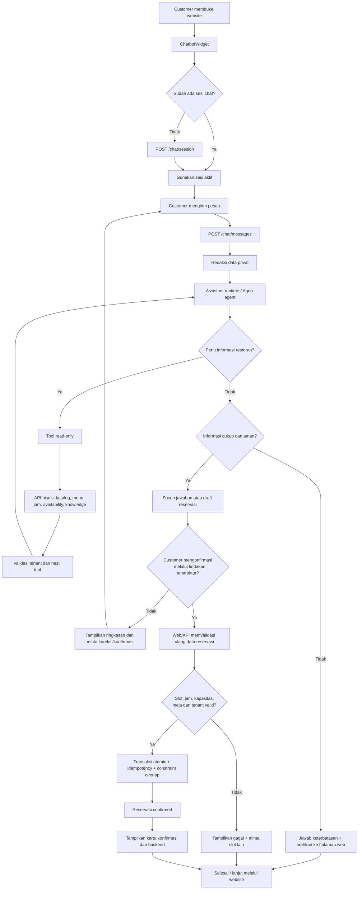
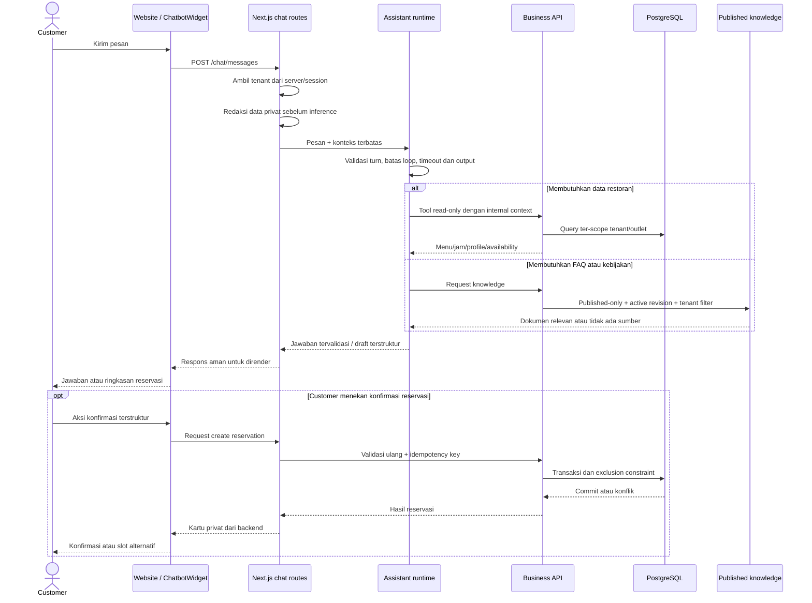

# Flow Chatbot Restaurant Assistant

Diagram ini menggambarkan alur MVP chatbot: chatbot membantu customer menemukan informasi restoran dan menyiapkan alur reservasi, sedangkan validasi bisnis dan transaksi tetap dilakukan oleh API bisnis.

## 1. Flow utama customer

## 2. Diagram cara kerja sistem

## 3. Batas tanggung jawab

| Komponen | Tanggung jawab |
| --- | --- |
| Website / `ChatbotWidget` | Input customer, render output aman, konfirmasi melalui aksi UI |
| Next.js chat routes | Session, tenant context, masking, response ke browser |
| Assistant runtime | Memahami pesan, memilih tool yang diizinkan, menyusun jawaban/draft |
| Business API | Sumber fakta, aturan reservasi, auth, tenant isolation dan validasi akhir |
| PostgreSQL | Konsistensi transaksi, relasi tenant/outlet dan pencegahan overlap |
| Knowledge retrieval | FAQ/kebijakan yang published dan revision aktif; bukan sumber harga/availability |

Catatan: slot yang terlihat tersedia belum berarti ditahan. Reservasi hanya sah setelah validasi ulang dan transaksi berhasil di API bisnis.
