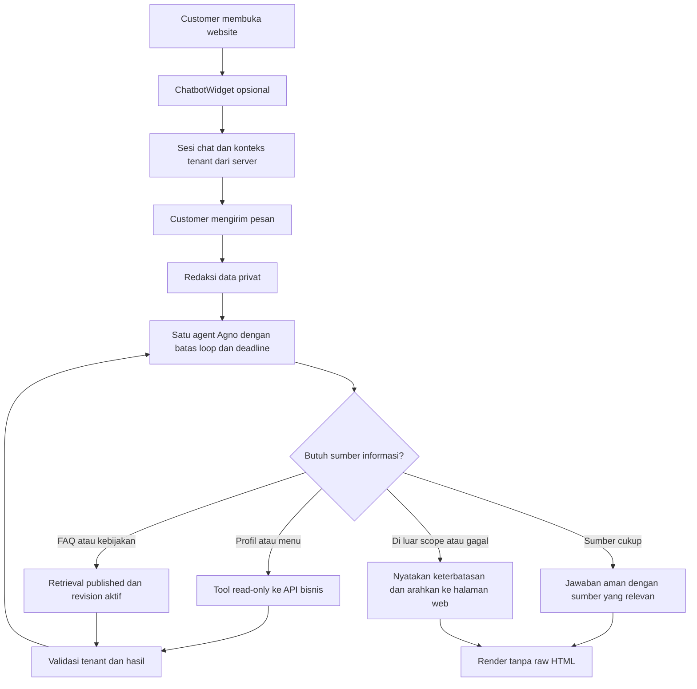
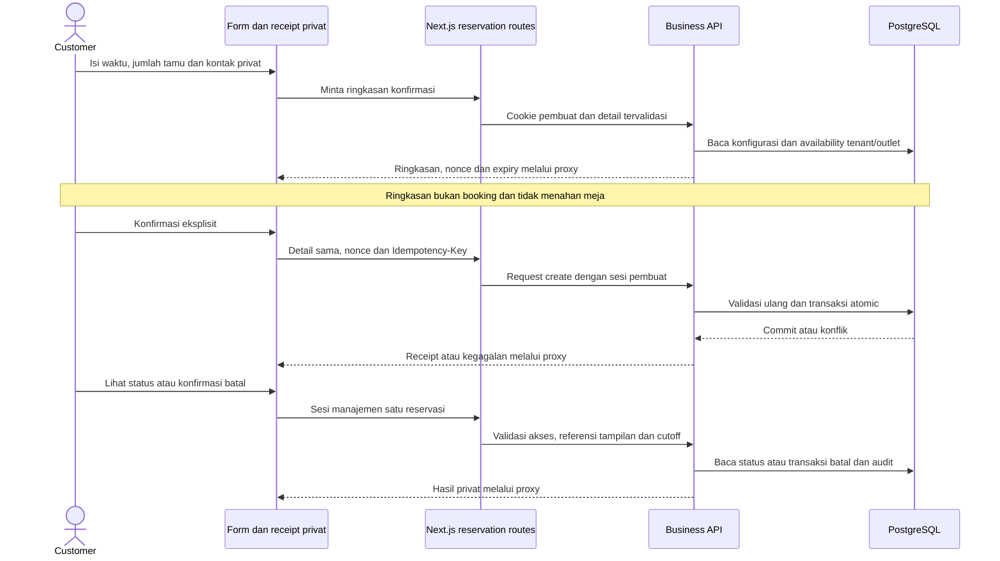

# Flow Chatbot Restaurant Assistant

Alur berikut memisahkan chatbot informasi dari reservasi web. Diagram menjelaskan batas integrasi yang dituju, bukan bukti seluruh komponen retrieval atau evaluasi sudah selesai diimplementasikan.

## Chatbot website

Chatbot membantu informasi restoran, pencarian menu, serta FAQ/kebijakan bersumber. Tidak mengecek meja, menyusun proposal booking, atau menjalankan transaksi reservasi dalam cakupan website ini.



Fakta operasional berasal dari API. FAQ hanya menggunakan dokumen yang boleh dipublikasikan untuk tenant tersebut; kontak customer dan data booking bukan corpus knowledge. Dokumen dan hasil tool diperlakukan sebagai data, bukan instruksi system.

## Reservasi web terpisah

Customer dapat memakai form tanpa membuka chat. Runtime AI tidak terlibat dalam penyimpanan, konfirmasi, akses privat, atau pembatalan.



Retry dengan key dan payload sama hanya memulihkan hasil untuk pihak berhak. Kode referensi saja tidak memberi akses. Token tidak dikirim ke URL, prompt, atau transcript chat.

## Eksperimen CLI

`TestChatbot/chat.py` adalah simulator terpisah untuk eksperimen percakapan. Panggilan model dapat live, tetapi adapter tools membaca fixture lokal, bukan database bisnis.

```text
Terminal → validasi scope dan masking → model
                                      ↕
                              validator tool → fixture sintetis
```

Tools eksperimen meliputi `get_restaurant_info`, `search_menu`, `check_availability`, dan `prepare_reservation`. Availability dan proposal di sini hanya simulasi; tidak terhubung ke ringkasan konfirmasi backend dan tidak membuat booking. Keberadaan tools eksperimen tidak memperluas scope chatbot website atau menambahkan runtime kedua ke aplikasi.

## Batas tanggung jawab

| Komponen | Tanggung jawab |
| --- | --- |
| ChatbotWidget dan chat routes | Sesi chat, konteks tenant, masking dan render jawaban informasi |
| Agent Agno | Memilih tool read-only yang diizinkan dan menyusun jawaban bersumber |
| Form reservasi dan reservation routes | Input privat, ringkasan, konfirmasi eksplisit dan receipt |
| Business API | Fakta operasional, aturan bisnis, auth, isolasi tenant/outlet, transaksi dan audit |
| PostgreSQL | Foreign key komposit, konsistensi dan pencegahan overlap |
| Knowledge retrieval | FAQ/kebijakan published dengan revision aktif dan tenant filter |
| Simulator CLI | Eksperimen fixture; bukan sumber fakta live atau jalur transaksi website |

Model internal tetap Tenant → Outlet. Istilah produk Restoran tidak menghapus isolasi tenant atau relasi lokasi yang sudah ada; migrasi model data memerlukan arahan terpisah.
