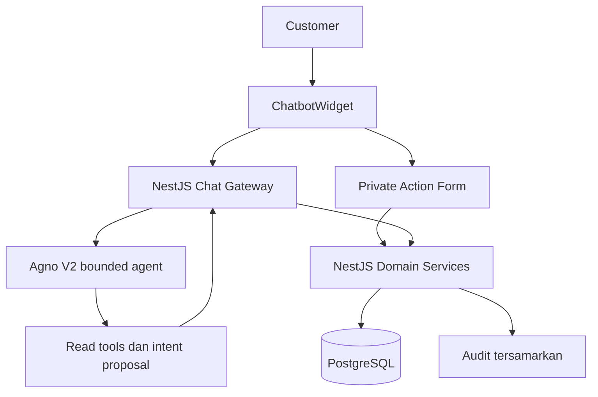
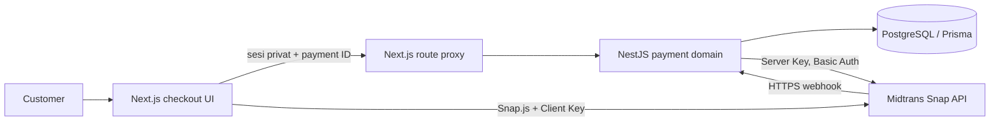

# PRD — Chatbot Take Action

> PRD baru berdasarkan kondisi repository setelah sinkronisasi `main` dan branch `phase2`. Dokumen ini mengubah scope chatbot dari read-only menjadi dapat membantu menyelesaikan action customer secara terbatas. `PRD — Restaurant Assistant MVP.md` tetap menjadi baseline untuk domain, tenant, keamanan, dan aturan reservasi; dokumen ini tidak mengubahnya secara diam-diam.

## 1. Baseline repository yang menjadi dasar

Perubahan dari `main` yang relevan terhadap PRD ini sudah menyediakan fondasi berikut:

- API bisnis tenant-scoped untuk profil, menu, jam, availability, reservasi, sesi privat, knowledge, dan audit.
- Alur reservasi web dengan confirmation nonce, request hash, idempotency key, transaksi atomic, management session, dan recovery ketika response commit tidak diketahui.
- Runtime Agno V2 yang bounded, internal tools, masking, fallback, dan action button UI yang saat ini hanya berupa navigasi atau prompt aman.
- Widget chat dan simulator `TestChatbot` dengan `check_availability` serta `prepare_reservation` sintetis; simulator tidak menulis database bisnis.
- PRD baseline dan alur chatbot saat ini masih menyatakan chatbot website tidak mengecek meja, membuat proposal, atau menjalankan transaksi.

Kesimpulan: action-taking belum dianggap implemented. PRD ini adalah keputusan scope baru yang perlu diimplementasikan dan diuji.

## 2. Tujuan

Customer dapat menyelesaikan reservasi dari percakapan tanpa kehilangan keamanan form web:

1. Customer menyampaikan kebutuhan reservasi melalui chat.
2. Chatbot mengumpulkan tanggal, waktu, dan jumlah tamu.
3. API memeriksa availability aktual tenant/outlet.
4. Customer mengisi nama dan nomor telepon pada form privat aplikasi.
5. API membuat proposal yang belum menahan meja.
6. Customer menekan tombol konfirmasi pada ringkasan terstruktur.
7. API memvalidasi ulang dan membuat tepat satu reservasi confirmed.
8. Chatbot/UI menampilkan hasil hanya setelah commit terkonfirmasi.

Chatbot boleh mengarahkan dan mengorkestrasi alur, tetapi model tidak pernah menjadi pihak yang memiliki izin transaksi.

## 3. Sasaran dan ukuran keberhasilan

- Minimal satu skenario reservasi normal dapat selesai dari chat sampai receipt.
- Availability yang ditampilkan selalu berasal dari API, bukan memori model, fixture, atau RAG.
- Tidak ada booking tanpa klik konfirmasi eksplisit pada kartu/form aplikasi.
- Retry dengan key dan payload sama menghasilkan receipt yang sama, bukan reservasi kedua.
- Pada concurrency test satu meja dan interval sama, tepat satu request berhasil.
- Unauthorized write, booking sukses tanpa commit, dan kebocoran lintas tenant: nol.
- Nama, nomor telepon, token akses, dan detail privat tidak masuk payload model, transcript model, atau log mentah.
- Saat model/provider/AI gateway gagal, form reservasi web tetap dapat digunakan.

Angka ini adalah target acceptance untuk implementasi baru, bukan bukti bahwa branch saat ini sudah memenuhinya.

## 4. Scope action V1

### 4.1 Action customer yang wajib

| Action | Perilaku | Write |
| --- | --- | --- |
| `start_reservation` | Membuka alur reservasi dan meminta field yang kurang | Tidak |
| `check_availability` | Mengambil slot/meja yang cocok dari API | Tidak |
| `create_reservation_proposal` | Membuat ringkasan sementara dengan expiry | Tidak |
| `confirm_reservation` | Membuat reservasi setelah klik konfirmasi terstruktur | Ya |
| `open_booking_management` | Membuka form privat untuk satu reservation | Tidak |
| `cancel_reservation` | Membatalkan booking setelah verifikasi dan konfirmasi | Ya |

### 4.2 Bentuk pengalaman

Action dapat dimulai dari pesan natural maupun tombol chat. Jika action memerlukan data privat, UI membuka form privat inline atau section reservasi yang sudah ada. Nilai privat dikirim langsung ke API, bukan melalui pesan chatbot.

Chatbot boleh menampilkan hasil availability dan ringkasan yang tidak mengandung credential. Receipt, management token, dan data kontak hanya dirender oleh aplikasi dari response backend.

## 5. Di luar scope

- Order makanan, pembayaran, deposit, voucher, loyalty, dan billing.
- Ubah jadwal, pindah meja, gabung meja, waitlist, dan permintaan yang memerlukan keputusan staff.
- Action staff/owner dari chatbot.
- WhatsApp, Telegram, email/SMS OTP, voice, dan notifikasi produksi.
- Autonomous booking, booking hanya karena pesan `ya`, atau approval dari model.
- Tool SQL, shell, arbitrary HTTP, browser bebas, admin, dan write tool generik.
- Mengubah simulator `TestChatbot` menjadi jalur transaksi production.
- Mengganti model data Tenant → Outlet atau membuka banyak outlet di UI.

Fitur yang tidak dibutuhkan untuk satu alur reservasi aman ditunda agar tidak menambah orchestrator, agent, atau service baru.

## 6. Perjalanan pengguna

### 6.1 Permintaan reservasi

Contoh:

> Saya mau reservasi empat orang besok jam 19.00.

Agent dapat mengekstrak intent, tanggal, waktu, dan jumlah tamu. Gateway menormalkan tanggal menjadi tanggal absolut WIB dan meminta klarifikasi jika nilai ambigu.

Model tidak boleh memilih tenant, outlet, role, atau policy. Semua itu berasal dari server-side session dan domain API.

### 6.2 Pemeriksaan availability

API memakai service availability yang sama dengan form web dan menerapkan policy aktif, jam khusus, kapasitas, durasi, serta reservasi confirmed.

UI wajib menjelaskan:

> Slot terlihat tersedia saat diperiksa, tetapi belum ditahan. Slot dapat berubah sebelum konfirmasi.

Jika tidak tersedia, aplikasi hanya menampilkan alternatif yang berasal dari API atau meminta waktu baru. Model tidak membuat alternatif sendiri.

### 6.3 Data privat

Nama dan nomor telepon dikumpulkan melalui form privat. Jika customer menulis PII di chat, gateway melakukan masking dan mengarahkan ke form. PII tidak boleh dipakai sebagai history inference.

Form privat tidak menggunakan model untuk validasi. Ia memakai schema dan endpoint API yang sama dengan reservasi web.

### 6.4 Proposal

Proposal menampilkan:

- nama restoran/outlet dan tenant yang sudah ditentukan server;
- tanggal absolut, waktu mulai, waktu selesai, dan `Asia/Jakarta`;
- jumlah tamu dan meja/kapasitas jika dipilih domain service;
- nama/telepon yang dikumpulkan privat, hanya pada kartu privat;
- kebijakan penting dan expiry;
- status jelas: `Belum dikonfirmasi`.

Proposal bukan hold dan tidak memblokir meja. Detail berubah, expiry lewat, session berbeda, atau request hash berbeda harus menghasilkan proposal baru.

### 6.5 Konfirmasi

Customer menekan tombol `Konfirmasi reservasi` pada kartu yang dirender aplikasi. Tombol mengirim proposal id, nonce, request hash, dan idempotency key melalui channel privat.

Pesan chat, `confirmed=true` dari browser, tool call model, dan label tombol dari model bukan bukti konfirmasi.

API melakukan validasi ulang waktu, jam buka, kapasitas, cutoff, tenant/outlet, status meja, nonce, expiry, dan overlap dalam transaksi yang sama. Receipt hanya dikembalikan setelah commit.

### 6.6 Lihat dan batal

Customer memakai management session privat yang terikat ke satu reservasi. Kode referensi bukan credential. Pembatalan memerlukan status confirmed, cutoff yang masih berlaku, referensi tampilan yang cocok, dan konfirmasi UI.

Jika action dipicu dari chat, chat hanya membuka atau mengarahkan ke form privat. Token tidak boleh dikirim ke model, URL, transcript, atau log.

## 7. Arsitektur target



Pembagian kepemilikan:

| Concern | Pemilik | Batas agent |
| --- | --- | --- |
| Tenant, session, auth, CSRF | NestJS | Tidak memilih atau mengubah |
| Availability dan policy | Domain API | Tidak mengarang hasil |
| Proposal dan idempotency | Domain API | Tidak menyimpan state transaksi sendiri |
| Commit/cancel reservasi | Domain API + PostgreSQL | Tidak memanggil write langsung |
| Intent dan bahasa | Agno | Tidak menjadi otoritas |
| Action schema/rendering | Gateway + Next.js | Tidak menerima raw HTML/URL |
| Simulator | `TestChatbot` fixture | Tidak terhubung ke transaksi production |

Gunakan service/repository reservasi yang sudah ada. Jangan menggandakan aturan reservasi di Python, simulator, atau frontend.

## 8. Kontrak action

Gateway mengembalikan response bounded seperti:

```json
{
  "status": "ok",
  "message": "Saya menemukan waktu yang tersedia.",
  "cards": [],
  "actions": [
    {
      "id": "opaque-action-id",
      "type": "reservation_proposal",
      "label": "Periksa dan konfirmasi",
      "expiresAt": "2026-11-10T12:00:00Z"
    }
  ]
}
```

Aturan kontrak:

- action berasal dari registry allowlist aplikasi;
- id opaque dan tenant/session scoped;
- expiry wajib diverifikasi backend;
- maksimal tiga action per response;
- frontend memvalidasi ulang type, id, label, expiry, dan field yang diperlukan;
- field tambahan, action unknown, raw HTML, script, external URL, dan callback ditolak;
- duplicate click aman dan tidak membuat request kedua yang berdampak;
- action yang memutasi selalu melewati private API, bukan endpoint agent;
- model tidak menerima response receipt atau management token.

## 9. Model data dan state

Gunakan tabel V1 yang sudah memiliki confirmation/session/idempotency bila cakupannya cukup. Tambahkan entitas hanya jika diperlukan:

```text
ReservationProposal
- id
- tenant_id, outlet_id
- creator_session_id
- request_hash
- normalized_input
- expires_at
- consumed_at / invalidated_at
- status
```

Proposal harus memiliki relasi tenant/outlet yang konsisten dan tidak boleh menjadi reservasi. Jika confirmation nonce V1 sudah mewakili state ini, gunakan ulang service dan tabel tersebut.

State minimal:

```text
idle
  -> collecting_details
  -> checking_availability
  -> proposal_ready
  -> awaiting_confirmation
  -> confirmed
```

Error state penting:

```text
proposal_expired
slot_conflict
session_invalid
payload_changed
provider_unavailable
commit_status_unknown
```

`commit_status_unknown` harus memulihkan status melalui lookup idempotent; tidak boleh mengulang create dengan key baru secara otomatis.

## 10. Keamanan, privasi, dan batas model

- Tenant ditentukan dan diikat server-side.
- Browser dan model tidak dipercaya untuk mengirim tenant ID, role, approval, reservation status, atau izin.
- Semua query, action, proposal, session, cache, dan history dibatasi tenant dan scope yang sesuai.
- PII dimasking sebelum inference; form privat tidak memanggil model.
- Token hanya disimpan hash + expiry dan tidak masuk URL, log, prompt, atau transcript.
- CSRF/Origin, rate limit, replay protection, dan revocation wajib tetap aktif.
- Dokumen knowledge dan hasil tool diperlakukan sebagai data tak tepercaya, bukan instruksi system.
- Tool invalid, prompt injection, indirect injection, timeout, 429, dan provider error menghasilkan refusal/fallback aman.
- Tidak ada fallback ke model berbayar atau retry tanpa batas.

## 11. Acceptance criteria

### Sukses

1. Customer memulai reservasi dari chat.
2. Field tanggal/waktu/pax dinormalisasi dan diklarifikasi bila ambigu.
3. Availability berasal dari API dengan tenant/outlet yang benar.
4. Kontak hanya dikirim melalui private form.
5. Proposal memiliki expiry dan status belum dikonfirmasi.
6. Tanpa klik tombol tidak ada mutation.
7. Klik tombol menghasilkan tepat satu reservasi confirmed setelah commit.
8. Receipt privat dapat dibuka dan tidak dikirim ke model.
9. Chat tetap dapat mengarahkan ke form biasa saat AI tidak tersedia.

### Penolakan dan recovery

1. Pesan `ya` tanpa tombol tidak mengonfirmasi reservasi.
2. `confirmed=true`, role palsu, tenant palsu, nonce salah, atau action unknown ditolak.
3. Proposal expired/berubah/session lain memerlukan proposal baru.
4. Konflik meja meminta waktu baru dan tidak membuat partial write.
5. Retry key + payload sama mengembalikan hasil lama.
6. Retry key sama + payload berbeda ditolak.
7. Timeout setelah request commit melakukan lookup aman.
8. Concurrency untuk slot sama menghasilkan satu booking confirmed.
9. Customer tidak dapat mengakses booking tenant/customer lain.
10. PII, token, dan cookie tidak ada di payload model, history, atau log mentah.

### Regresi main

- Read-only menu/profil/jam/FAQ tetap berjalan.
- Action button lama tetap aman dan allowlisted.
- Form reservasi web tetap dapat membuat, melihat, dan membatalkan booking tanpa chat.
- Dashboard staff/owner tidak mendapat bypass baru.
- Simulator tetap sintetis dan tidak pernah menulis DB production.

## 12. Bukti verifikasi minimum

- Unit test normalisasi intent, schema action, expiry, request hash, dan state transition.
- Integration PostgreSQL nyata untuk FK komposit, proposal consume atomic, overlap, idempotency, dan audit.
- Parallel request test untuk satu meja dan interval sama.
- Auth/tenant test untuk tenant lain, session lain, token invalid/expired, CSRF, revocation, dan role.
- Privacy test terhadap payload Agno, transcript, browser log, dan telemetry.
- Agent test untuk invalid tool, direct/indirect injection, timeout, 429, output bounded, dan loop limit.
- E2E browser: chat → availability → private form → proposal → confirm → receipt → management/cancel.
- E2E failure: AI offline, API timeout, response commit hilang, slot berubah, double click, refresh, dan mobile/keyboard.
- Regression test untuk semua jalur web dan read-only dari `main`.

CI harus memakai stub agent deterministik. Live inference hanya smoke test berbasis data sintetis dan tidak menjadi satu-satunya bukti kelulusan.

## 13. Tahapan implementasi

| Tahap | Output |
| --- | --- |
| 1. Reconcile | Tetapkan kontrak V1 API/domain yang dipakai; jangan membuat implementasi action pada simulator saja |
| 2. Contract | Registry action, schema response, proposal state, error code, expiry, dan negative test |
| 3. Domain | Integrasikan availability/proposal/confirm/cancel ke service reservasi yang sudah ada |
| 4. Private UI | Form PII, proposal card, confirm, expiry, status unknown, receipt, dan management |
| 5. Agent/gateway | Intent allowlist, masking, bounded execution, fallback, dan action validation |
| 6. Hardening | Concurrency, replay, tenant isolation, privacy, accessibility, dan regression |
| 7. Rollout | Mulai dari feature flag/route terbatas; fallback ke read-only V1 jika acceptance belum lulus |

Jika waktu atau model gratis tidak cukup, kirim versi read-only yang sudah ada dan pertahankan form web. Jangan menghapus konfirmasi, idempotency, isolasi tenant, audit, atau recovery demi mengejar demo.

## 14. Keputusan yang harus dibuat sebelum coding

- Apakah private form tampil inline di widget atau membuka section reservasi yang sudah ada?
- Apakah action V1 hanya reservasi customer, atau `open_booking_management` juga wajib diembed ke chat?
- Berapa expiry proposal yang sesuai, tanpa dianggap menahan meja?
- Apakah availability menampilkan nama meja atau cukup jumlah slot/kapasitas?
- Feature flag apa yang dipakai untuk rollback read-only?
- Apakah implementasi dimulai setelah `phase2` di-ff ke `main`, atau PRD dan implementasi action dikerjakan pada branch turunan yang akan menggabungkan keduanya?

## 15. Definisi selesai

PRD ini dianggap terimplementasi hanya jika satu customer sintetis dapat menyelesaikan reservasi dari chat sampai receipt melalui API yang sama dengan web, dengan konfirmasi eksplisit, tenant isolation, idempotency, audit, privacy, dan recovery yang lulus. Jika belum, statusnya tetap rancangan dan chatbot harus jujur kembali ke read-only/form web.

## Sumber repository

- `PRD — Restaurant Assistant MVP.md`
- `CHATBOT-FLOW.md`
- `docs/chatbot-system-flow.md`
- `TestChatbot/PRD.md`
- `apps/api/src/restaurant/availability.*`
- `apps/api/src/restaurant/reservation.*`
- `apps/api/src/restaurant/chat-*`
- `agno-v2/app/`


# PRD — Midtrans Payment & Checkout

Status: draft

Scope: pembayaran deposit reservasi melalui Midtrans Snap pada website dan API bisnis restoran.

> `AGENTS.md` dan `PRD — Restaurant Assistant MVP.md` tetap lebih tinggi sebagai sumber batas produk saat ini. Dokumen ini adalah usulan perluasan pembayaran dan tidak mengizinkan perubahan kode, migrasi data, penggunaan credential, atau aktivasi merchant. PRD MVP saat ini menunda pembayaran/deposit; konflik tersebut harus diputuskan sebelum dokumen ini menjadi *implementation-ready*.

## Ringkasan

Website memerlukan jalur checkout Midtrans yang tidak mempercayai nominal dari browser dan tidak pernah menjadikan callback browser sebagai bukti pembayaran. Baseline yang diusulkan adalah **deposit reservasi**, bukan pemesanan makanan: satu *payment order* merupakan niat bayar yang tersimpan dan tidak dapat diubah, terikat tepat pada satu reservasi serta tenant yang sama.

Midtrans Snap memberi token kepada browser untuk membuka modal pembayaran. Hanya notifikasi HTTP Midtrans yang tervalidasi boleh memindahkan status pembayaran ke lunas. Browser hanya boleh meminta token dan menampilkan status yang dibaca kembali dari backend.

## Masalah dan keadaan saat ini

**Fakta:** aplikasi mempunyai `Reservation` dan `MenuItem`, tetapi belum mempunyai cart, `Order`, harga reservasi, deposit, maupun modul pembayaran. Reservasi saat ini dibuat sebagai `confirmed` setelah customer mengonfirmasi form.

**Fakta:** API bisnis adalah NestJS dengan Prisma/PostgreSQL; website adalah Next.js. Oleh karena itu, status pembayaran, validasi tenant, audit, dan webhook dimiliki NestJS. Next.js hanya menjadi BFF/antarmuka browser dan tidak memegang Server Key.

**Masalah:** tanpa rekam pembayaran server-side, nominal dari browser dapat dimanipulasi; tanpa webhook tervalidasi, callback Snap atau redirect dapat dipalsukan untuk menandai reservasi lunas.

## Batas scope

### Dalam scope

- Satu pembayaran deposit untuk satu reservasi yang telah dibuat.
- Nominal deposit yang diputuskan dan disimpan server-side sebelum token Snap dibuat.
- Midtrans Snap popup, dengan redirect ke `redirect_url` hanya bila Snap.js tidak tersedia/gagal dimuat.
- Pembuatan token, penerimaan webhook, audit, status pembayaran, idempotensi, serta tampilan status pembayaran.
- Sandbox terlebih dahulu; produksi hanya setelah konfigurasi merchant dan pengujian terpisah.

### Di luar scope

- Cart, order makanan, pickup/delivery, kasir, pajak, diskon, voucher, loyalty, split bill, subscription, billing SaaS, dan pembayaran chatbot.
- Refund otomatis/manual, partial payment, cicilan, chargeback workflow, dan rekonsiliasi batch.
- Mengubah harga menu melalui checkout atau menerima nominal dari browser.
- Menandai pembayaran lunas dari `onSuccess`, parameter redirect, atau hasil query client.
- Mengaktifkan credential Midtrans, mengubah dashboard merchant, atau deploy endpoint publik sebagai bagian dari PRD ini.

## Pengguna, pemilik, dan otoritas

| Aktor | Kebutuhan / tanggung jawab | Otoritas dan batas |
| --- | --- | --- |
| Customer | Membayar deposit dan melihat statusnya pada sesi reservasi privat | Boleh meminta checkout untuk reservasinya sendiri; tidak menentukan nominal atau status. |
| Browser / Next.js | Meminta token dan membuka Snap | Tidak menyimpan Server Key dan tidak memutasi status lunas. |
| NestJS API bisnis | Memvalidasi reservasi, nominal, tenant, sesi, status, dan menyimpan perubahan | Sumber fakta pembayaran dan pemilik webhook/audit. |
| Midtrans | Membuat token Snap dan mengirim notifikasi transaksi | Tidak diberi akses basis data; notifikasi harus tervalidasi sebelum dipercaya. |
| Owner/staff | Menetapkan kebijakan deposit dan menangani kasus operasional | Tidak dapat melewati tenant isolation atau membuat transaksi lintas tenant. |

## Tujuan dan bukti keberhasilan

- Customer dapat memulai checkout deposit untuk reservasinya melalui Snap tanpa memasukkan nominal sendiri.
- Backend mengirim `gross_amount` yang sama dengan snapshot payment order di database; nilai `amount` dari request browser hanya pembanding dan tidak menjadi sumber nominal.
- Status `settlement` hanya muncul setelah webhook Midtrans valid dan transaksi database/audit berhasil.
- Notifikasi duplikat atau terlambat tidak menghasilkan audit/payment kedua dan tidak dapat menurunkan pembayaran settlement.
- Kegagalan Snap.js membuka `redirect_url`, tetapi redirect tersebut tidak pernah dianggap bukti pembayaran.

| Hasil | Bukti penerimaan |
| --- | --- |
| Zero-trust nominal | Request dengan nominal browser berbeda dari snapshot ditolak tanpa membuat token. |
| Konfirmasi server-side | `onSuccess`/redirect tidak mengubah `Payment.status`; webhook signature valid mengubahnya. |
| Isolasi tenant | Sesi reservasi tenant A tidak dapat membuat/membaca payment order tenant B. |
| Ketahanan notifikasi | Webhook sama dikirim dua kali menghasilkan satu transisi dan satu audit; notifikasi gagal setelah settlement tidak menurunkan status. |
| Kegagalan dependensi | Token tidak diklaim dibuat bila Midtrans gagal; webhook yang gagal menulis database menjawab non-2xx agar dapat diulang Midtrans. |

## Keputusan dan pertanyaan yang harus ditutup

| Area | Keputusan / status | Konsekuensi |
| --- | --- | --- |
| Domain checkout | **Keputusan usulan:** deposit reservasi, bukan order makanan | Tidak membuat cart atau line-item menu baru. |
| Sumber nominal | **Keputusan:** kebijakan deposit outlet di API menghasilkan snapshot integer Rupiah | Client tidak mengirim atau mengubah harga. |
| Nilai deposit | **Open:** fixed nominal, per orang, atau persentase; besaran belum dipilih | Implementasi token tidak boleh dimulai tanpa aturan dan nilai yang disetujui. |
| Konfirmasi reservasi | **Open:** tetap `confirmed` sebelum bayar, atau menunggu pembayaran | Opsi kedua mengubah state machine, overlap constraint, hold, dan expiry; tidak boleh diasumsikan. |
| Pembatalan/refund | **Deferred:** tidak ada refund otomatis | Kebijakan customer/staff untuk deposit settlement harus diputuskan sebelum pilot. |
| Sandbox/production | **Keputusan:** sandbox lebih dahulu | `MIDTRANS_IS_PRODUCTION` tidak boleh diaktifkan tanpa review konfigurasi merchant. |

## Prinsip dan invariant

Primary invariant:

> Nominal dan status lunas berasal dari transaksi terikat tenant yang tersimpan server-side dan notifikasi Midtrans tervalidasi; tidak ada pesan browser, redirect, atau model AI yang dapat menggantikannya.

1. **Payment order immutable** — `grossAmount` dan item snapshot tidak berubah setelah token pertama dibuat. Perubahan kebijakan atau detail reservasi memerlukan payment order baru menurut aturan eksplisit, bukan overwrite transaksi lama.
2. **Webhook is authoritative** — respons callback Snap hanya memperbarui UI. Webhook valid adalah satu-satunya jalan ke `settlement`.
3. **Monotonic settlement** — `settlement` terminal terhadap notifikasi kegagalan terlambat. Semua update memakai transaksi dan kondisi status agar retry aman.
4. **Tenant-bound access** — reservation ID, payment ID, dan context browser selalu diverifikasi terhadap tenant/sesi privat di server.
5. **No secret exposure** — Server Key hanya di environment server API. Client Key boleh diberikan ke browser hanya untuk Snap.

## Perjalanan customer

### Memulai pembayaran deposit

1. Customer memiliki akses management session privat untuk satu reservasi.
2. Customer menekan tombol bayar; browser mengirim payment order/reservation ID dan nominal tampilan sebagai pembanding opsional.
3. API memeriksa sesi, tenant, reservasi aktif, payment order belum settlement, dan mencocokkan nominal request bila dikirim dengan `grossAmount` database.
4. API membuat atau memakai token Snap aktif secara idempoten; token, `redirect_url`, Snap URL, dan Client Key dikirim kembali.
5. Browser memuat Snap.js dengan Client Key dan memanggil `window.snap.pay(token, callbacks)`.

**Alternatif/kegagalan:**

- Snap.js tidak tersedia atau tidak dapat dipanggil → browser membuka `redirect_url` yang diterima dari API.
- Token gagal dibuat → UI menampilkan kegagalan yang jujur; tidak ada status lunas lokal.
- Customer menutup modal/pending/error → UI memberi tahu pembayaran belum dikonfirmasi dan menawarkan muat status dari backend.

### Konfirmasi webhook

1. Midtrans mem-POST notifikasi JSON ke endpoint publik API bisnis.
2. API memvalidasi bentuk payload, mencari payment order menurut merchant `order_id`, dan membandingkan signature SHA-512 secara constant-time.
3. API memverifikasi `gross_amount` payload sama dengan snapshot payment order, lalu memetakan status Midtrans.
4. Dalam satu transaksi database, API menerapkan transisi yang diizinkan dan menulis audit tanpa PII atau credential.
5. API menjawab 200 hanya setelah commit berhasil. Respons selain 2xx meminta Midtrans mencoba ulang.

**Alternatif/kegagalan:**

- Signature tidak valid atau nominal/order tidak cocok → 401/4xx tanpa mutasi.
- Notifikasi duplikat → 200 tanpa audit/transisi tambahan.
- Notifikasi `expire`, `cancel`, atau `deny` setelah `settlement` → 200 tanpa menurunkan settlement, dengan audit observasional bila diperlukan.
- Database gagal → non-2xx; jangan memalsukan keberhasilan.

## Requirement dan acceptance criteria

| Perilaku | Aturan / edge case | Bukti penerimaan |
| --- | --- | --- |
| Membuat token Snap | Hanya API bisnis memakai `POST /snap/v1/transactions` dengan Basic Auth `base64(ServerKey + ":")`; `order_id` unik dan <= 50 karakter sesuai batas Midtrans. | Test transport memeriksa endpoint sandbox/production, Authorization tidak keluar ke client, dan nilai transaksi berasal dari snapshot. |
| Validasi token request | Payload memiliki ID yang valid; request tidak dapat memilih tenant; reservasi/sesi privat harus cocok; `amount` bila dikirim harus integer Rupiah dan sama dengan snapshot. | Request tenant lain, nominal berbeda, order tidak ada, dan payment settlement ditolak tanpa panggilan Midtrans. |
| Item detail | Jumlah `item_details` sama dengan `gross_amount`; data customer hanya dikirim sejauh diperlukan Midtrans. | Contract test menolak jumlah item tidak konsisten. |
| Snap client | Script menggunakan Snap URL sesuai environment dan Client Key; `onSuccess`, `onPending`, `onError`, `onClose` hanya memuat ulang status backend. | Browser test membuktikan tidak ada request mutasi status dari callback; gagal load membuka `redirect_url`. |
| Verifikasi webhook | Hash `SHA512(order_id + status_code + gross_amount + ServerKey)` dibandingkan dengan `crypto.timingSafeEqual` setelah validasi panjang/format. | Payload signature salah menghasilkan 401 tanpa perubahan data. |
| Status sukses | `settlement`, atau `capture` dengan `fraud_status` `accept` bila fraud status ada, memetakan ke payment `settlement`. | Webhook valid mengubah satu payment dari pending ke settlement dan mencatat satu audit. |
| Status gagal | `expire`, `cancel`, atau `deny` memetakan ke `failed` hanya jika status saat ini belum settlement. `pending` tidak menjadi lunas. | Notifikasi gagal sebelum settlement memberi state gagal; notifikasi sama setelah settlement tidak mengubahnya. |
| Idempotensi | Kunci merchant `order_id` unik; update memakai transaksi/kondisi status; payload duplikat aman. | Dua webhook paralel dan retry token menghasilkan satu payment order aktif serta satu transisi settlement. |
| Test notification | Notifikasi uji dashboard yang dapat dikenali menurut dokumentasi Midtrans dapat menjawab 200 **tanpa mutasi bisnis**. Ia tidak boleh melewati signature untuk settlement/failure. | Test payload uji tidak menciptakan atau mengubah payment order. |

## Arsitektur dan kontrak integrasi



### Ownership

- **NestJS/Prisma:** tenant binding, payment order, nominal snapshot, token persistence, status state machine, webhook, audit, dan secret Server Key.
- **Next.js:** origin/CSRF handling bagi action browser, proxy yang tidak memperluas otoritas, pemuatan Snap.js, fallback redirect, dan UI status.
- **Midtrans:** penerbitan Snap token dan pemberitahuan status eksternal.
- **Agno/chatbot:** tidak mendapat tool payment, token, credential, maupun data pembayaran privat.

### Data minimum yang diusulkan

| Data | Makna / aturan |
| --- | --- |
| `PaymentOrder.id` | UUID internal; tenant-scoped. |
| `PaymentOrder.midtransOrderId` | ID merchant unik yang dikirim ke Midtrans; immutable dan unik global. |
| `tenantId`, `reservationId` | Composite foreign key membuktikan reservasi berada pada tenant yang sama. |
| `grossAmount` | Integer Rupiah snapshot dari kebijakan server. |
| `itemDetailsSnapshot` | Snapshot item yang jumlahnya sama dengan gross amount; bukan nilai browser. |
| `status` | Minimal `pending`, `settlement`, `failed`; aturan monotonic di atas berlaku. |
| `snapToken`, `redirectUrl` | Data operasional server; token tidak dicatat pada log/telemetry dan dapat dibatasi lifecycle-nya. |
| `providerTransactionId`, `providerStatus` | Metadata notifikasi untuk idempotensi/dukungan; bukan pengganti status domain. |
| `PaymentEvent` atau audit | Timestamp, transisi, tipe aktor/provider dan correlation ID tanpa nomor telepon, Server Key, token, atau raw webhook. |

### Endpoint konseptual

| Operasi | Pemilik | Prasyarat | Hasil |
| --- | --- | --- | --- |
| `POST /payment/token` (BFF) → API bisnis | Next.js lalu NestJS | Origin sah, sesi management reservasi, payment order tenant cocok | Token Snap/id redirect dan key publik; tanpa perubahan lunas. |
| `POST /api/v1/public/payments/midtrans/webhook` | NestJS | HTTPS publik, payload valid, signature dan gross amount cocok | 200 setelah commit atau error non-2xx tanpa state palsu. |
| `GET /payment/status` (BFF) → API bisnis | Next.js lalu NestJS | Sesi management yang cocok | Status server-side untuk UI. |

Nama route/file final mengikuti struktur package aktual (`apps/api` sebagai domain dan `apps/web` sebagai UI), bukan pola `lib/` root yang akan menduplikasi business logic.

## Keamanan, privasi, dan operasi

- Server Key disimpan hanya di environment server dan tidak pernah dikirim ke Next.js/browser, log, test fixture, prompt AI, atau dokumen.
- Client Key dan URL Snap dipilih lewat konfigurasi environment; mode production dan sandbox tidak boleh tercampur.
- Webhook tidak memakai CSRF browser, tetapi wajib signature validation, limit payload, JSON schema validation, tenant lookup, dan idempotensi. Endpoint token browser tetap memakai Origin/CSRF/session safeguards sesuai pola reservasi.
- `timingSafeEqual` dipakai hanya setelah kedua signature valid dan memiliki panjang sama agar tidak melempar error atau menghasilkan perbandingan biasa.
- Redirect URL serta callback Snap adalah sinyal UI saja. UI menampilkan “menunggu konfirmasi” sampai membaca status yang telah diproses webhook.
- Audit/log hanya memuat correlation ID, payment ID, tenant ID aman, tipe peristiwa, hasil, dan durasi; tidak memuat Server Key, token Snap, signature penuh, nomor telepon, atau raw payload.
- Jika endpoint webhook belum HTTPS publik atau database tidak sehat, merchant tidak boleh diaktifkan. Respons gagal harus dipantau dan dipulihkan, bukan dijawab sukses.

## Verifikasi dan observabilitas

### Testing seam

- **Primary:** endpoint NestJS token/webhook terhadap PostgreSQL test nyata, dengan transport Midtrans deterministik.
- **Secondary:** route Next.js dan komponen checkout dengan Snap object/script yang disimulasikan; verifikasi fallback redirect dan bahwa callback tidak memutasi payment.

### Proof bar

- Test unit untuk configuration loader, Basic Auth request, equal item total, signature valid/invalid/panjang salah, dan pemetaan status.
- Integration PostgreSQL untuk tenant isolation, token retry, webhook paralel, duplikasi, status terlambat, rollback transaksi, audit, dan kegagalan commit.
- Browser/E2E sandbox dengan data sintetis: popup Snap, redirect fallback, pending, settlement yang baru tampil setelah webhook, keyboard, serta mobile.
- Sandbox smoke dicatat dengan tanggal, environment sandbox, merchant test, model data sintetis, dan hasil—tanpa key atau token.
- `rtk proxy git diff --check`, typecheck/build package aktual, dan test command aktual setelah implementasi.

### Observabilitas

- Event: token requested/created/reused, webhook signature rejected, webhook duplicate, transisi payment, commit failed, redirect fallback.
- Setiap event menyimpan request/correlation ID dan payment ID teredaksi; status webhook tidak pernah mencetak payload mentah.
- Alert/operasional: kegagalan webhook berulang, signature rejection meningkat, atau token Snap gagal berulang perlu diperiksa sebelum mengaktifkan production.

## Rollout dan rollback

1. Tambahkan domain/payment schema dan test deterministik tanpa mengubah status reservasi yang sudah ada.
2. Aktifkan route dan UI hanya untuk sandbox/tenant demo setelah token, webhook, tenant, idempotensi, dan fallback lulus.
3. Jalankan end-to-end sandbox dengan endpoint HTTPS yang dikonfigurasi pada dashboard Midtrans oleh operator berwenang.
4. Aktivasi production memerlukan keputusan nominal, keputusan state reservasi, konfigurasi merchant, privacy review, dan bukti sandbox.
5. Rollback UI/route menghentikan token baru; payment order/audit dan webhook tetap dipertahankan untuk transaksi yang telah dibuat. Tidak ada migration rollback yang menghapus data pembayaran.

## Risiko dan mitigasi

| Risiko | Mitigasi |
| --- | --- |
| Nominal/produk deposit belum disetujui | Tetap draft; blok pembuatan token hingga kebijakan server diputuskan. |
| Redirect/callback diperlakukan sebagai lunas | Status UI selalu dari API dan hanya webhook valid memutasi settlement. |
| Webhook terlambat/duplikat | Unique merchant order ID, transaksi atomic, idempotensi, dan monotonic settlement. |
| Slot reservasi terkunci tanpa pembayaran | Jangan jadikan pembayaran prasyarat confirm tanpa desain hold/expiry yang terpisah. |
| Credential bocor | Server Key hanya server; rotasi/revocation dilakukan di merchant dashboard dan secret store sesuai prosedur operasional. |
| Perbedaan sandbox/production | Satu loader environment tervalidasi; smoke sandbox sebelum pengaktifan production. |

## Open questions, assumptions, dan deferred work

- **Open:** berapa nominal deposit dan kebijakan pembatalan/refund? Owner: pemilik produk/restoran. Default aman: checkout tidak diaktifkan.
- **Open:** apakah `confirmed` berarti meja langsung dijamin sebelum pembayaran? Owner: pemilik produk/restoran. Default aman: pertahankan alur reservasi sekarang sampai state machine baru disetujui.
- **Open:** berapa lama token/payment pending dapat dipakai dan apakah token boleh dibuat ulang? Owner: pemilik produk. Default aman: reuse payment order aktif secara idempoten, jangan membuat order Midtrans baru tanpa aturan expiry.
- **Assumption:** Midtrans merchant dapat menyediakan endpoint HTTPS publik untuk webhook saat sandbox/live test. Validasi: konfigurasi dashboard dan smoke test oleh operator.
- **Deferred:** order makanan, refund, payment reconciliation otomatis, pembayaran chatbot, dan dashboard finance.

## Referensi

- [PRD — Restaurant Assistant MVP.md](./PRD%20%E2%80%94%20Restaurant%20Assistant%20MVP.md) — batas produk/reservasi saat ini dan konflik scope pembayaran.
- [Prisma schema](./apps/api/prisma/schema.prisma) — fakta model tenant, menu, dan reservasi yang ada.
- [Midtrans Snap integration guide](https://docs.midtrans.com/docs/snap-snap-integration-guide) — endpoint Snap, Basic Auth, token, dan fallback redirect.
- [Midtrans Snap.js](https://docs.midtrans.com/reference/snap-js) — `snap.pay` serta callback browser.
- [Midtrans HTTPS notifications](https://docs.midtrans.com/docs/https-notification-webhooks) — signature SHA-512, idempotensi, dan status sukses.
- [Midtrans payment settings](https://docs.midtrans.com/docs/payment-settings) — konfigurasi notification dan redirect URL.
