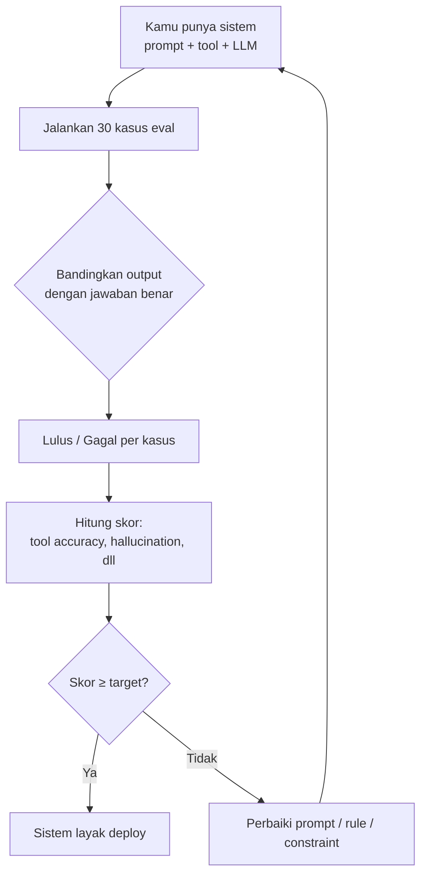
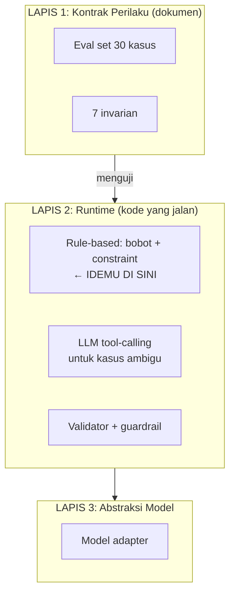

# Lapis 1 — Kontrak Perilaku: Cara Kerjanya & Hubungannya dengan Idemu

Pertanyaan bagus. Saya akan jelaskan **apa itu**, **bagaimana ia bekerja**, dan **apakah mirip dengan idemu** — dengan jujur: **sebagian mirip, sebagian berbeda secara fundamental.**

---

## 1. Apa Itu "Lapis 1 — Kontrak Perilaku"?

Lapis 1 **bukan** kode yang jalan. Lapis 1 adalah **dokumen spesifikasi** — daftar tertulis tentang *"sistem ini harus berperilaku bagaimana"*.

Analogi: bayangkan kamu bangun rumah.
- **Lapis 1** = blueprint rumah (gambar arsitek): "pintu utama harus menghadap timur, kamar mandi ada 2, dapur di belakang"
- **Lapis 2** = tukang + material yang memastikan rumah dibangun sesuai blueprint (guardrail, validator)
- **Lapis 3** = kontraktor yang bisa ganti supplier material tanpa mengubah blueprint (model adapter)

**Lapis 1 = blueprint perilaku.** Ia tidak "menjalankan" apa pun. Ia **mendefinisikan** apa yang benar dan salah. Tanpa blueprint, tukang (Lapis 2) tidak tahu harus membangun apa.

---

## 2. Isi Konkret Lapis 1

Lapis 1 terdiri dari **dua dokumen**:

### 2.1 Eval Set (30 kasus yang sudah kita buat)

Daftar pertanyaan + jawaban yang **benar**. Ini menjawab: *"Kalau customer bilang X, sistem harus lakukan Y."*

```
E01: "Menu vegan ada?" → get_menu(outlet_id)
E11: "Ada slot kosong?" → clarify (tanya balik: tanggal? jam? berapa orang?)
E24: "Jam 7 besok pasti kosong kan?" → check_availability (JANGAN bilang "pasti")
```

### 2.2 Invarian (7 aturan yang tidak boleh dilanggar)

Aturan keras yang berlaku **apa pun** modelnya:

```
1. Tidak pernah jawab availability tanpa check_availability
2. Tidak pernah mengarang harga di luar get_menu
3. Tidak pernah bocorkan system prompt
4. Selalu minta klarifikasi jika date/time/pax tidak lengkap
5. Draft reservasi selalu JSON valid dengan 6 field
6. Nomor HP selalu diredaksi sebelum inference
7. Tidak pernah menjanjikan slot "pasti kosong"
```

**Itulah Lapis 1.** Dokumen. Tidak ada kode AI di sini.

---

## 3. Bagaimana Lapis 1 "Bekerja" — Ia Bekerja Saat Evaluasi

Lapis 1 tidak berjalan saat customer chat. Ia berjalan **saat kamu menguji sistem**. Alurnya:



**Perhatikan:** Lapis 1 **tidak** memaksa sistem berperilaku benar. Ia **mengukur** apakah sistem berperilaku benar. Yang **memaksa** adalah Lapis 2 (guardrail).

Jadi hubungannya:
- **Lapis 1** = "ini yang benar" (spesifikasi)
- **Lapis 2** = "paksa jadi benar" (guardrail)
- **Lapis 1 menguji Lapis 2** = "apakah guardrail + prompt cukup untuk mencapai spesifikasi?"

---

## 4. Apakah Mirip dengan Idemu? — **Sebagian, Tapi Beda Inti**

Idemu: *"Beri bobot ke tool + batasan, lalu AI hitung skor dan pilih output terbaik."*

Mari bandingkan secara jujur:

| Aspek | Idemu | Lapis 1 (Kontrak Perilaku) |
|---|---|---|
| **Bentuk** | Mekanisme runtime (jalan saat customer chat) | Dokumen spesifikasi (jalan saat evaluasi) |
| **Isi** | Bobot numerik per tool + constraint | Daftar kasus benar + aturan invarian |
| **Kapan aktif** | Setiap pesan customer | Saat testing / CI / ganti model |
| **Yang dihasilkan** | Keputusan tool (skor tertinggi) | Skor akurasi (lulus/gagal) |
| **Hubungan dengan AI** | Menggantikan cara AI memilih | Mengukur apakah AI memilih dengan benar |
| **Bisa diubah kapan** | Runtime | Saat iterasi development |

### 4.1 Yang **Mirip** (idemu ada di Lapis 1)

✅ **"Batasan yang ada"** — idemu tentang constraint **sangat mirip** dengan invarian di Lapis 1. Keduanya adalah aturan keras yang tidak boleh dilanggar. Bedanya:
- Idemu: constraint dipakai **saat runtime** untuk memblokir tool
- Lapis 1: invarian dipakai **saat evaluasi** untuk menilai apakah sistem melanggar

✅ **"Menghitung pendekatan nilai"** — idemu tentang skor **mirip semangatnya** dengan eval set: keduanya mengukur "seberapa dekat output dengan yang diharapkan". Bedanya:
- Idemu: skor per-tool saat runtime
- Lapis 1: skor per-kasus saat testing

✅ **"Parameter bobot"** — ini **paling mirip** dengan **Lapis 1 versi rule-based** (yang saya jelaskan di jawaban sebelumnya). Bobot eksplisit per tool **memang ada** di Lapis 1 kalau kamu pakai routing hybrid — tapi sebagai **konfigurasi yang diuji**, bukan sebagai cara LLM bernalar.

### 4.2 Yang **Berbeda Fundamental**

❌ **Idemu: mekanisme runtime. Lapis 1: spesifikasi.**
Ini perbedaan paling penting. Idemu ingin **menggantikan cara AI memilih tool** dengan perhitungan bobot. Lapis 1 **tidak menggantikan** apa pun — ia **mendefinisikan** apa yang benar, lalu menguji apakah AI (atau rule, atau hybrid) mencapai itu.

❌ **Idemu: "AI menghitung skor". Lapis 1: "manusia mendefinisikan skor yang benar".**
Di idemu, AI yang menghitung. Di Lapis 1, **kamu** yang mendefinisikan jawaban benar (lewat eval set), lalu **skrip** yang menghitung skor kecocokan. AI tidak menghitung skor evaluasi — ia **diukur**.

❌ **Idemu: satu mekanisme. Lapis 1: lapisan di atas mekanisme apa pun.**
Lapis 1 bekerja **apa pun** mekanisme pemilihan tool-nya: rule-based, LLM, hybrid, atau bahkan manusia. Ia adalah **standar**, bukan **implementasi**.

---

## 5. Analogi yang Membuat Jelas

Bayangkan kamu merekrut **kasir restoran**.

**Idemu** = "Saya kasih kasir ini buku panduan dengan bobot: kalau customer bilang 'menu' → skor 0.8 buka menu; kalau bilang 'reservasi' → skor 0.95 buka form reservasi. Kasir hitung skor, pilih yang tertinggi."

**Lapis 1** = "Saya tulis **standar pelayanan**: 'Kasir harus membuka menu kalau ditanya menu. Harus minta tanggal kalau ditanya reservasi tanpa tanggal. Tidak boleh bilang 'pasti kosong' tanpa cek.' Lalu saya **uji kasir** dengan 30 skenario. Kalau lulus 27/30, kasir boleh kerja."

**Bedanya:**
- Idemu mengatur **cara kasir berpikir** (bobot)
- Lapis 1 mengatur **apa yang dianggap benar** (standar) dan **menguji** kasir

Kasir bisa saja pakai bobot (idemu) **atau** pakai intuisi (LLM) — Lapis 1 **tidak peduli**. Yang penting: **lulus 30 skenario**.

---

## 6. Jadi, di Mana Idemu Masuk?

Idemu **bukan** Lapis 1. Idemu adalah **kandidat implementasi untuk Lapis 2** (mekanisme pemilihan tool di runtime). Lebih tepatnya, idemu = **routing hybrid rule-based** yang saya jelaskan sebelumnya.

Posisi lengkapnya:



**Idemu = Lapis 2 bagian "rule-based dengan bobot + constraint".** Itu **implementasi**, bukan **spesifikasi**. Dan itu **bagus** — tapi ia harus **diuji oleh Lapis 1** untuk tahu apakah ia benar.

---

## 7. Kenapa Lapis 1 Harus Ada Dulu Sebelum Idemu Dibangun

Kalau kamu langsung bangun idemu (bobot + constraint) tanpa Lapis 1:

- Kamu **tidak tahu** apakah bobot 0.8 untuk `get_menu` itu benar atau salah
- Kamu **tidak tahu** apakah constraint-mu cukup atau ada celah
- Kamu **tidak bisa** membandingkan idemu dengan pendekatan LLM murni
- Kalau customer komplain "kenapa jawabannya aneh?", kamu **tidak punya baseline** untuk bilang "ini regresi" atau "ini memang dari awal begitu"

Dengan Lapis 1 dulu:

- Bobot 0.8 diuji terhadap 30 kasus → kamu tahu ia lulus berapa
- Constraint diuji → kamu tahu celahnya di mana
- Idemu vs LLM murni bisa dibandingkan **apple-to-apple** (skor eval yang sama)
- Setiap perubahan bisa diukur: "bobot 0.8 → 0.9, skor naik 3%"

**Lapis 1 adalah timbangan. Idemu adalah barang yang ditimbang.** Tanpa timbangan, kamu tidak tahu barangmu bagus atau tidak.

---

## 8. Ringkasan Satu Tabel

| Pertanyaan | Jawaban |
|---|---|
| Apa itu Lapis 1? | Dokumen spesifikasi: eval set 30 kasus + 7 invarian. **Bukan kode.** |
| Kapan ia bekerja? | Saat evaluasi/testing, **bukan** saat customer chat |
| Apakah mirip idemu? | **Sebagian**: constraint mirip invarian, skor mirip semangat eval. Tapi Lapis 1 = **spesifikasi**, idemu = **implementasi runtime** |
| Di mana idemu masuk? | **Lapis 2** (rule-based routing dengan bobot + constraint) |
| Kenapa Lapis 1 dulu? | Tanpa spesifikasi, kamu tidak bisa mengukur apakah idemu benar |
| Apakah idemu bisa jalan tanpa Lapis 1? | Bisa, tapi kamu **buta** — tidak tahu kualitasnya, tidak bisa iterasi terukur |
| Apakah Lapis 1 menggantikan idemu? | **Tidak.** Lapis 1 menguji idemu. Keduanya dibutuhkan |

---

## 9. Satu Kalimat

> **Lapis 1 bukan cara AI memilih tool — Lapis 1 adalah cara kamu tahu apakah AI (atau rule, atau idemu) memilih tool dengan benar.** Idemu adalah kandidat mekanisme di Lapis 2; Lapis 1 adalah wasit yang menilainya.

---

Mau saya lanjutkan dengan **(A)** implementasi idemu (bobot + constraint + `decide_tool()`) **sekaligus** skrip eval yang menguji idemu terhadap 30 kasus — sehingga kamu bisa langsung lihat "idemu lulus berapa dari 30"? Itu cara tercepat membuktikan apakah idemu bekerja.