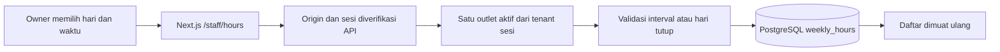

# Alur Jam Operasional

Dashboard /dashboard?tab=hours menampilkan tujuh hari. Owner menyimpan satu hari per request; staff hanya membaca. Waktu ditafsirkan pada timezone outlet, bukan timezone browser. Minggu bernilai 0, Senin 1, sampai Sabtu 6.



GET /api/v1/staff/tenants/:slug/hours mengembalikan data dan timezone. PUT route yang sama menerima tepat weekday, openMinute, closeMinute. Body tidak menerima tenant/outlet. Menit dihitung dari awal hari: 11:00 = 660; 21:00 = 1260; 24:00 = 1440 hanya untuk jam tutup. Kedua nilai null berarti tutup. Salah satu null, interval terbalik/sama, pecahan, serta melewati tengah malam ditolak. Belum diatur berbeda dari tutup: jangan menganggap restoran buka tanpa data.

FK komposit tenant/outlet dan constraint SQL menjaga integritas. Upsert satu hari bersifat atomic dan tidak mengubah hari lain. Tidak memilih outlet default jika nol/lebih dari satu outlet aktif. Mutasi memerlukan owner dan exact Origin. Semua pembacaan memakai tenant sesi.

## Mencoba

1. Login owner, pilih Jam operasional.
2. Isi jam buka dan tutup dengan format HH:MM lalu Simpan hari tersebut.
3. Untuk libur mingguan, centang Hari tutup.
4. Staff hanya melihat jadwal yang tersimpan.

Jadwal belum di-seed. Halaman publik membaca GET /api/v1/public/tenants/:slug/hours tanpa cache; hari yang belum diatur tampil Belum diatur, bukan jadwal contoh. Respons hanya memuat weekday, menit buka/tutup, timezone dan metadata sumber, tanpa ID internal. Strip kunjungan menautkan jadwal dan tidak lagi mengaku buka pada jam hardcoded. Pengecualian tanggal dan audit belum tersedia. Sebelum reservasi diaktifkan, validasi konflik booking yang ada wajib ditambahkan; perubahan jam tidak boleh membatalkan booking diam-diam.

## Verifikasi

```sh
rtk proxy node --test apps/api/test/hours.test.cjs apps/api/test/hours.integration.cjs apps/api/test/hours-http.integration.cjs
```

Unit mencakup hari tutup, batas 00:00–24:00, jam sama/terbalik, null parsial, pecahan dan injeksi tenant. Integration PostgreSQL menguji persistence/upsert, constraint interval dan FK lintas tenant. Tes HTTP owner/staff, Origin salah/hilang, tenant lain, payload invalid, publikasi hari tutup, tenant nonaktif serta respons publik tanpa ID internal lulus pada PostgreSQL nyata. Browser belum diverifikasi. Endpoint publik tegas mengembalikan dateExceptionsSupported=false; jangan menganggapnya pemeriksaan jam pada tanggal tertentu.
