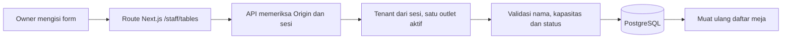

# Alur Pengelolaan Meja

Dashboard: /dashboard?tab=tables. Navigasi Menu dan Meja tetap memeriksa sesi server. Owner membuat/mengubah nama, kapasitas dan status aktif; staff hanya membaca. Tidak ada penghapusan meja.



## Data dan invariant

- Kapasitas integer 1–12; nama 1–80 karakter; status boolean.
- Tenant dan outlet tidak diterima dari body browser.
- Satu outlet aktif dipilih server. Nol atau lebih dari satu outlet aktif menghasilkan konflik; tidak memilih outlet diam-diam.
- FK komposit tenant/outlet mencegah meja terhubung ke outlet tenant lain.
- Nama meja unik per tenant/outlet. Duplikat menghasilkan 409.
- Update ID tenant lain menghasilkan 404 tanpa mengubah baris.
- Aktif bukan berarti slot tersedia; belum ada perhitungan jadwal atau booking.

## API

Base /api/v1, membutuhkan cookie staff:

| Metode | Path | Izin |
| --- | --- | --- |
| GET | /staff/tenants/:slug/tables | Owner/staff |
| POST | /staff/tenants/:slug/tables | Owner + exact Origin |
| PATCH | /staff/tenants/:slug/tables/:id | Owner + exact Origin |

Body tambah/edit: name, capacity, isActive. Field tambahan ditolak. Tindakan tidak menghapus riwayat. Karena reservasi belum diimplementasikan, perubahan kapasitas/status belum memeriksa booking confirmed; pemeriksaan konflik wajib ditambahkan sebelum integrasi booking. Jangan mengaktifkan booking berdasarkan CRUD ini saja.

## Verifikasi

```sh
rtk proxy node --test apps/api/test/table.test.cjs apps/api/test/table.integration.cjs apps/api/test/table-http.integration.cjs
```

Unit menguji input invalid dan penolakan konteks tenant/outlet dari payload. Integration PostgreSQL menguji persistence, constraint kapasitas, FK komposit dan update lintas tenant. Tes HTTP membuktikan tanpa sesi ditolak, staff hanya baca, mutasi Origin salah/hilang ditolak, payload tenant ditolak, kapasitas invalid ditolak, nama duplikat konflik, sesi/ID tenant lain ditolak, penonaktifan tersimpan, serta nol/dua outlet aktif ditolak. Fixture tenant/outlet/akun dibuat khusus tes dan dibersihkan; data demo tidak dimodifikasi. Alur browser belum diverifikasi; status implementasi belum berarti seluruh acceptance selesai.

Meja demo belum di-seed; owner dapat membuat meja M01 kapasitas 2, M02 kapasitas 4 melalui dashboard. Data menu/akun yang sudah ada dipertahankan.
