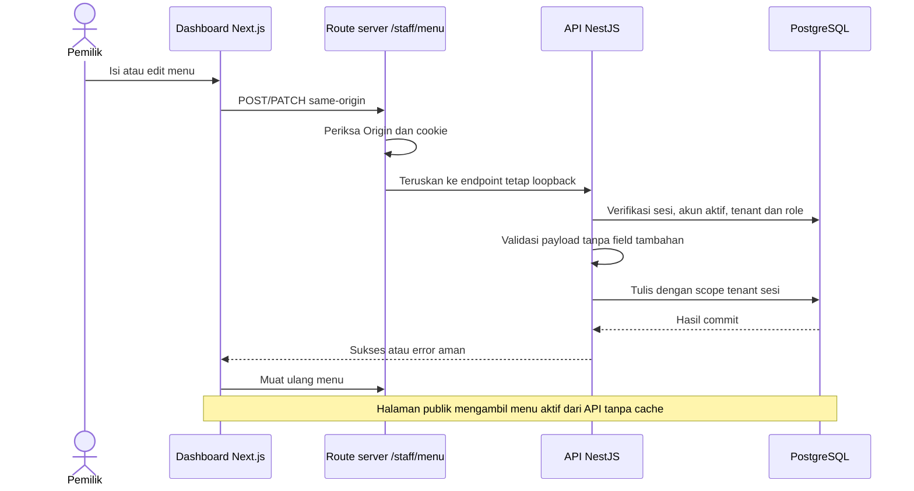

# Alur Pengelolaan Menu

## Gambaran

Menu merupakan data operasional API bisnis, bukan ingatan model atau fixture browser. PostgreSQL menyimpan nama, deskripsi, harga Rupiah integer, status aktif dan ketersediaan. Website Dapur Sela memilih katalog publik demo-padang; dashboard mengambil tenant dari sesi yang diverifikasi backend.



## Izin

| Operasi | Pemilik | Staff | Publik |
| --- | --- | --- | --- |
| Lihat daftar internal termasuk nonaktif | Ya | Ya | Tidak |
| Tambah/edit nama, deskripsi, harga | Ya | Tidak | Tidak |
| Aktif/nonaktifkan menu | Ya | Tidak | Tidak |
| Tandai tersedia/habis | Ya | Ya | Tidak |
| Lihat menu aktif dan harga | Ya | Ya | Ya |

Nonaktif berbeda dari habis: nonaktif disembunyikan dari katalog publik; habis masih tampil dengan label Habis. Penonaktifan menggantikan penghapusan permanen pada alur ini. Data lama dipertahankan; tidak ada penghapusan berantai.

## Jalur permintaan

Base API: http://127.0.0.1:3001/api/v1

| Metode | Route | Perilaku |
| --- | --- | --- |
| GET | /public/tenants/:slug/menu | Menu aktif tenant aktif; tanpa data staff atau tenant ID |
| GET | /staff/tenants/:slug/menu | Daftar menu tenant sesi |
| POST | /staff/tenants/:slug/menu | Pemilik menambah menu |
| PATCH | /staff/tenants/:slug/menu/:id | Pemilik mengirim seluruh field menu |
| PATCH | /staff/tenants/:slug/menu/:id/availability | Pemilik/staff mengirim isAvailable saja |

Body tambah/edit: name, description, price, isActive, isAvailable. Nama 1–120 karakter, deskripsi maksimal 1000 karakter, harga integer 0–100.000.000 Rupiah, status boolean. Field tambahan seperti tenantId/role ditolak. Update menu tenant lain memberi 404 tanpa mengubah data. Slug tenant lain dengan sesi yang tidak cocok memberi 401. Origin mutasi harus cocok konfigurasi terpercaya.

Route browser /staff/menu hanya meneruskan endpoint menu ke API tetap. Cookie mentah tidak masuk JSON, localStorage atau log. Kontrol UI bukan batas izin: backend tetap menolak permintaan staff yang memodifikasi harga.

## Menjalankan dan mencoba

Jalankan BE dan FE seperti panduan lokal, lalu buka http://127.0.0.1:3000/login. Akun demo sudah tersedia; password dibaca privat dari file lokal, tidak disalin ke dokumentasi. Pada dashboard:

1. Owner melihat menu, form tambah dan tombol edit.
2. Isi nama, deskripsi, harga; pilih visibilitas dan ketersediaan.
3. Tekan Simpan menu; sukses baru tampil setelah respons API.
4. Muat ulang beranda: menu aktif tampil dengan harga dari DB.
5. Staff hanya melihat aksi Tandai habis/Tandai tersedia, tanpa form harga.
6. Owner nonaktifkan menu; beranda tidak menampilkannya.

Seed menu memakai ID sintetis stabil untuk dua tenant. Retry tidak menimpa perubahan pemilik. Foto dipetakan ke nama menu demo yang dikenali; nama baru menggunakan placeholder, bukan gambar yang salah. Tidak ada upload gambar pada alur ini.

## Verifikasi

```sh
rtk proxy node --test apps/api/test/menu.test.cjs apps/api/test/menu.integration.cjs
```

Tes mencakup input harga invalid, field tenant injeksi, akses tanpa sesi, staff create/edit ditolak, Origin salah, sesi tenant lain, ID menu tenant lain, status habis, publish/unpublish, serta constraint harga PostgreSQL nyata. Akun/menu probe tes dibersihkan tanpa menghapus data demo yang sudah ada.

## Verifikasi lintas dashboard

```sh
rtk proxy node --test apps/api/test/dashboard-web.integration.cjs
```

Membutuhkan FE dan BE lokal aktif. Tes HTTP melewati route Next.js hingga PostgreSQL pada tenant sintetis khusus: owner tambah/edit menu, staff tersedia/habis, staff ditolak pada konfigurasi meja/jadwal/profil, Origin asing ditolak, serta hasil publik berubah. Semua baris fixture milik tes dibersihkan. Cookie sesi sintetis dibuat langsung di DB; login diuji terpisah pada suite auth. Ini bukan tes klik form browser, keyboard atau screenshot.

## Batas saat ini

- Pengelolaan meja dan jadwal mingguan tersedia terpisah; availability reservasi dan transaksi booking belum tersedia.
- Daftar belum berpaginasi; gunakan korpus demo kecil.
- Perubahan simultan memakai last-write-wins; belum ada optimistic version check.
- Foto dan data seed bersifat sintetis; bukan katalog restoran produksi.
- Pemeriksaan browser keyboard/mobile tetap diperlukan; tes API tidak membuktikan kualitas render.

## Sources

- [NestJS Controllers](https://docs.nestjs.com/controllers)
- [Next.js Route Handlers](https://nextjs.org/docs/app/api-reference/file-conventions/route)
