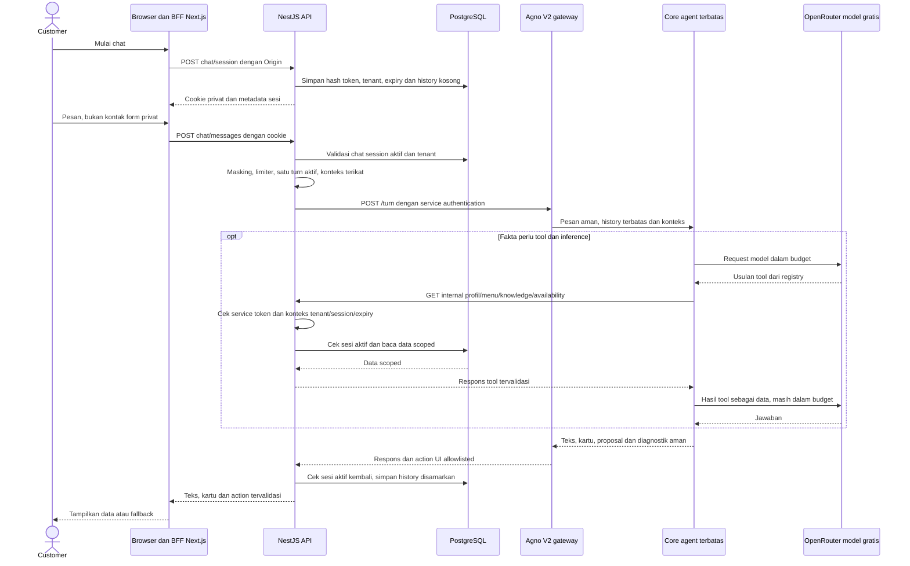
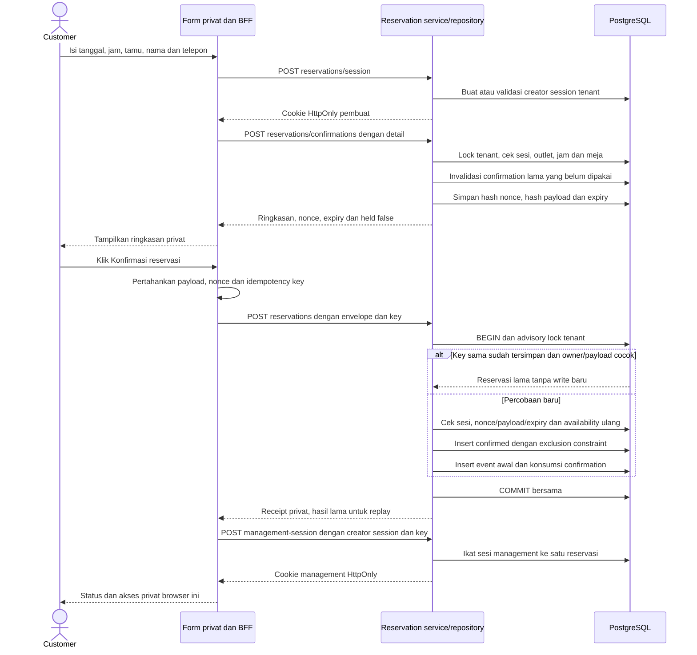
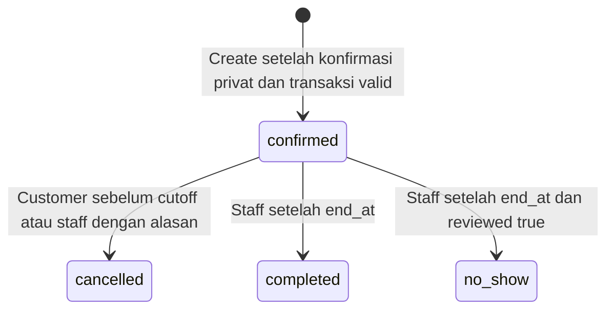
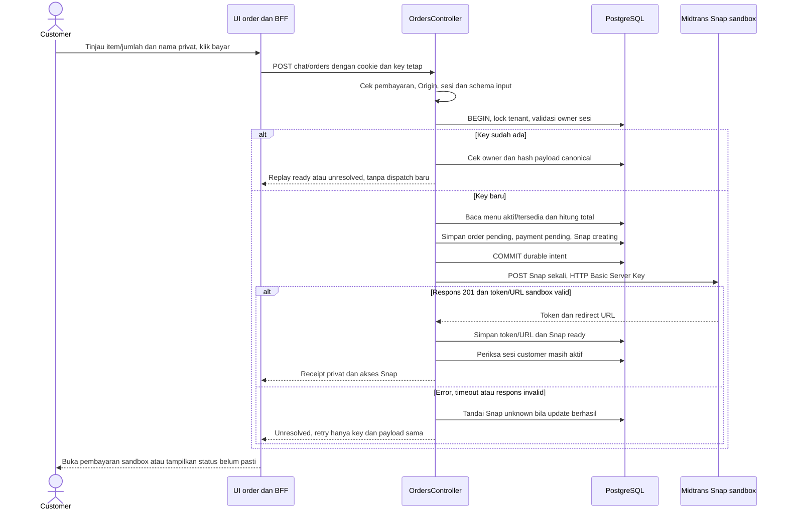
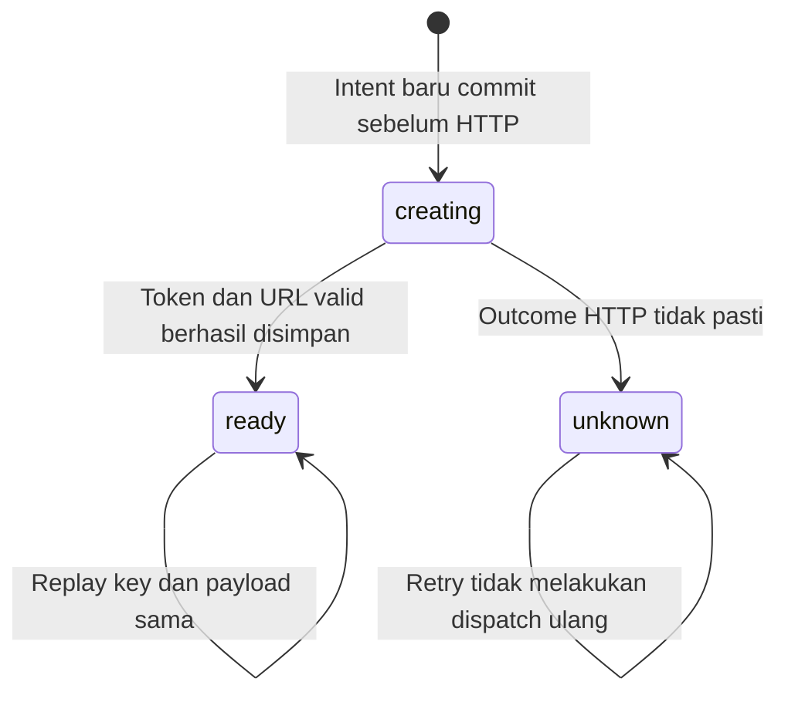
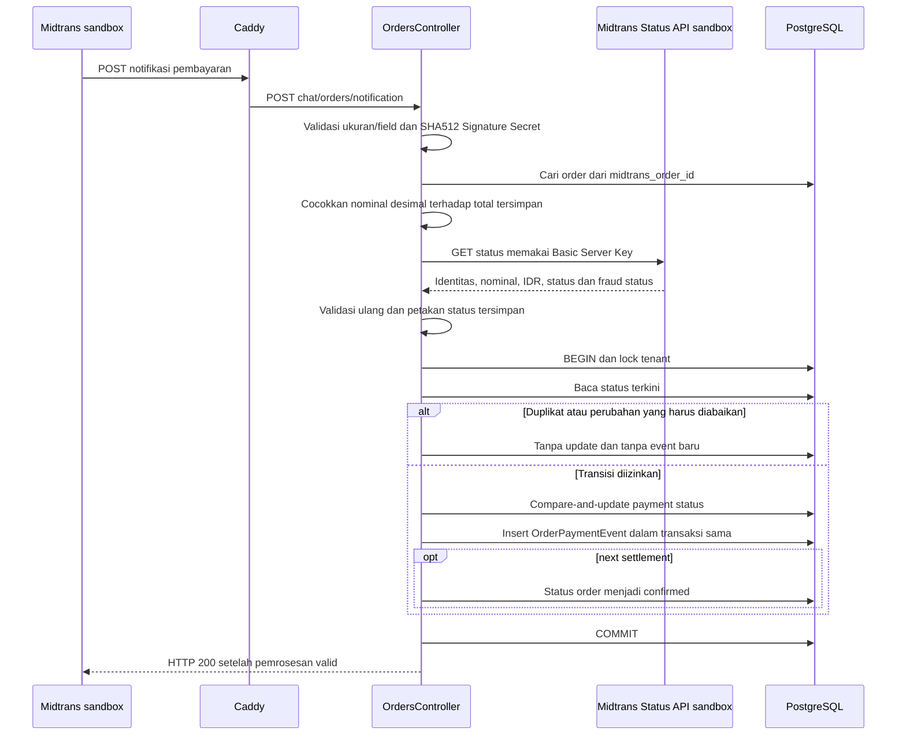
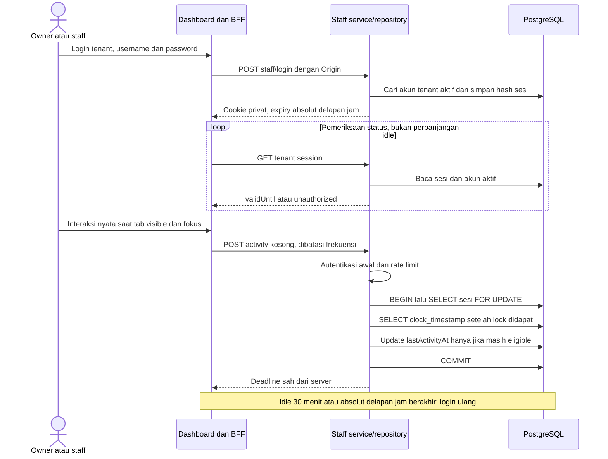

# Alur Sistem

## 1. Batas pembacaan

Alur berikut mengikuti kode pada commit `a684fb2dfb851ba0fd9daf68685c111768a151fa`. Diagram menggambarkan jalur yang tersedia pada source, bukan hasil uji live baru. Struktur layanan ada pada [Arsitektur Sistem](Arsitektur%20Sistem.md); seluruh tabel/constraint ada pada [ERD Database](ERD%20Database.md). Diagram Mermaid belum dirender karena renderer lokal belum ditemukan; tidak memasang tool tambahan.

Istilah penting:

- **BFF**: route handler Next.js yang menerima request same-origin browser dan meneruskannya ke API bisnis.
- **Snapshot**: data saat dibaca, bukan jaminan keadaan saat transaksi berikutnya.
- **Atomic**: seluruh perubahan DB pada transaksi berhasil bersama atau rollback bersama. HTTP provider dan penulisan berkas tidak ikut transaksi DB.
- **Unknown**: hasil belum dapat dipastikan; bukan bukti gagal, bukan bukti lunas, dan bukan izin memulai request baru dengan key berbeda.

Semua contoh route di bawah hanya path tanpa token atau data privat. Prefix route NestJS adalah `/api/v1`; path BFF web berbeda dan tidak otomatis memiliki prefix itu.

## 2. Jalur web biasa dan katalog

Customer dapat membuka halaman restoran tanpa memulai sesi chat. [page.tsx](../apps/web/app/page.tsx) membaca profil dari API melalui server-side `API_ORIGIN`; [MenuSection.tsx](../apps/web/app/components/MenuSection.tsx) membaca menu catalogue termasuk key foto. Kedua jalur memakai `cache: no-store`. Jika API gagal, UI menampilkan keterbatasan, bukan harga atau booking buatan model.

Route publik penting:

| Kebutuhan | Route API |
| --- | --- |
| Profil/outlet | `GET /api/v1/public/tenants/:slug/restaurant` |
| Menu tanpa foto untuk tool | `GET /api/v1/public/tenants/:slug/menu` |
| Katalog menu dengan referensi foto | `GET /api/v1/public/tenants/:slug/menu/catalogue` |
| Availability | `GET /api/v1/public/tenants/:slug/availability` |
| Foto upload publik | `GET /api/v1/public/tenants/:slug/menu/images/:key` |

Slug memilih katalog publik tenant aktif. Slug bukan bukti hak akses staff, reservasi privat atau order. Website utama dan chat saat ini mengikat tenant demo di kode; BFF reservasi memakai konfigurasi slug server dengan default katalog demo.

## 3. Percakapan: fakta dari tool, aksi tulis dari UI

Sumber: [chat-session.controller.ts](../apps/api/src/restaurant/chat-session.controller.ts), [chat-sessions.service.ts](../apps/api/src/restaurant/chat-sessions.service.ts), [chat-message.controller.ts](../apps/api/src/restaurant/chat-message.controller.ts), [gateway V2](../agno-v2/app/main.py), [runtime V2](../agno-v2/app/runtime.py), [conversation_runner.py](../apps/assistant/conversation_runner.py).

Tidak setiap turn memanggil model: greeting, beberapa pertanyaan jam buka, atau navigasi form dapat dijawab jalur deterministik. Registry aktif berisi `get_restaurant_info`, `search_menu`, `search_knowledge`, `check_availability`, dan `prepare_order`. Seluruhnya tanpa write bisnis. `prepare_order` membaca menu dan mengembalikan proposal terstruktur di memori; order DB belum ada.

Action `reservation` hanya mengisi awal tanggal/jam/jumlah tamu, lalu membuka form. Action `order` hanya menambahkan item/jumlah ke draft UI. Customer tetap harus meninjau dan menekan kontrol privat. Kalimat “ya”, flag model, atau tool proposal bukan persetujuan membuat reservasi/order/pembayaran.

Batas aktif: pesan 2.000 karakter, delapan pesan history API, tiga request inference, tiga tool call, output model 512 token, deadline core 30 detik. Timeout bukan alasan retry tanpa batas. Kegagalan dapat menghasilkan data API yang sudah tervalidasi atau fallback web; tidak boleh menampilkan sukses transaksi palsu. Masking pola email/nomor/nilai panjang bukan jaminan semua data privat terhapus.

## 4. Retrieval FAQ/kebijakan

1. Tool knowledge membawa konteks tenant/session yang diterbitkan API; API memeriksa auth service, signature konteks dan sesi aktif.
2. Repository mengambil dokumen tenant aktif dengan pointer revision aktif dalam snapshot `RepeatableRead`.
3. Revision harus berasal dari dokumen/tenant sama, sama dengan `activeRevision`, dan berstatus `published`. Snapshot tidak konsisten ditolak, bukan diteruskan ke model.
4. Pencarian lexical menyaring tenant sebelum validasi/ranking, menghitung kecocokan token dan mengembalikan maksimal tiga cuplikan deterministik. Tidak ada embedding yang diasumsikan terjadi.
5. Cuplikan menjadi data sumber tidak tepercaya. Tanpa bukti cocok, assistant menyatakan keterbatasan; harga, jam dan availability tetap berasal dari tool operasional, bukan FAQ.

Sumber: [knowledge.controller.ts](../apps/api/src/restaurant/knowledge.controller.ts), [knowledge.repository.ts](../apps/api/src/restaurant/knowledge.repository.ts), [knowledge-search.ts](../apps/api/src/restaurant/knowledge-search.ts). Publikasi memakai [knowledge-publication.repository.ts](../apps/api/src/restaurant/knowledge-publication.repository.ts) dan trigger konsistensi DB; bukan izin bagi model untuk mempublikasikan dokumen.

## 5. Reservasi melalui form privat

### Kebijakan yang benar-benar didukung

[availability.ts](../apps/api/src/restaurant/availability.ts) menolak kebijakan outlet selain konfigurasi yang didukung: zona `Asia/Jakarta`, durasi 90 menit, minimal notice 60 menit, maksimal 30 hari ke depan, 1–12 tamu, serta cutoff batal customer 120 menit sebelum mulai. Struktur kolom konfigurasi tidak berarti semua variasi kebijakan sudah didukung.

API meminta tepat satu outlet aktif. Jadwal khusus tanggal mendahului mingguan; jadwal tidak ada berarti belum dikonfigurasi, bukan otomatis tutup. Kandidat meja harus aktif, cukup kapasitas dan tidak overlap confirmed; dipilih kapasitas terkecil yang cukup, lalu ID sebagai tie-break. Hasil availability selalu `held: false`.

Sumber: [ReservationSection.tsx](../apps/web/app/components/ReservationSection.tsx), [BFF reservasi](../apps/web/app/reservation/%5Baction%5D/route.ts), [reservation.controller.ts](../apps/api/src/restaurant/reservation.controller.ts), [reservation.repository.ts](../apps/api/src/restaurant/reservation.repository.ts), [reservation-input.ts](../apps/api/src/restaurant/reservation-input.ts).

### Mengapa dua pemeriksaan availability?

Pemeriksaan saat ringkasan hanya membantu customer melihat opsi. Meja belum ditahan. Saat create, repository memeriksa ulang setelah lock tenant; sebelum menyimpan, masa sesi/konfirmasi dan batas waktu juga diperiksa ulang. Constraint PostgreSQL menjadi perlindungan terakhir terhadap booking confirmed yang overlap. Reservasi, event awal dan konsumsi nonce harus commit bersama; kegagalan salah satu membatalkan semuanya.

Create saat ini menyimpan `source=web`, termasuk bila tanggal/jam awal berasal dari action chat. Nilai `source=chat` di CHECK SQL tidak membuktikan ada write tool booking lewat chat.

### Nonce, perubahan detail dan retry

- Nonce terikat tenant, creator session dan hash detail reservasi, maksimal lima menit serta tidak melewati expiry sesi pembuat. DB menyimpan hash, bukan nonce mentah.
- Ringkasan baru menginvalidasi confirmation lama yang belum dikonsumsi. Koreksi detail membuang attempt/ringkasan UI; request dengan payload berubah tidak dapat memakai nonce lama sebagai izin baru.
- Idempotency key unik per tenant. Replay wajib owner sesi sama dan hash payload sama; mismatch ditolak. Double click dibatasi UI dan backend; UI bukan satu-satunya pengaman.
- Jika respons create terputus, **jangan langsung membuat booking baru**. UI mempertahankan key percobaan pada sessionStorage; hanya key lookup/attempt disimpan di sana, bukan nama/telepon atau nonce.
- Pemulihan `management-session` + `receipt` mencari hasil percobaan dengan sesi pembuat yang sah. Endpoint `recovery` mengembalikan `reservation_exists` atau `not_created` dalam transaksi tenant yang sama. Bila belum ada reservasi, recovery menginvalidasi semua confirmation belum dipakai pada creator session, termasuk tab lain; booking yang sudah ada tidak dibatalkan.
- Jika hasil masih belum pasti, hentikan percobaan baru sampai status jelas. Kegagalan jaringan bukan bukti rollback.

### Lihat dan batal

BFF menyediakan `/reservation/management`, `/reservation/receipt`, `/reservation/cancel`, `/reservation/recovery`, dan `/reservation/logout`, dipetakan ke endpoint API. Receipt dan cancel membutuhkan management session satu reservasi. Creator session + key dapat menerbitkan management session; **key saja, kode referensi saja, atau ID chat tidak cukup**.

Cancel memeriksa kode referensi yang sedang ditampilkan agar perubahan sesi/tab tidak membatalkan reservasi lain secara diam-diam, lalu memeriksa cutoff. Reference code hanya pemeriksaan kecocokan, bukan credential. Transisi confirmed ke cancelled dan event customer tersimpan atomic; cancel yang sudah cancelled mengembalikan receipt tanpa menambah efek.

“Tutup akses privat” mencabut management session, bukan membatalkan booking dan bukan otomatis mencabut creator session. Browser bersama masih berisiko memiliki akses pemulihan selama creator session berlaku.

### State reservasi

Ketiga status tujuan bersifat terminal pada jalur aktif; tidak ada transisi balik ke confirmed. Status `pending` bukan state reservasi. Staff tidak dapat bypass constraint overlap. Pembatalan staff wajib alasan; completed/no_show baru sah ketika waktu server **melewati**, bukan sama dengan, `end_at`. Transisi staff memakai key event idempotent dan pemeriksaan sesi aktif di dalam transaksi setelah lock tenant.

Sumber: [staff-reservations.service.ts](../apps/api/src/restaurant/staff-reservations.service.ts), [migrasi constraint reservasi](../apps/api/prisma/migrations/20261102090000_reservations/migration.sql).

## 6. Order privat dan inisialisasi Snap sandbox

Customer menerima proposal dari chat, menambahkan item ke draft UI, mengisi nama pada kontrol privat, lalu menekan tombol pembayaran. Nama pemesan tidak menjadi pesan chat dan tidak ditambahkan ke history model. Browser tidak menentukan harga, tenant, total atau status paid.

Sumber: [UI chat/order](../apps/web/app/components/ChatbotWidget.tsx), [BFF order](../apps/web/app/chat/orders/route.ts), [orders.controller.ts](../apps/api/src/restaurant/orders.controller.ts), [payments.ts](../apps/api/src/restaurant/payments.ts).

Aturan penting:

- API hanya menerima `customerName`, `idempotencyKey`, dan `items` berisi ID/jumlah. ID tenant tidak diterima dari body; sesi menentukan tenant. Duplikasi item digabung, payload canonical diurutkan, jumlah agregat dibatasi 20 per item; maksimal 30 row masukan.
- Total integer Rupiah dihitung dari menu DB yang masih aktif/tersedia, wajib 1–100.000.000. Order menyimpan snapshot item, bukan menerima harga model/browser.
- Durable intent disimpan **sebelum HTTP**. Tidak ada request provider di dalam transaksi DB. Satu key hanya memiliki satu klaim dispatch Snap.
- Timeout atau crash setelah dispatch dapat berarti provider sudah membuat transaksi. `unknown` tidak didispatch ulang otomatis. Bahkan row `creating` yang tertinggal karena crash tidak otomatis dikirim ulang. Retry key/payload sama hanya mengembalikan hasil ready yang tersimpan atau pesan unresolved; bukan mekanisme otomatis membuat Snap kedua.
- Pemeriksaan manual diperlukan jika intent tetap creating/unknown atau token belum tersimpan. Tidak ada dashboard mutasi/reconciliation otomatis yang diasumsikan tersedia.
- Token dan URL Snap disimpan/ditampilkan privat, bukan masuk prompt/history atau DTO staff. Redirect URL harus origin HTTPS sandbox yang diizinkan.
- Jika sesi berakhir selama HTTP, hasil Snap tetap disimpan bila berhasil, tetapi respons privat tidak diberikan sebelum sesi dicek lagi. Batas sesi tidak diabaikan karena pembayaran sudah dimulai.

### State inisialisasi Snap

Schema memberikan default `unknown` untuk kompatibilitas data lama; route create baru secara eksplisit memakai `creating`. Gagal menulis hasil/error ke DB dapat meninggalkan row `creating`; ini tetap unresolved. Diagram ini terpisah dari payment status: `ready` berarti akses Snap siap, **bukan lunas**.

## 7. Notifikasi dan verifikasi pembayaran

Dua credential punya fungsi berbeda:

| Nama konfigurasi | Penggunaan |
| --- | --- |
| `MIDTRANS_SERVER_KEY` | HTTP Basic dengan bentuk Server Key sebagai username dan password kosong, untuk Snap dan Status API sandbox |
| `MIDTRANS_SIGNATURE_SECRET` | SHA512 biasa dari penggabungan `order_id + status_code + gross_amount + Signature Secret Key` untuk memeriksa `signature_key` notifikasi |

Tidak memakai HMAC untuk signature notifikasi. Tidak ada fallback Signature Secret Key ke Server Key. Keduanya wajib terkonfigurasi bila pembayaran aktif. Tidak ada nilai credential dalam dokumen ini.

Signature valid saja belum cukup untuk lunas. Nominal dibandingkan secara desimal memakai integer satuan sen terhadap total Rupiah, bukan float longgar. Status API harus cocok order, nominal dan currency `IDR`; promosi ke settlement memerlukan status code remote `200`. Signed fraud denial tidak boleh dipromosikan menjadi lunas meskipun respons status berbeda. Error verifikasi mengembalikan non-success; tidak menebak paid dari redirect browser.

Mapping dan transisi tepat dari [orders.controller.ts](../apps/api/src/restaurant/orders.controller.ts):

| Status provider / kondisi | Payment status tersimpan |
| --- | --- |
| `settlement` atau `capture`, fraud tidak ada atau `accept` | `settlement` |
| `settlement` atau `capture`, fraud `challenge` | `pending` |
| Fraud `deny` | `deny` |
| `failure` | `deny` |
| `pending`, `expire`, `cancel`, `deny` | Nama sama |

```mermaid
stateDiagram-v2
    state "unpaid atau pending" as Open
    state "expire, cancel atau deny" as Negative
    [*] --> Open: Default schema unpaid; create aktif pending
    Open --> Open: Pending atau duplikat tanpa efek ganda
    Open --> Negative: Status negatif terverifikasi
    Open --> settlement: Pembayaran terverifikasi
    Negative --> settlement: Status otoritatif belakangan menyatakan settlement
    settlement --> settlement: Duplikat atau status terlambat diabaikan
```

`Open` dan `Negative` adalah kelompok visual, bukan nilai kolom baru. Status negatif yang sudah tersimpan tidak berpindah ke pending atau status negatif lain; settlement boleh mengoreksinya ketika verifikasi memenuhi syarat. Settlement tidak pernah diturunkan. `failure` tidak disimpan sebagai payment status; kosakata DB adalah `unpaid`, `pending`, `settlement`, `expire`, `cancel`, `deny`. Filter staff masih menerima label `failure`, tetapi tidak membuatnya menjadi state DB.

Event hanya dibuat ketika status benar-benar berubah, dalam transaksi yang sama. Jika insert audit gagal, update status rollback dan notifikasi tidak dianggap sukses. Notifikasi ganda/paralel tidak boleh menggandakan efek. Limiter ingress invalid, customer, dan pekerjaan verifikasi provider terpisah serta in-memory; ini bukan jaminan perlindungan terdistribusi terhadap semua serangan.

Order aktif mulai `status=pending`; hanya settlement mengubahnya menjadi `confirmed`. Payment expire/cancel/deny tidak otomatis mengubah status order menjadi cancelled. Tidak ada state DB `paid` atau handler callback browser yang menetapkan lunas.

Customer membaca `GET /api/v1/chat/orders/:id/status` melalui [BFF status order](../apps/web/app/chat/orders/%5Bid%5D/route.ts); API mensyaratkan tenant dan chat session pemilik yang masih aktif. Owner/staff membaca `GET /api/v1/staff/tenants/:slug/orders` serta detail `/:id`. [StaffOrdersController](../apps/api/src/restaurant/staff-orders.controller.ts) hanya mendaftarkan GET; [service](../apps/api/src/restaurant/staff-orders.service.ts) mengembalikan snapshot item/audit, tanpa mutasi, token Snap atau redirect URL.

## 8. Login, idle dan aktivitas staff

Sumber: [staff.controller.ts](../apps/api/src/auth/staff.controller.ts), [staff.service.ts](../apps/api/src/auth/staff.service.ts), [staff.repository.ts](../apps/api/src/auth/staff.repository.ts), [staff-session-policy.ts](../apps/api/src/auth/staff-session-policy.ts), [StaffSessionGuard.tsx](../apps/web/app/dashboard/StaffSessionGuard.tsx), [BFF sesi](../apps/web/app/staff/session/route.ts).

Deadline sesi adalah nilai terkecil dari `lastActivityAt + 30 menit`, `createdAt + 8 jam`, dan `expiresAt`. Tepat pada deadline dianggap expired. Akun staff atau tenant nonaktif, role tidak valid, slug tidak cocok, maupun sesi revoked ditolak.

Dashboard memang polling GET setiap 15 detik serta memeriksa ketika fokus/visibility berubah. **Polling tidak memperbarui lastActivityAt.** Hanya interaksi trusted `pointerdown`, `keydown`, atau `change` pada tab visible/fokus dapat memicu POST activity, maksimal sekali per 60 detik dari UI. Server membatasi lagi dan tidak mempercayai timestamp browser.

Repository activity mengambil row lock **sebelum** waktu database dibaca. Sesi yang menunggu lock lalu melewati batas idle tidak dapat hidup kembali memakai waktu awal request. Activity tidak mengubah `createdAt`/`expiresAt` dan tidak memperpanjang batas absolut. Kegagalan jaringan tidak memperbarui deadline lokal yang belum dikonfirmasi server. UI menyebarkan sesi berakhir antar-tab dan mengarahkan login ulang; query tenant berikutnya tetap harus lolos backend.

[Migrasi idle](../apps/api/prisma/migrations/20261111220000_staff_idle_sessions/migration.sql) mengisi `last_activity_at` dari created time dan mencabut seluruh sesi lama yang belum revoked. Saat migrasi itu diterapkan pada environment, staff perlu login ulang; bukan perubahan yang aman diasumsikan mempertahankan login lama.

### Perbandingan masa hidup sesi

| Objek | Masa hidup dari source aktif | Bukan berarti |
| --- | --- | --- |
| Staff session | Idle 30 menit, absolut delapan jam, dibatasi expiresAt/revocation | Polling membuat sesi hidup terus |
| Chat session | 24 jam sejak dibuat, dapat revoked | Mengikuti idle staff atau menjadi credential reservasi |
| Konteks internal tool | Maksimal 30 detik, tidak melewati chat expiry | Service token saja memberi akses semua tenant |
| Reservation creator session | 32 hari sejak dibuat | Akses permanen atau akun customer |
| Reservation confirmation | Maksimal lima menit, dibatasi creator expiry | Meja ditahan selama lima menit |
| Reservation management session | Maksimal 30 menit, dibatasi management expiry reservasi | Berlaku untuk semua reservasi tenant |
| Batas management reservasi | Create menetapkan `end_at + 24 jam` | Token lama/kode referensi otomatis memberi akses |

Durasi chat berasal dari [chat-sessions.service.ts](../apps/api/src/restaurant/chat-sessions.service.ts); durasi reservasi dari [reservation.repository.ts](../apps/api/src/restaurant/reservation.repository.ts). Kolom nullable pada schema dan cookie Max-Age tidak menggantikan pemeriksaan expiry/revocation server.

## 9. Pengelolaan operasional dan foto

Owner mengelola profil, menu/foto, meja dan jadwal melalui dashboard/BFF. Staff dapat membaca serta mengubah availability menu sesuai controller; role tidak boleh diambil dari body. Mutasi operasional yang memiliki audit menulis perubahan dan `OperationalAudit` dalam transaksi. Audit reservasi berbeda: `ReservationEvent` menyimpan aktor, from/to, alasan dan waktu.

Untuk foto upload, [MenuController](../apps/api/src/menu/menu.controller.ts) menuntut owner dan Origin mutasi. [MenuImageStorage](../apps/api/src/menu/menu-image-storage.ts) membatasi masukan, decode/re-encode menjadi WebP dan menulis key acak ke storage; [MenuService](../apps/api/src/menu/menu.service.ts) menyimpan metadata tenant. UI mengunggah file saat owner menyimpan form, lalu mengirim key hasil upload bersama data menu. Foto belum terpasang pada menu sampai penyimpanan item berhasil; owner tidak perlu memilih atau mengetik key secara manual. Service dan trigger SQL memeriksa ownership tenant saat menautkannya. Akses publik hanya untuk foto yang terhubung menu aktif tenant aktif; file statis memakai registry terbundel web.

Tidak ada jaminan transaksi atomik lintas filesystem dan DB. Bila metadata gagal tersimpan, file yatim dapat tertinggal; kuota membatasi dampak, bukan membersihkan otomatis. Tidak ada object storage eksternal atau CDN upload yang diasumsikan tersedia.

## 10. Cakupan tes dan hal yang belum dibuktikan

| Alur | Rujukan tes sumber |
| --- | --- |
| Availability tanpa write | [availability-readonly.integration.cjs](../apps/api/test/availability-readonly.integration.cjs) |
| Create/nonce/idempotency dan ketidakpastian | [reservation-repository.test.cjs](../apps/api/test/reservation-repository.test.cjs), [reservation-resilience.integration.cjs](../apps/api/test/reservation-resilience.integration.cjs), [reservation-recovery.test.cjs](../apps/api/test/reservation-recovery.test.cjs) |
| Overlap/FK/event PostgreSQL | [reservation-storage.integration.cjs](../apps/api/test/reservation-storage.integration.cjs) |
| Staff transition | [staff-transitions.test.cjs](../apps/api/test/staff-transitions.test.cjs) |
| Durable order, dua credential, SHA512, audit dan status monotonik | [orders.test.cjs](../apps/api/test/orders.test.cjs) |
| Order read-only tenant/sesi staff | [staff-orders-http.test.cjs](../apps/api/test/staff-orders-http.test.cjs), [staff-orders-session.integration.cjs](../apps/api/test/staff-orders-session.integration.cjs) |
| Idle, absolut, clock setelah lock | [staff-idle.test.cjs](../apps/api/test/staff-idle.test.cjs), [staff-session-lock.integration.cjs](../apps/api/test/staff-session-lock.integration.cjs) |
| Knowledge published/current/tenant | [knowledge-search.test.cjs](../apps/api/test/knowledge-search.test.cjs), [knowledge-pipeline.integration.cjs](../apps/api/test/knowledge-pipeline.integration.cjs) |
| Runtime, registry, budget dan gateway | [test_conversation_runner.py](../apps/assistant/test_conversation_runner.py), [test_execution_gateway.py](../apps/assistant/test_execution_gateway.py), [test_gateway.py](../agno-v2/test_gateway.py) |

Tes deterministik/stub bukan bukti provider live mendukung model, tool calling, kuota, atau settlement sandbox pada saat pembacaan ini. Dokumen disusun tanpa menjalankan DB/migrasi, membangun aplikasi, memanggil provider, mengakses deployment, atau menjalankan browser. Link/file, cakupan model dan struktur Markdown diperiksa lokal; visual diagram, perilaku runtime terbaru, serta kesiapan produksi tetap belum diverifikasi ulang.
