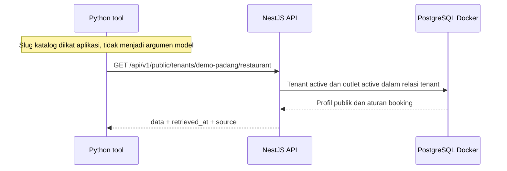

# Alur Tool Restoran

## Tujuan dan batas

Tool `get_restaurant_info` membaca profil publik tenant melalui API, bukan database langsung dan bukan ingatan model. Implementasi ini belum menjalankan agent, sesi chat, endpoint internal bercredential atau OpenRouter. Menguji fungsi tool tanpa model merupakan pemeriksaan integrasi deterministik, bukan bukti model memilih tool dengan benar.

## Alur yang sudah berjalan



API mengambil tenant berdasarkan slug dan status active. Hanya nama, slug, outlet aktif, alamat, kontak publik, timezone dan konfigurasi booking yang dipilih. ID internal, credential dan data customer tidak dikembalikan. Jam buka belum dikembalikan karena skema jadwal belum ada; tidak boleh menyimpulkan restoran buka hanya dari isActive.

## Cara membaca kode

- `apps/api/src/restaurant/restaurant.service.ts`: query Prisma dengan select eksplisit dan pembatasan relasi tenant; melepas pool saat aplikasi ditutup.
- `apps/api/src/restaurant/restaurant.controller.ts`: route GET katalog publik.
- `apps/api/src/http/error.filter.ts`: kontrak error aman dengan request_id buatan server.
- `apps/api/src/create-app.ts`: konfigurasi prefix dan filter yang dipakai server maupun integration test.
- `apps/assistant/restaurant_tool.py`: factory mengikat origin loopback dan slug; fungsi tool hasil factory tidak menerima argumen tenant.

Origin tool hanya HTTP loopback untuk development. Origin arbitrary, credential pada URL, path/query/fragment dan slug invalid ditolak. Tidak ada konfigurasi URL dari pesan customer. Fungsi membatasi timeout lima detik dan payload 64 KiB, memeriksa slug hasil, lalu mengembalikan data terstruktur. Respons kini divalidasi ketat lewat Pydantic: profil/outlet, numeric bounds, timezone demo, timestamp berzona dan larangan extra fields. Schema tetap perlu disesuaikan ketika domain bertambah.

## Endpoint publik bukan otorisasi privat

Slug tenant adalah pilihan katalog publik, bukan secret. Customer boleh melihat katalog brand lain lewat slug lain. Tes dua slug memastikan query tidak tercampur, bukan menjamin semua data tenant bersifat privat.

Wrapper mengikat konteks di luar argumen model dan menolak slug hasil yang berbeda. Sebelum internal tools/session chat dipakai, API wajib memverifikasi service authentication, session binding dan expiry. Implementasi sekarang tidak boleh dipakai sebagai pengganti itu. Tool tidak memiliki hak create/cancel reservasi dan tidak membaca data privat.

## Kontrak respons dan error

Sukses memuat `data`, `retrieved_at` ISO timestamp dan `source: restaurant_api`. `data` memuat slug/nama serta outlet aktif berikut kebijakan booking. Nilainya berasal dari DB saat request, bukan snapshot prompt.

Error memuat `error.code`, `error.message`, dan `request_id`. Missing/invalid tenant memberi 404 NOT_FOUND yang sama. Gangguan query dipetakan ke 503 SERVICE_UNAVAILABLE tanpa pesan driver. Error tak terduga menjadi 500 INTERNAL_ERROR tanpa stack atau SQL. Filter memakai pesan tetap, bukan pesan exception mentah. Client tidak boleh menampilkan pesan mentah provider.

Ketika tool timeout/API gagal/respons salah, fungsi melempar ToolUnavailable dengan pesan aman. Belum ada respons percakapan otomatis yang menawarkan fallback; itu harus disambungkan pada runtime agent/gateway berikutnya. Jangan menangkap error lalu mengembalikan harga/alamat tebakan.

## Menjalankan pemeriksaan

Pastikan Docker healthy, konfigurasi API privat sudah tersedia dan seed dua tenant terpasang. Build dahulu:

```sh
rtk proxy npx --yes pnpm@12.15.0 --filter @restaurant/api build
rtk proxy npx --yes pnpm@12.15.0 --filter @restaurant/api test:database
rtk proxy uv run --project apps/assistant --locked python -m unittest discover -s apps/assistant -p "test_*.py"
rtk proxy uv run --project apps/assistant --locked python scripts/smoke_restaurant_tool.py
```

Integration API menggunakan port acak, menutup aplikasi setelah tes. Smoke Python menggunakan port 3001 yang harus kosong; menjalankan API sementara dan menghentikan proses miliknya. Tidak memanggil provider eksternal, tidak perlu key model.

Cakupan: profil dua katalog berbeda, response fields, tenant hilang/slug invalid, POST ditolak, wrapper tanpa argumen tenant, hasil tenant salah, timeout/error aman dan konteks URL invalid. Belum ada rate limit, sesi privat, uji browser, evaluasi model, atau pengujian kegagalan DB live. Error 503/500 perlu tes khusus sebelum dianggap matang untuk production.

## Urutan berikutnya

- Schema respons ketat, regression test malformed dan factory satu agent offline sudah tersedia; lihat `Konfigurasi Agent.md` untuk cara membaca dan batasnya.
- Tambahkan gateway dengan budget request/deadline serta tes loop model stub.
- Tambahkan loader file model privat; validasi mapping dan allowlist gratis sudah tersedia tanpa mencetak key.
- Setelah pengguna menyetujui inference live dan provider/model ditentukan, uji satu pertanyaan sintetis, tool call dan error/fallback; catat jumlah request aktual.
- Sesi internal dan business tools selanjutnya tetap membutuhkan auth terpisah; jangan membuka akses privat melalui route publik.

## Sources

- [Agno: Tools overview](https://docs.agno.com/tools/overview.md)
- [NestJS: Exception filters](https://docs.nestjs.com/exception-filters)
