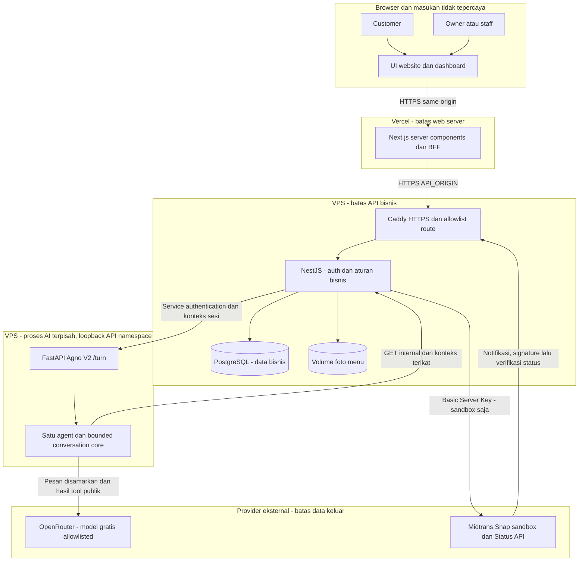
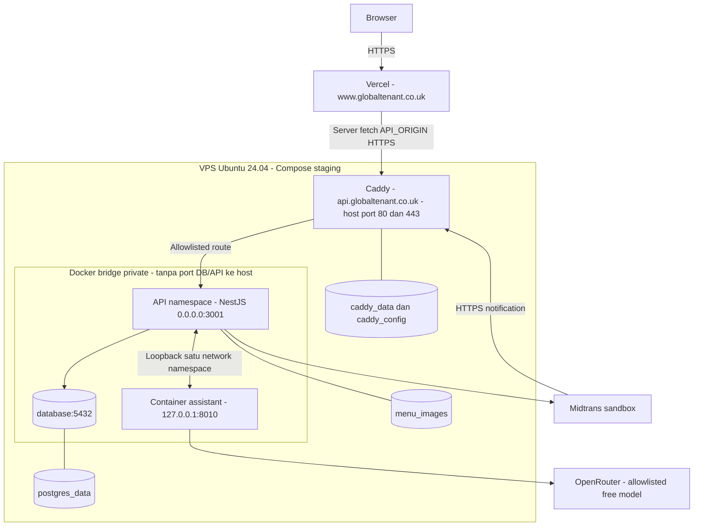

# Arsitektur Sistem Restoran

## 1. Cara membaca dokumen

Dokumen ini menjelaskan **implementasi pada kode**, bukan rancangan fitur yang belum dibuat. Baseline pembacaan: branch `main`, commit `a684fb2dfb851ba0fd9daf68685c111768a151fa`. Konfigurasi deployment dijelaskan sebagai topologi yang disediakan repository; pembacaan kode bukan bukti layanan, DNS, database, atau provider sedang sehat.

Bacaan lanjutan:

- [ERD Database](ERD%20Database.md): seluruh 21 model Prisma, tabel, kardinalitas, serta constraint SQL.
- [Alur Sistem](Alur%20Sistem.md): urutan request, transaksi, sesi, dan perubahan status.

Diagram memakai Mermaid. Diagram belum dirender pada pemeriksaan dokumen ini karena renderer Mermaid lokal belum ditemukan; tidak ada dependensi tambahan yang dipasang.

## 2. Tujuan dan batas implementasi

Sistem menyediakan website restoran, dashboard operasional, reservasi meja melalui form privat, serta bantuan percakapan untuk informasi restoran dan usulan pesanan. Customer tidak perlu akun staff dan tidak harus memakai chatbot untuk reservasi.

**Pembagian tanggung jawab utama:** Next.js menangani tampilan dan Backend for Frontend (BFF); NestJS memiliki aturan bisnis dan akses database; Agno menyusun jawaban dari tool baca; PostgreSQL menjaga data dan integritas transaksi. Model bukan pemberi izin dan bukan sumber harga, slot, atau status pembayaran.

| Area | Implementasi saat ini | Batas yang tidak boleh dianggap sudah tersedia |
| --- | --- | --- |
| Website | Profil, menu, jam buka, form reservasi, widget chat, login/dashboard staff | Halaman utama dan jalur chat masih mengikat katalog demo `demo-padang`; bukan portal onboarding SaaS |
| Tenant/outlet | Data tenant-scoped, FK komposit, struktur banyak tenant/outlet | Jalur reservasi meminta tepat satu outlet aktif; UI bukan pengelola banyak outlet |
| Reservasi | Cek availability, ringkasan/nonce privat, create confirmed, pemulihan hasil, lihat/batal dengan management session; transisi staff | Tidak ada tahan slot, reschedule, gabung meja, deposit, atau konfirmasi booking lewat LLM |
| Pesanan | Usulan menu oleh chat; customer membuat order lewat UI privat; harga dihitung backend; Snap sandbox | Tidak ada write tool, kasir/POS, delivery, refund, atau fulfillment |
| Dashboard pesanan | Owner/staff membaca daftar, detail, snapshot item dan histori perubahan pembayaran tenant sendiri | Tidak menyediakan mutasi pesanan atau tombol menetapkan lunas |
| Pengetahuan | FAQ/kebijakan revision aktif published; pencarian lexical dengan scope tenant sebelum ranking | Tidak ada embedding/vector retrieval pada jalur aktif, meskipun image database menyediakan pgvector |
| AI | Satu agent; model OpenRouter `:free` yang di-allowlist; batas request dan waktu | Tidak ada fallback berbayar, multi-agent, atau akses SQL/shell dari model |
| Deployment | Web Vercel; API, database dan assistant lewat Compose di VPS | Konfigurasi bukan bukti deployment live terverifikasi; pembayaran live ditolak |

Menambah fitur pada kolom batas memerlukan perubahan aplikasi dan pengujian tersendiri. Fitur itu bukan bagian tersembunyi dari diagram ini.

## 3. Konteks, container, dan batas kepercayaan

### Batas yang benar-benar diperiksa

1. **Browser ke BFF:** route mutasi memeriksa Origin tepercaya dan cookie sesuai jalur; BFF meneruskan hanya credential yang diperlukan. Cookie privat memakai HttpOnly, SameSite Strict, serta Secure pada production. Nama cookie web staff berbeda dari nama cookie API; BFF memetakannya, bukan membagikan cookie lintas domain.
2. **BFF ke API:** `API_ORIGIN` adalah konfigurasi server. API memeriksa sesi, tenant, role dan input lagi; keberhasilan melewati Caddy atau BFF bukan otorisasi bisnis. Mutasi memakai Origin/penolakan cross-site, bukan token CSRF terpisah yang dibuat-buat dalam diagram.
3. **API ke assistant:** `ConversationTransport` hanya menerima origin HTTP loopback, memakai service token, timeout dan validasi respons. Browser tidak memanggil `/turn` langsung.
4. **Assistant ke internal API:** service token saja tidak cukup. API memeriksa konteks bertanda tangan yang mengikat slug, session ID dan expiry, lalu memastikan chat session masih aktif. Tenant bukan argumen bebas tool yang dipilih model. Konteks dibuat API dengan masa berlaku maksimal 30 detik, dibatasi expiry sesi.
5. **Data/model eksternal:** pesan disamarkan sebelum inference dan penyimpanan history. Dokumen retrieval dan hasil tool adalah data tidak tepercaya, bukan instruksi system. Nama/kontak dari form reservasi, nama pemesan, token Snap dan URL pembayaran tidak dikirim melalui jalur model. Kontak publik restoran boleh ada dalam tool profil; jangan samakan dengan kontak privat customer.
6. **API ke database:** filter tenant pada query dilengkapi FK komposit dan transaksi. Model AI tidak menerima credential database. Ini shared database dengan isolasi aplikasi/constraint, bukan database-per-tenant atau klaim row-level security.

Sumber: [BFF/sesi web](../apps/web/app/staff-session.ts), [transport percakapan](../apps/api/src/restaurant/chat-message.controller.ts), [konteks internal](../apps/api/src/restaurant/internal-context.ts), [otorisasi internal tool](../apps/api/src/restaurant/internal-tools.controller.ts).

## 4. Peta modul aktual

NestJS memakai satu `AppModule`, bukan kumpulan microservice domain. Prefix global API adalah `/api/v1`. Tabel berikut mengelompokkan controller yang benar-benar didaftarkan; file helper atau controller yang tidak masuk registry tidak dianggap route aktif.

| Modul / tanggung jawab | Entry point kode | Pemilik data / batas |
| --- | --- | --- |
| Registry dan bootstrap HTTP | [app.module.ts](../apps/api/src/app.module.ts), [create-app.ts](../apps/api/src/create-app.ts) | Registrasi controller/provider, prefix, CORS dan error filter |
| Liveness | [health.controller.ts](../apps/api/src/health.controller.ts) | Proses hidup, bukan readiness DB/model |
| Profil publik restoran | [restaurant.controller.ts](../apps/api/src/restaurant/restaurant.controller.ts), [restaurant.service.ts](../apps/api/src/restaurant/restaurant.service.ts) | Tenant/outlet aktif dan profil saat ini |
| Auth staff | [staff.controller.ts](../apps/api/src/auth/staff.controller.ts), [staff.service.ts](../apps/api/src/auth/staff.service.ts), [staff.repository.ts](../apps/api/src/auth/staff.repository.ts) | Login, autentikasi owner/staff, activity dan revoke |
| Menu/foto | [menu.controller.ts](../apps/api/src/menu/menu.controller.ts), [menu.service.ts](../apps/api/src/menu/menu.service.ts) | Katalog publik; owner mengelola menu/foto; staff mengubah ketersediaan |
| Meja | [table.controller.ts](../apps/api/src/restaurant/table.controller.ts), [table.service.ts](../apps/api/src/restaurant/table.service.ts) | Kapasitas/status aktif meja tenant/outlet |
| Jam mingguan | [hours.controller.ts](../apps/api/src/restaurant/hours.controller.ts), [hours.service.ts](../apps/api/src/restaurant/hours.service.ts) | Jadwal reguler dan audit |
| Hari khusus | [special-hours.controller.ts](../apps/api/src/restaurant/special-hours.controller.ts), [special-hours.service.ts](../apps/api/src/restaurant/special-hours.service.ts) | Override tanggal, bukan tambahan interval ke jadwal mingguan |
| Profil dashboard | [profile.controller.ts](../apps/api/src/restaurant/profile.controller.ts) | Controller dan service pembaruan profil berada pada file yang sama |
| Availability | [availability.controller.ts](../apps/api/src/restaurant/availability.controller.ts), [availability.service.ts](../apps/api/src/restaurant/availability.service.ts), [availability.ts](../apps/api/src/restaurant/availability.ts) | Snapshot baca, `held: false`; pemilihan meja dari aturan server |
| Reservasi customer | [reservation.controller.ts](../apps/api/src/restaurant/reservation.controller.ts), [reservation.service.ts](../apps/api/src/restaurant/reservation.service.ts), [reservation.repository.ts](../apps/api/src/restaurant/reservation.repository.ts) | Sesi pembuat, nonce, create, recovery dan management session |
| Reservasi/audit staff | [staff-reservations.controller.ts](../apps/api/src/restaurant/staff-reservations.controller.ts), [staff-reservations.service.ts](../apps/api/src/restaurant/staff-reservations.service.ts) | Baca tenant sendiri; transisi terminal dan audit atomic |
| Chat session | [chat-session.controller.ts](../apps/api/src/restaurant/chat-session.controller.ts), [chat-sessions.service.ts](../apps/api/src/restaurant/chat-sessions.service.ts) | Hash token, expiry/revoke, history terbatas |
| Katalog/chat message | [chat-catalogue.controller.ts](../apps/api/src/restaurant/chat-catalogue.controller.ts), [chat-message.controller.ts](../apps/api/src/restaurant/chat-message.controller.ts) | Baca katalog, masking, rate limit, transport AI dan fallback API |
| Internal read tools | [internal-tools.controller.ts](../apps/api/src/restaurant/internal-tools.controller.ts) | Profil/menu/availability dengan service token, konteks dan sesi aktif |
| Knowledge retrieval | [knowledge.controller.ts](../apps/api/src/restaurant/knowledge.controller.ts), [knowledge.repository.ts](../apps/api/src/restaurant/knowledge.repository.ts), [knowledge-search.ts](../apps/api/src/restaurant/knowledge-search.ts) | Endpoint internal; tenant + published current revision sebelum ranking |
| Order/payment customer | [orders.controller.ts](../apps/api/src/restaurant/orders.controller.ts), [payments.ts](../apps/api/src/restaurant/payments.ts) | Durable intent, Snap sandbox, notifikasi, verifikasi status dan audit |
| Order staff baca saja | [staff-orders.controller.ts](../apps/api/src/restaurant/staff-orders.controller.ts), [staff-orders.service.ts](../apps/api/src/restaurant/staff-orders.service.ts) | GET daftar/detail, pagination 20, tanpa token/URL pembayaran pada DTO staff |
| Web publik dan privat | [page.tsx](../apps/web/app/page.tsx), [MenuSection.tsx](../apps/web/app/components/MenuSection.tsx), [ReservationSection.tsx](../apps/web/app/components/ReservationSection.tsx), [ChatbotWidget.tsx](../apps/web/app/components/ChatbotWidget.tsx) | Server fetch katalog; form customer dan chat memakai jalur BFF |
| BFF web | [reservasi](../apps/web/app/reservation/%5Baction%5D/route.ts), [chat message](../apps/web/app/chat/messages/route.ts), [order](../apps/web/app/chat/orders/route.ts), [sesi staff](../apps/web/app/staff/session/route.ts) | Same-origin proxy, cookie mapping dan response no-store |
| Gateway AI aktif | [main.py](../agno-v2/app/main.py), [runtime.py](../agno-v2/app/runtime.py) | `/turn` terautentikasi; `/v2/chat` mengembalikan 410 setelah auth |
| Core AI aktif | [conversation_runner.py](../apps/assistant/conversation_runner.py), [execution_gateway.py](../apps/assistant/execution_gateway.py), [model_transport.py](../apps/assistant/model_transport.py) | Agent, registry tool, budget request, deadline dan validasi transport |

## 5. Runtime AI dan retrieval

Rantai aktif adalah `agno-v2/app/main.py` → `agno-v2/app/runtime.py` → `apps/assistant/conversation_runner.py`. Gateway V2 memakai kembali core tersebut. Registry tiga tool pada [agno-v2/app/tools.py](../agno-v2/app/tools.py) dan factory profil tunggal pada [agent_factory.py](../apps/assistant/agent_factory.py) **bukan** registry percakapan aktif.

| Tool registry aktif | Operasi sebenarnya | Efek tulis bisnis |
| --- | --- | --- |
| `get_restaurant_info` | GET profil, outlet, jadwal dan kebijakan reservasi dari API | Tidak ada |
| `search_menu` | GET menu aktif, harga Rupiah dan status tersedia/habis | Tidak ada |
| `search_knowledge` | GET cuplikan FAQ/kebijakan published pada revision aktif | Tidak ada |
| `check_availability` | GET tanggal, jam, jumlah tamu; hasil tidak menahan meja | Tidak ada |
| `prepare_order` | Baca menu terkini, cocokkan item tersedia, buat proposal terstruktur di memori | Tidak membuat order, tidak membuat Snap, tidak menagih |

Batas pada jalur aktif:

- Pesan masuk maksimal 2.000 karakter; history yang dibaca/disimpan API adalah delapan pesan terakhir, bukan transcript tanpa batas.
- Satu agent, maksimal tiga tool call; maksimal tiga request inference per turn; deadline core 30 detik. Deadline bersifat cancellation kooperatif, bukan jaminan provider menghentikan pekerjaannya.
- OpenRouter `max_tokens=512`, timeout model 10 detik, retry SDK nol; tool API timeout lima detik dan respons maksimal 65.536 byte. Kartu maksimal tiga.
- [Konfigurasi V2](../agno-v2/app/config.py) dan transport menolak endpoint selain OpenRouter, model di luar allowlist `:free`, serta override routing/plugin pada payload. Allowlist dapat berisi beberapa model, tetapi jalur percakapan aktif memakai satu model terpilih; tidak menyatakan perpindahan otomatis ke cadangan sudah aktif.
- API membatasi lima turn per menit per chat session dan satu turn aktif per sesi dalam satu proses. Limiter ini in-memory, bukan limiter terdistribusi lintas replika.
- Greeting dan beberapa pertanyaan memiliki jalur deterministik tanpa inference. Kegagalan model dapat menghasilkan kartu data API tervalidasi atau fallback web, bukan klaim transaksi berhasil.

Retrieval membaca snapshot `RepeatableRead`, maksimal 100 dokumen, 100 chunk per revision, dan 200.000 karakter snapshot. Fungsi lexical menormalisasi token, menyaring tenant sebelum validasi/ranking, memilih hanya `published` dengan `revision == activeRevision`, lalu mengembalikan maksimal tiga cuplikan. Tidak ada panggilan embedding pada jalur ini. FAQ tidak dipakai sebagai sumber harga/jam/availability atau tempat menyimpan kontak customer. Publikasi dan pergantian revision memakai [knowledge-publication.repository.ts](../apps/api/src/restaurant/knowledge-publication.repository.ts) serta constraint/trigger SQL, bukan endpoint admin yang diasumsikan ada.

## 6. Penyimpanan dan integritas

Database memiliki 21 model aplikasi. Data operasional, sesi, reservasi, pesanan/pembayaran, serta pengetahuan dipisahkan secara logis dalam tabel, bukan database berbeda. Detail kunci dan semua relasi terdapat pada [ERD Database](ERD%20Database.md).

Prinsip penting:

- `tenant_id` bukan label dekoratif: FK komposit mengikat meja ke outlet tenant yang sama, reservasi ke meja/outlet, event ke entitas induk, order ke chat session, serta revision/chunk ke dokumen.
- Availability membaca jadwal khusus lebih dahulu, lalu jadwal mingguan. Create memeriksa ulang di transaksi dan memakai advisory lock per tenant. Exclusion constraint PostgreSQL melarang interval confirmed bertabrakan pada meja yang sama dengan rentang setengah terbuka `[start_at, end_at)`.
- Create reservasi, event awal dan konsumsi nonce berada dalam satu transaksi. Transisi reservasi dan event; transisi pembayaran dan `OrderPaymentEvent` juga atomic.
- Order menyimpan snapshot JSON item dan total saat dibuat. Snapshot bukan FK ke menu; perubahan nama/harga katalog tidak mengubah histori tagihan.

### Foto menu: dua jenis referensi

[Registry foto](../apps/api/src/menu/menu-images.ts) memuat sembilan key foto statis yang dibundel di web. `MenuItem.imageKey` boleh null, key statis, atau key upload yang lolos validasi. Tidak ada tabel untuk setiap foto statis dan tidak ada FK biasa dari seluruh `image_key` ke `menu_uploads`.

Upload owner diterima sebagai JPEG/PNG/WebP, maksimal 4.000.000 byte masukan, lalu diproses ulang menjadi WebP tanpa metadata bawaan melalui [menu-image-storage.ts](../apps/api/src/menu/menu-image-storage.ts). Output maksimal 1 MiB, dimensi maksimal 1.600 × 1.600. Metadata key/ukuran/tenant disimpan pada `menu_uploads`; berkas disimpan pada volume lokal persisten. API mengecek ownership saat menautkan foto; trigger `menu_upload_reference` menolak key berawalan `upload-` yang tidak tercatat pada tenant sama.

Akses publik foto upload memerlukan tenant aktif dan foto direferensikan menu aktif; akses staff memerlukan sesi tenant terkait. File tidak langsung diekspos sebagai direktori publik. Penulisan filesystem dan database bukan transaksi tunggal: kegagalan penyimpanan metadata dapat meninggalkan file yatim, dibatasi kuota penyimpanan, tanpa garbage collection otomatis. Trigger tersebut adalah validasi saat INSERT/UPDATE menu, bukan pengganti penuh FK untuk seluruh siklus delete metadata upload.

## 7. Topologi deployment yang disediakan

Alamat penempatan: **https://www.globaltenant.co.uk** untuk web Vercel dan **https://api.globaltenant.co.uk** untuk API pada VPS Ubuntu 24.04. Hostname adalah alamat deployment yang ditetapkan; nilai DNS/TLS/health tidak diperiksa lewat jaringan dalam penyusunan dokumen ini. Compose memakai variabel origin/domain, bukan hardcode domain tersebut.

Sumber konfigurasi: [compose.staging.yaml](../compose.staging.yaml), [Caddyfile](../infra/staging/Caddyfile), [API wrapper](../infra/staging/api-entrypoint.cjs), [assistant wrapper](../infra/staging/assistant-entrypoint.py), [API image](../infra/staging/api.Dockerfile), [assistant image](../infra/staging/assistant.Dockerfile).

- Hanya Caddy mempublikasikan port host 80/443. Database dan API tidak memiliki port host pada Compose staging. Jaringan bernama `private` adalah bridge, **bukan** jaringan Docker `internal: true`; assistant tetap perlu egress ke OpenRouter.
- Assistant memakai `network_mode: service:api`: proses berbeda tetapi berbagi network namespace API. Karena itu dua arah HTTP loopback tetap bekerja; assistant bind ke `127.0.0.1:8010`, bukan IP container assistant terpisah. Berbagi namespace tidak memberi credential database kepada assistant.
- Caddy hanya meneruskan daftar route bisnis/liveness yang eksplisit. `/api/v1/internal/...`, `/turn`, schema dan route development tidak dipublikasikan oleh allowlist. Pemeriksaan otorisasi API tetap wajib.
- API mount `menu_images` pada `/app/.local/menu-images`; database mount `postgres_data`. Foto statis tetap bagian deployment web. Berkas upload tidak disimpan pada filesystem Vercel yang sementara.
- Wrapper membaca Docker secrets dari mount dan memasukkannya ke environment proses tanpa nilai dalam argumen command. Runtime API memakai role `restaurant_runtime`; service `migrate` terpisah memakai role administrator. Service `migrate`/`bootstrap` berada pada profile tools, bukan langkah otomatis pada startup API.
- API menerima credential pembayaran terpisah, assistant hanya credential model/service yang diperlukan. Signature Secret Key tidak dipinjam dari Server Key.
- Compose staging mengaktifkan `PAYMENTS_ENABLED=true` dan `MIDTRANS_IS_PRODUCTION=false`. Kode menolak mode live/ambigu. API umum bisa menonaktifkan pembayaran dengan flag false; endpoint baca status tetap memerlukan sesi aktif.
- Pemeriksaan health Compose hanya liveness. Tidak membuktikan model tersedia, izin DB benar, atau transaksi provider berhasil.
- [compose.yaml](../compose.yaml) adalah konfigurasi DB lokal berbeda: port DB hanya bind `127.0.0.1:55432`. Jangan menyalin asumsi port lokal ke staging.

### Origin web

[Halaman utama](../apps/web/app/page.tsx), menu server component, dan BFF privat memakai `API_ORIGIN` server-side. `STAFF_ORIGIN` harus sama persis dengan origin web HTTPS yang dipercaya API/BFF; `API_ALLOWED_ORIGINS` mengatur CORS API, bukan pengganti autentikasi. [Helper katalog lain](../apps/web/app/data/restaurant-api.ts) masih membaca `NEXT_PUBLIC_RESTAURANT_API_BASE_URL`; helper itu bukan bukti semua request halaman utama langsung dari browser. Browser menggunakan route same-origin `/chat/...`, `/reservation/...` dan `/staff/...` untuk alur privat.

## 8. Sesi dan pembayaran: ringkasan keamanan

**Staff:** idle 30 menit dan batas absolut delapan jam. Deadline adalah minimum `lastActivityAt + 30 menit`, `createdAt + 8 jam`, dan `expiresAt`. GET session/polling tidak memperpanjang sesi. Event interaksi nyata UI memicu POST activity yang dibatasi frekuensinya; repository mengunci row sesi dahulu, baru membaca `clock_timestamp()` database dan memeriksa ulang eligibility sebelum update. [Migrasi idle](../apps/api/prisma/migrations/20261111220000_staff_idle_sessions/migration.sql) mencabut sesi lama saat diterapkan: deployment migrasi ini mengharuskan staff login ulang. Kebijakan ini tidak boleh disalin sebagai masa hidup chat atau reservasi.

**Reservasi:** form privat adalah tempat nama/kontak, persetujuan ringkasan dan nonce. Chat hanya boleh memberi data awal tanggal/jam/jumlah tamu. ID chat atau kode referensi bukan credential management. Sesi pembuat dan management terpisah; durasi tepat dijelaskan pada [Alur Sistem](Alur%20Sistem.md).

**Pembayaran:** `MIDTRANS_SERVER_KEY` dipakai untuk HTTP Basic ke Snap/Status API. `MIDTRANS_SIGNATURE_SECRET` dipakai untuk SHA512 biasa dari `order_id + status_code + gross_amount + Signature Secret Key`, **bukan HMAC**, tanpa fallback ke Server Key. Notifikasi juga diverifikasi ke Status API, cocokkan identitas/nominal/IDR, lalu perubahan status dan event disimpan atomic. Redirect/callback browser bukan bukti lunas. Status `settlement` tidak diturunkan. Outcome Snap yang tidak pasti tidak dikirim ulang otomatis; retry harus memakai request key sama dan kasus belum terselesaikan memerlukan pemeriksaan manual.

## 9. Bukti pengujian dalam repository dan batas verifikasi

Daftar berikut menunjukkan area yang memiliki tes sumber, **bukan laporan bahwa tes tersebut dijalankan ulang atau provider live lulus saat dokumen ditulis**.

| Area | Sumber tes yang relevan |
| --- | --- |
| Isolasi data/FK/constraint | [database.integration.cjs](../apps/api/test/database.integration.cjs), [reservation-storage.integration.cjs](../apps/api/test/reservation-storage.integration.cjs), [knowledge-storage.integration.cjs](../apps/api/test/knowledge-storage.integration.cjs) |
| Reservasi, recovery, hasil tidak pasti | [reservation-repository.test.cjs](../apps/api/test/reservation-repository.test.cjs), [reservation-resilience.integration.cjs](../apps/api/test/reservation-resilience.integration.cjs), [reservation-recovery.integration.cjs](../apps/api/test/reservation-recovery.integration.cjs) |
| Idle/absolute dan lock sesi | [staff-idle.test.cjs](../apps/api/test/staff-idle.test.cjs), [staff-session-lock.integration.cjs](../apps/api/test/staff-session-lock.integration.cjs) |
| Order dan pembayaran | [orders.test.cjs](../apps/api/test/orders.test.cjs), [orders-http.test.cjs](../apps/api/test/orders-http.test.cjs), [orders-proxy.test.cjs](../apps/api/test/orders-proxy.test.cjs) |
| Staff order baca saja | [staff-orders.test.cjs](../apps/api/test/staff-orders.test.cjs), [staff-orders-session.integration.cjs](../apps/api/test/staff-orders-session.integration.cjs) |
| Retrieval dan publikasi | [knowledge-search.test.cjs](../apps/api/test/knowledge-search.test.cjs), [knowledge-pipeline.integration.cjs](../apps/api/test/knowledge-pipeline.integration.cjs) |
| Tool/budget/gateway | [test_conversation_runner.py](../apps/assistant/test_conversation_runner.py), [test_model_transport.py](../apps/assistant/test_model_transport.py), [test_gateway.py](../agno-v2/test_gateway.py) |
| Foto dan edge/wrapper | [menu-upload.test.cjs](../apps/api/test/menu-upload.test.cjs), [staging.test.cjs](../infra/staging/staging.test.cjs) |

Penyusunan dokumen memeriksa source, model, relasi, referensi file, dan struktur Markdown. Tidak menjalankan DB, migrasi, build, browser, jaringan provider, atau deployment. Karena itu dokumen tidak menyimpulkan kesiapan produksi, backup/recovery yang telah diuji, maupun jaminan privasi sempurna. Masking berbasis pola dapat melewatkan data privat; penggunaan customer nyata tetap perlu tinjauan privasi. Tidak ada bukti high availability atau koordinasi limiter lintas replika dari topologi satu VPS ini.
