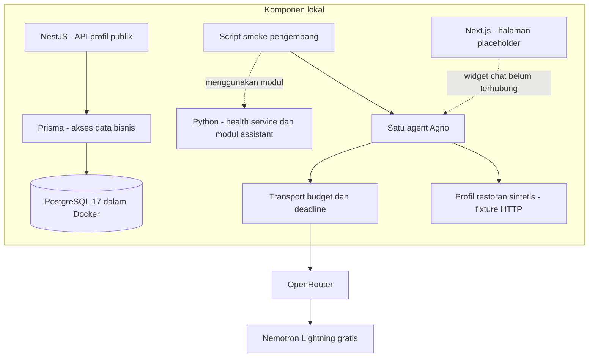
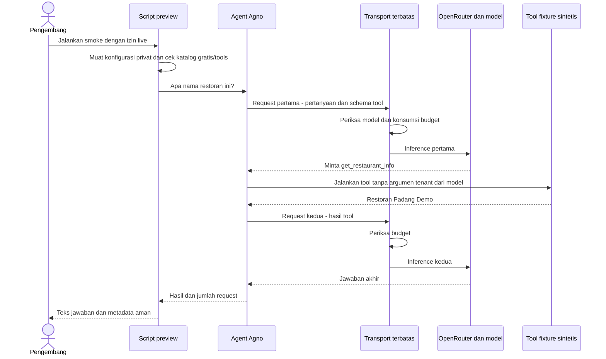
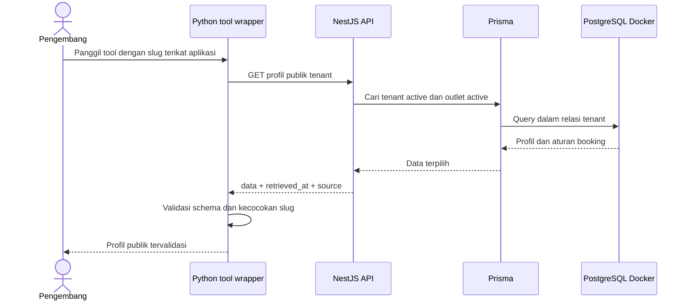
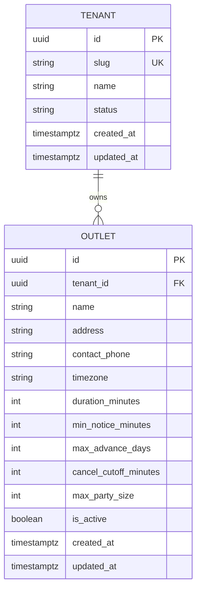
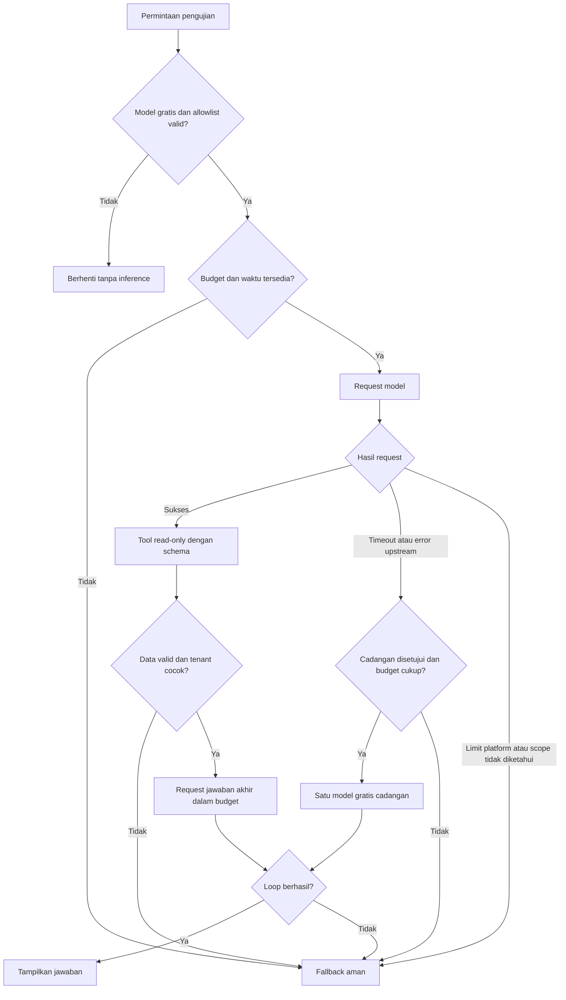

# Diagram Fondasi Sistem

Materi presentasi berdasarkan implementasi dan pengujian yang sudah tersedia. Garis pada diagram menunjukkan alur masing-masing pemeriksaan, bukan klaim semua komponen sudah terhubung menjadi produk customer.

## Gambaran komponen

**Penjelasan:** web masih placeholder. API sudah membaca PostgreSQL. Agent sudah diuji dengan model nyata, tetapi tool pada smoke model membaca fixture sintetis. Python health service belum menyediakan endpoint chat. Tidak ada akses database bisnis dari Python.

## Alur smoke model yang berhasil

Bukti preview: dua request HTTP 200, satu tool call, jawaban akhir:

> Nama restoran ini adalah **Restoran Padang Demo**. (dikonfirmasi melalui tool `get_restaurant_info`).

Model: `nvidia/nemotron-3.5-lightning:free`. Provider NVIDIA dan biaya $0.00 terkonfirmasi pada dashboard untuk smoke sukses sebelumnya. Provider tidak direkam ulang pada preview terakhir. Tidak ada retry atau cadangan yang dipanggil pada preview tersebut.

**Kalimat untuk mentor:** “Model tidak mengambil fakta restoran dari memorinya. Model meminta tool, aplikasi menjalankan tool, lalu model menyusun jawaban dari hasilnya. Satu percakapan ini membutuhkan dua request model.”

## Alur tool ke database yang diuji terpisah

Tes ini memakai API dan PostgreSQL nyata, tanpa memanggil LLM. Dua katalog sintetis diuji terpisah. Slug memilih katalog publik, bukan bukti izin untuk data privat. Pengujian model live dan tool ke database **belum digabung menjadi satu alur customer di browser**.

## ERD yang sudah diimplementasikan

Seed berisi dua tenant dengan masing-masing satu outlet. Foreign key tenant pada outlet menjaga parent valid. Unique key komposit `(tenant_id, id)` pada outlet disiapkan untuk referensi resource anak yang harus cocok tenant; tes probe transaksi membuktikan kombinasi tenant/outlet silang ditolak. Ini belum bukti seluruh endpoint privat sudah tenant-safe. Tabel customer, meja, reservasi, staff dan sesi belum termasuk ERD implementasi ini.

## Alur kegagalan dan batas akses

Diagram fallback adalah ringkasan kebijakan modul yang diuji offline, bukan klaim perpindahan model live sudah terbukti. Scope upstream pada 429 harus diidentifikasi sebelum mencoba cadangan. Deadline dan request budget dipakai bersama antar-attempt; timeout memakai cancellation kooperatif, bukan jaminan penghentian provider eksternal.

Respons tool gagal tidak boleh ditimpa klaim sukses dari model. Percobaan awal menemukan framework dapat menangkap error dan mengembalikan output; runner menambahkan pemeriksaan flag kegagalan untuk memaksa fallback.

## Batas demo dan privasi

- Belum ada UI chatbot, login customer/staff, atau transaksi reservasi yang siap dipakai.
- API key hanya server-side; file privat, token dan password tidak masuk repo/prompt/log.
- Dashboard provider menunjukkan Training allowed pada jalur yang diperiksa. Hanya data sintetis digunakan; pilot customer nyata memerlukan review privasi dan routing.
- Satu smoke berhasil tidak menjamin model selalu tersedia, bebas halusinasi, atau seluruh kasus Bahasa Indonesia lulus.
- Model cadangan belum diuji live. MCP, A2A dan fine-tuning tidak dibangun pada fondasi ini.

## Urutan presentasi singkat

1. **Masalah:** model bisa mengarang fakta; data tenant juga tidak boleh tercampur.
2. **Arsitektur:** web, API bisnis dan assistant dipisah tanggung jawabnya.
3. **Data:** tunjukkan ERD tenant/outlet dan tes relasi silang.
4. **AI:** jelaskan dua request dan satu tool call memakai sequence smoke.
5. **Keamanan/ketahanan:** tunjukkan budget, validasi dan fallback saat provider 429.
6. **Bukti dan batas:** tunjukkan jawaban asli; nyatakan fixture model berbeda dari tes API/DB, web masih placeholder.
7. **Lanjut:** bangun website, sesi staff dan data operasional sebelum widget diintegrasikan penuh.

## Melihat diagram

Buka file ini memakai Markdown preview yang mendukung Mermaid. Jika diagram tampil sebagai teks, aktifkan dukungan Mermaid pada viewer yang digunakan. Tidak perlu mengirim source atau konfigurasi privat ke renderer publik. File ini belum menyertakan ekspor PNG/PDF; render visual perlu diperiksa sebelum presentasi.
