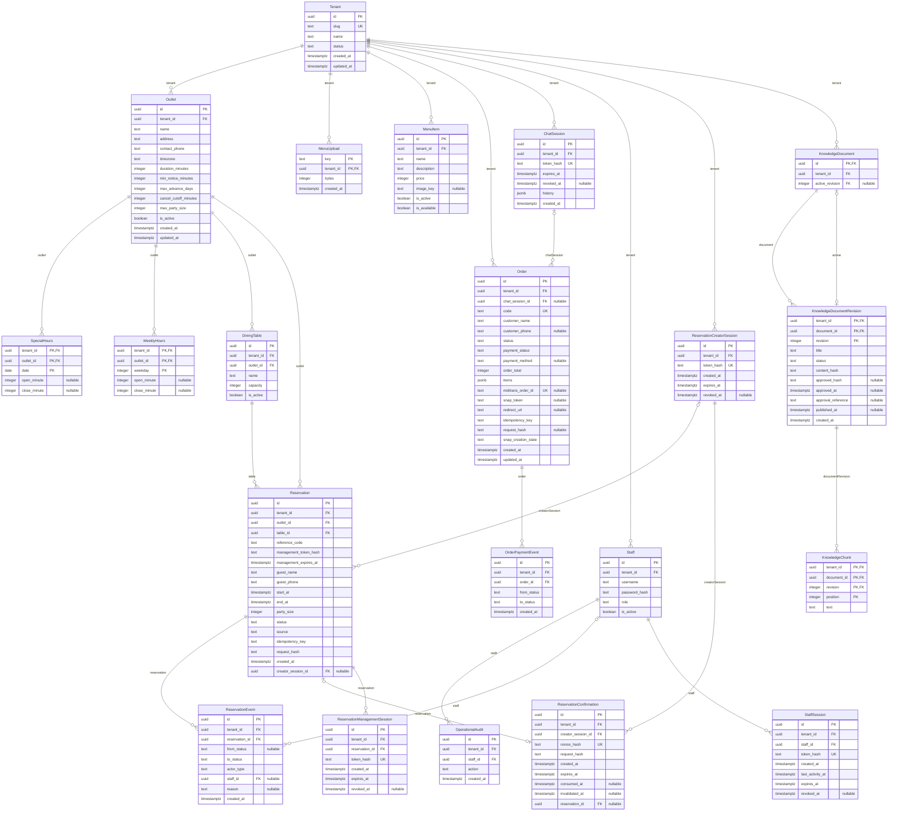
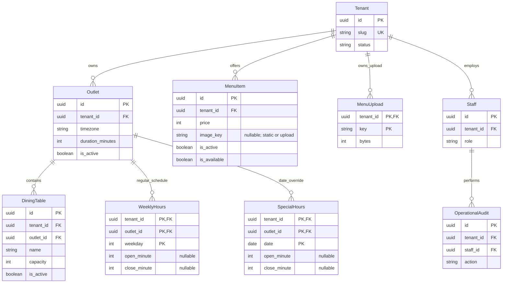
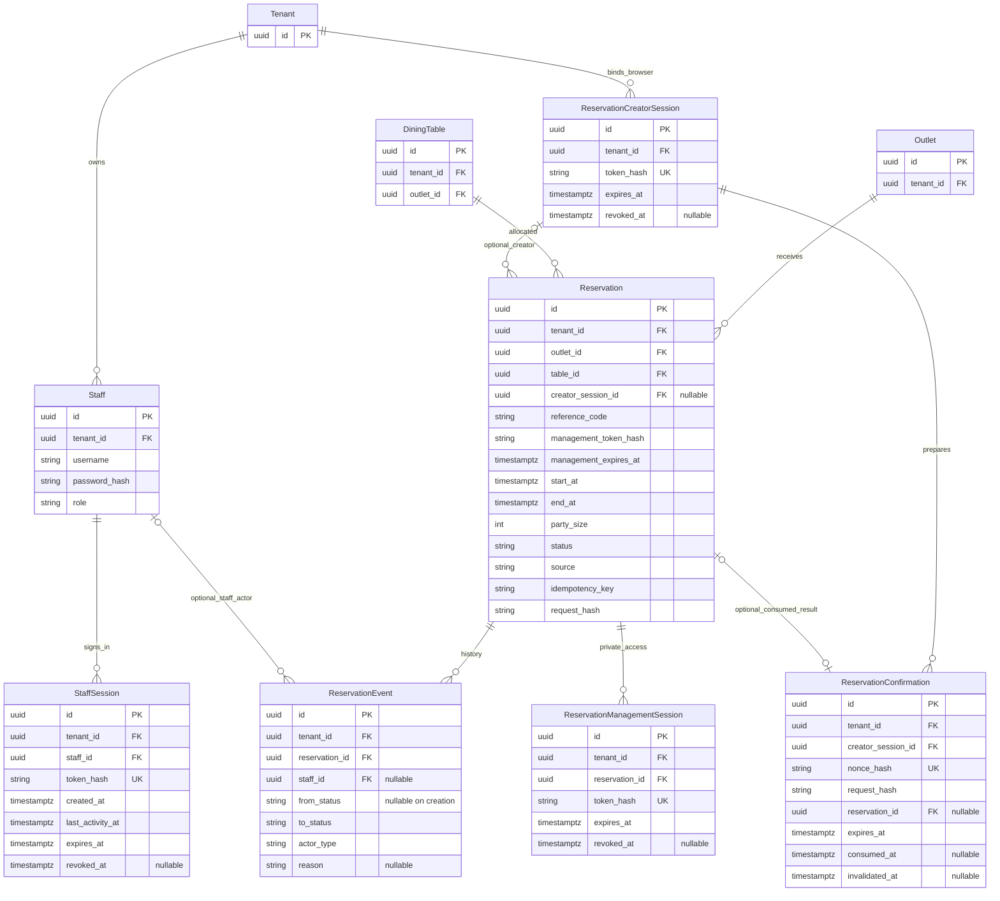
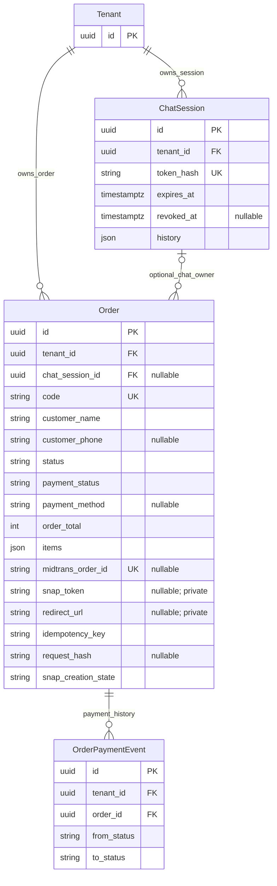
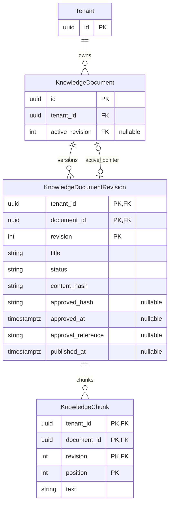

# ERD Database

## 1. Cakupan dan notasi

ERD ini berasal dari [schema.prisma](../apps/api/prisma/schema.prisma) dan [migrasi SQL](../apps/api/prisma/migrations), pada baseline commit `a684fb2dfb851ba0fd9daf68685c111768a151fa`. Terdapat **21 model Prisma = 21 tabel aplikasi**; tabel metadata migrasi Prisma tidak dihitung. Tersedia satu diagram gabungan seluruh tabel/kolom dan empat diagram kelompok supaya mudah dibaca. Entitas yang muncul kembali pada diagram lain adalah tabel yang sama, bukan tabel tambahan.

Hubungan proses ada pada [Alur Sistem](Alur%20Sistem.md); topologi layanan ada pada [Arsitektur Sistem](Arsitektur%20Sistem.md).

- `||`: tepat satu; `o|`: nol atau satu; `o{`: nol atau banyak. Parent boleh belum memiliki anak.
- `PK`: primary key; `UK`: unique key; `FK`: foreign key. Untuk kunci komposit, daftar kolom pada tabel penjelasan adalah definisi yang menentukan; penanda pada satu kolom diagram bukan berarti kolom itu unik sendiri.
- `nullable` ditulis pada komentar atribut yang opsional. Null pada bagian FK komposit membuat hubungan tersebut opsional; kolom tenant yang tetap NOT NULL tidak membuat seluruh FK menjadi wajib.
- Diagram gabungan menampilkan seluruh kolom tersimpan. Diagram per kelompok menampilkan kunci dan atribut inti; tabel inventaris mencakup **semua** model.
- Nama entitas Mermaid menggunakan nama model Prisma; nama tabel SQL tercantum pada inventaris.
- Diagram belum dirender dalam pemeriksaan ini; renderer Mermaid lokal belum ditemukan dan tidak dipasang.

## 2. Inventaris seluruh model

| Model Prisma | Tabel SQL | Kunci utama dan unique penting | Peran |
| --- | --- | --- | --- |
| `Tenant` | `tenants` | PK `id`; UQ `slug` | Batas tenant aktif/inaktif |
| `Outlet` | `outlets` | PK `id`; UQ `(tenant_id,id)` | Profil lokasi dan kebijakan reservasi |
| `SpecialHours` | `special_hours` | PK `(tenant_id,outlet_id,date)` | Override jam per tanggal |
| `OperationalAudit` | `operational_audits` | PK `id` | Audit tindakan operasional staff |
| `WeeklyHours` | `weekly_hours` | PK `(tenant_id,outlet_id,weekday)` | Jam reguler; weekday 0–6 |
| `DiningTable` | `dining_tables` | PK `id`; UQ `(tenant_id,outlet_id,id)` dan `(tenant_id,outlet_id,name)` | Meja, kapasitas dan aktif/tidak |
| `MenuUpload` | `menu_uploads` | PK `(tenant_id,key)` | Kepemilikan/ukuran file foto upload |
| `MenuItem` | `menu_items` | PK `id`; UQ `(tenant_id,id)` | Harga, deskripsi, availability dan referensi foto |
| `Order` | `orders` | PK `id`; UQ `code`, `midtrans_order_id` nullable, `(tenant_id,id)`, `(tenant_id,idempotency_key)` | Snapshot pesanan dan intent Snap |
| `OrderPaymentEvent` | `order_payment_events` | PK `id` | Audit perubahan payment status |
| `ChatSession` | `chat_sessions` | PK `id`; UQ `token_hash`, `(tenant_id,id)` | Sesi customer terikat tenant, history terbatas |
| `Staff` | `staff` | PK `id`; UQ `(tenant_id,id)`, `(tenant_id,username)` | Akun owner/staff |
| `Reservation` | `reservations` | PK `id`; UQ `(tenant_id,id)`, `(tenant_id,reference_code)`, `(tenant_id,idempotency_key)`, `(tenant_id,creator_session_id,id)` | Satu meja, satu interval booking |
| `ReservationEvent` | `reservation_events` | PK `id` | Audit create/transisi reservasi |
| `ReservationCreatorSession` | `reservation_creator_sessions` | PK `id`; UQ `token_hash`, `(tenant_id,id)` | Bukti akses browser pembuat |
| `ReservationConfirmation` | `reservation_confirmations` | PK `id`; UQ `nonce_hash`, `(tenant_id,creator_session_id,reservation_id)` | Nonce ringkasan dan konsumsi atomic |
| `ReservationManagementSession` | `reservation_management_sessions` | PK `id`; UQ `token_hash` | Akses privat untuk satu reservasi |
| `KnowledgeDocument` | `knowledge_documents` | PK `id`; UQ `(tenant_id,id)` | Identitas dokumen dan pointer revision aktif |
| `KnowledgeDocumentRevision` | `knowledge_document_revisions` | PK `(tenant_id,document_id,revision)`; partial UQ satu published per dokumen | Konten/review/publikasi revision |
| `KnowledgeChunk` | `knowledge_chunks` | PK `(tenant_id,document_id,revision,position)` | Potongan teks retrieval |
| `StaffSession` | `staff_sessions` | PK `id`; UQ `token_hash` | Sesi staff, idle dan batas absolut |

Tidak ada tabel customer/account customer, cart, invoice, embedding, reservation proposal terpisah, atau line-item order terpisah dalam schema ini. `Order.items` adalah JSON snapshot, bukan relasi many-to-many ke menu. `ReservationConfirmation` adalah bukti konfirmasi form privat, bukan hasil persetujuan model.

## Diagram menyeluruh: seluruh tabel dan kolom

Diagram gabungan berikut memuat **21 tabel dan 168 kolom tersimpan** dari schema Prisma, termasuk timestamp, hash sesi, dan payload JSON. Nama entitas menggunakan model Prisma, sedangkan atribut memakai nama kolom SQL. Ini definisi struktur saja, bukan nilai data atau credential. Field relasi virtual Prisma tidak dihitung sebagai kolom.

Penanda UK pada atribut hanya menunjukkan unique satu kolom. Unique komposit, partial unique, CHECK, trigger dan exclusion constraint tetap dijelaskan pada inventaris serta bagian constraint; Mermaid tidak mengekspresikan seluruh aturan SQL tersebut.

`MenuItem.image_key` tidak digambar sebagai FK ke `MenuUpload`: key dapat menunjuk aset statis atau upload. Untuk upload, service dan trigger memeriksa pasangan tenant/key. `Order.items` dan `ChatSession.history` adalah JSON, bukan tabel atau relasi tambahan. Garis FK bertumpuk pada key komposit tetap mewakili satu relasi, bukan beberapa relasi per kolom.

Diagram besar ini cocok untuk melihat keseluruhan struktur; gunakan diagram per modul di bawah untuk membaca detail tanpa memperkecil seluruh gambar.

## 3. Operasional, menu dan foto

### Relasi dan aturan operasional

| Anak | Kolom FK → parent | Kardinalitas / catatan |
| --- | --- | --- |
| `Outlet` | `tenant_id` → `Tenant.id` | Setiap outlet tepat satu tenant |
| `Staff`, `MenuItem`, `MenuUpload` | `tenant_id` → `Tenant.id` | Tiap row tepat satu tenant; menu berada pada tenant, bukan FK outlet |
| `DiningTable`, `WeeklyHours`, `SpecialHours` | `(tenant_id,outlet_id)` → `Outlet.(tenant_id,id)` | Parent wajib dan tenant harus cocok |
| `OperationalAudit` | `(tenant_id,staff_id)` → `Staff.(tenant_id,id)` | Staff wajib; tidak ada FK audit ke setiap objek yang diubah |

Jam buka/tutup harus keduanya null atau keduanya terisi dengan `0 <= open_minute < close_minute <= 1440`. Dua nilai null pada row berarti tutup; row yang tidak ada berarti belum dikonfigurasi. `SpecialHours` menggantikan jadwal mingguan pada tanggal itu. Kapasitas meja dibatasi 1–12, harga menu integer Rupiah 0–100.000.000.

### Hubungan foto bukan FK biasa

`MenuItem.image_key` memiliki tiga kemungkinan:

1. Null: belum memiliki foto.
2. Key foto statis: divalidasi terhadap sembilan entri [menu-images.ts](../apps/api/src/menu/menu-images.ts), berkas berada pada [public/images](../apps/web/public/images). Tidak memiliki row `MenuUpload`.
3. Key upload: mengikuti pola `upload-` + 48 karakter heksadesimal + `.webp`; pemilik/ukuran ada pada `MenuUpload`, isi berkas ada pada storage volume.

Untuk key upload, hubungan logisnya adalah satu `MenuUpload` dapat dipakai nol atau banyak menu, sementara satu menu memiliki nol atau satu upload. Hubungan ini **sengaja tidak digambar sebagai FK deklaratif**. Trigger `menu_upload_reference` memeriksa `(tenant_id,image_key)` terhadap `(tenant_id,key)` saat INSERT atau UPDATE `image_key/tenant_id` pada menu. Tenant lain tidak boleh menautkan foto upload tersebut. Trigger tidak membuat semua key statis wajib ada di tabel upload, dan tidak memberi jaminan delete-reference penuh seperti FK.

Sumber: [migrasi menu upload](../apps/api/prisma/migrations/20261111210000_menu_uploads/migration.sql), [menu.service.ts](../apps/api/src/menu/menu.service.ts), [menu-image-storage.ts](../apps/api/src/menu/menu-image-storage.ts). Transaksi filesystem dan DB terpisah; file yatim bisa terjadi bila save metadata gagal.

## 4. Auth staff dan reservasi privat

### FK komposit dan hubungan opsional

| Anak | FK → parent | Wajib / opsional |
| --- | --- | --- |
| `StaffSession` | `(tenant_id,staff_id)` → `Staff.(tenant_id,id)` | Wajib; sesi tidak bisa memakai staff tenant lain |
| `ReservationCreatorSession` | `tenant_id` → `Tenant.id` | Wajib |
| `Reservation` | `(tenant_id,outlet_id)` → `Outlet.(tenant_id,id)` | Wajib |
| `Reservation` | `(tenant_id,outlet_id,table_id)` → `DiningTable.(tenant_id,outlet_id,id)` | Wajib; mengikat meja **dan outlet** pada tenant yang sama |
| `Reservation` | `(tenant_id,creator_session_id)` → `ReservationCreatorSession.(tenant_id,id)` | Opsional karena `creator_session_id` nullable; create customer saat ini mengisinya |
| `ReservationConfirmation` | `(tenant_id,creator_session_id)` → `ReservationCreatorSession.(tenant_id,id)` | Wajib |
| `ReservationConfirmation` | `(tenant_id,creator_session_id,reservation_id)` → `Reservation.(tenant_id,creator_session_id,id)` | Opsional sampai dikonsumsi; hasil wajib milik pembuat dan tenant sama |
| `ReservationManagementSession`, `ReservationEvent` | `(tenant_id,reservation_id)` → `Reservation.(tenant_id,id)` | Wajib; satu management session hanya untuk satu reservasi |
| `ReservationEvent` | `(tenant_id,staff_id)` → `Staff.(tenant_id,id)` | Opsional; wajib terisi hanya bila `actor_type=staff` |

Unique `(tenant_id,creator_session_id,reservation_id)` membuat satu reservasi paling banyak satu confirmation terhubung. Sebelum konsumsi, banyak confirmation boleh memiliki `reservation_id` null; unique nullable bukan berarti hanya satu draft per pembuat. Aplikasi menginvalidasi confirmation lama yang belum terpakai ketika menyiapkan ringkasan baru.

`Reservation` menyimpan nama/telepon tamu privat, tetapi tidak membuat entitas Customer bersama. `management_token_hash` tetap kolom wajib pada reservasi; jalur akses customer saat ini memakai tabel `ReservationManagementSession`, bukan mengembalikan token legacy tersebut atau menganggap kode referensi sebagai credential.

### Constraint yang tidak cukup terlihat pada Prisma

- [Migrasi reservasi](../apps/api/prisma/migrations/20261102090000_reservations/migration.sql) mengaktifkan `btree_gist` dan exclusion constraint `reservations_confirmed_no_overlap`: kombinasi `tenant_id`, `table_id` dan `tstzrange(start_at,end_at,'[)')` tidak boleh overlap saat `status=confirmed`. Akhir booking boleh sama dengan awal booking berikutnya.
- Interval reservasi wajib finite dan tepat 90 menit; `management_expires_at` harus sesudah `end_at` dan paling lambat 24 jam sesudahnya. Aplikasi saat create menetapkannya tepat `end_at + 24 jam`.
- Status reservasi tersimpan: `confirmed`, `cancelled`, `completed`, `no_show`. Event awal dari null ke confirmed; setelah itu hanya confirmed ke salah satu status terminal.
- Event aktor staff wajib `staff_id`; customer/system wajib null. Pembatalan staff wajib alasan. Tidak ada bypass overlap khusus role staff.
- [Migrasi confirmation](../apps/api/prisma/migrations/20261104100000_reservation_confirmation/migration.sql) memastikan konsumsi nonce memiliki hasil reservasi, waktu konsumsi sebelum expiry, dan tidak invalidated. Belum dikonsumsi berarti `reservation_id` juga null.
- FK pada kelompok ini memakai `ON DELETE RESTRICT`; histori tidak hilang otomatis dengan penghapusan parent.
- [Migrasi idle staff](../apps/api/prisma/migrations/20261111220000_staff_idle_sessions/migration.sql) menambah `last_activity_at` dan mencabut sesi lama. Idle 30 menit dan absolut delapan jam ditegakkan kebijakan aplikasi, bukan enum atau trigger lifetime di schema.

## 5. Chat, pesanan dan pembayaran

| Anak | FK → parent | Makna |
| --- | --- | --- |
| `ChatSession`, `Order` | `tenant_id` → `Tenant.id` | Wajib |
| `Order` | `(tenant_id,chat_session_id)` → `ChatSession.(tenant_id,id)` | Opsional di schema; route create aktif selalu mengikat sesi customer aktif |
| `OrderPaymentEvent` | `(tenant_id,order_id)` → `Order.(tenant_id,id)` | Wajib, tenant cocok; `ON DELETE RESTRICT` |

Nullable di schema bukan izin membuat order anonim lewat endpoint. Controller menentukan tenant dan chat owner dari hash cookie server, bukan body. `request_hash` nullable mendukung row lama; request baru menyimpannya untuk pemeriksaan replay. `customer_phone` ada pada schema, tetapi kontrak create aktif hanya menerima nama, item/jumlah dan idempotency key; jangan mengasumsikan form pembayaran mengumpulkan telepon.

`items` berisi snapshot ID/nama/harga/jumlah saat create. Tidak ada FK JSON ke `MenuItem`; harga/total dihitung dari menu tenant yang aktif dan tersedia sebelum intent tersimpan. Satu order punya nol atau banyak payment event; create intent tidak otomatis berarti ada event pembayaran.

Nilai tersimpan berdasarkan [migrasi order](../apps/api/prisma/migrations/20261111150000_orders/migration.sql) dan [migrasi intent](../apps/api/prisma/migrations/20261111190000_order_payment_intents/migration.sql):

| Kolom | Nilai SQL yang diizinkan | Jalur aktif |
| --- | --- | --- |
| `status` | `pending`, `confirmed`, `cancelled` | Create pending; settlement menjadi confirmed; kegagalan payment tidak otomatis menetapkan cancelled |
| `payment_status` | `unpaid`, `pending`, `settlement`, `expire`, `cancel`, `deny` | Create aktif pending; `failure` provider dipetakan ke `deny`, bukan disimpan sebagai failure |
| `snap_creation_state` | `creating`, `ready`, `unknown` | Creating disimpan sebelum HTTP; ready setelah token/URL tervalidasi tersimpan; outcome tidak pasti menjadi unknown |

Filter baca staff menerima label `failure` juga pada kode service, tetapi SQL tidak menyediakan nilai payment_status itu dan notifikasi memetakannya ke `deny`. Jangan menggambar state database `paid`, `expired`, `failed` atau `captured`: itu bukan kosakata tersimpan. Event payment menyimpan from/to sebagai text; aturan transisi/monotonik dijaga controller transaksi, bukan CHECK enum event SQL.

Sumber perilaku: [orders.controller.ts](../apps/api/src/restaurant/orders.controller.ts), [staff-orders.service.ts](../apps/api/src/restaurant/staff-orders.service.ts). Token Snap dan redirect URL hanya untuk UI privat pemilik order; DTO staff tidak mengembalikannya dan history chat bukan tempat penyimpanannya.

## 6. Pengetahuan dan revision aktif

Ada **dua relasi berbeda** antara dokumen dan revision:

- Kepemilikan: revision wajib menunjuk `(tenant_id,document_id)` ke dokumen `(tenant_id,id)`. Dokumen boleh mempunyai nol atau banyak revision.
- Pointer aktif: dokumen memiliki nol atau satu `active_revision`, merujuk `(tenant_id,id,active_revision)` ke revision `(tenant_id,document_id,revision)`. Satu revision dapat menjadi aktif untuk nol atau satu dokumen yang sama; tidak dapat dipinjam dokumen/tenant lain. Karena pointer nullable, draft tanpa revision aktif tetap sah.

Chunk wajib menunjuk revision dengan FK tiga kolom `(tenant_id,document_id,revision)`. Posisi chunk 0–99 dan teks 1–2.000 karakter. Tidak ada kolom vector/embedding dalam ketiga tabel ini.

[Migrasi knowledge](../apps/api/prisma/migrations/20261106100000_knowledge_documents/migration.sql) menambah aturan yang penting untuk pembacaan ERD:

- FK pointer aktif bersifat `DEFERRABLE INITIALLY DEFERRED`, `ON DELETE NO ACTION ON UPDATE NO ACTION`. Aplikasi dapat mengganti publikasi/pointer dalam satu transaksi, lalu harus konsisten saat commit. FK kepemilikan revision/chunk tetap restrict.
- Partial unique index membatasi satu revision `published` per `(tenant_id,document_id)`.
- Approval metadata wajib konsisten; `approved_hash` harus sama dengan `content_hash`; published wajib approved dan memiliki published time yang valid.
- Trigger melarang perubahan identitas/konten/approval revision yang telah approved serta mutasi chunk yang telah approved. Edit chunk dikunci terhadap parent revision agar tidak balapan dengan approval.
- Deferred constraint trigger memastikan pointer aktif menunjuk revision approved/published dan setiap revision published cocok dengan pointer aktif. Draft/unpublished tidak boleh bocor hanya karena punya chunk.

[knowledge.repository.ts](../apps/api/src/restaurant/knowledge.repository.ts) hanya membaca revision aktif, lalu [knowledge-search.ts](../apps/api/src/restaurant/knowledge-search.ts) menyaring tenant sebelum ranking dan mensyaratkan published/current. Foreign key menjaga hubungan data; filter query tetap diperlukan untuk otorisasi dan retrieval.

## 7. Ringkasan integritas lintas kelompok

| Invariant | Perlindungan database | Pemeriksaan aplikasi tambahan |
| --- | --- | --- |
| Resource tenant sama | FK komposit pada outlet/meja/sesi/event/revision | Tenant dari server, filter query dan role |
| Meja tidak double-booked | Exclusion GiST untuk confirmed | Availability ulang dalam transaksi dan advisory lock tenant |
| Konfirmasi tidak berpindah pembuat | FK confirmation tiga kolom dan unique hasil | Hash payload/nonce, expiry, invalidation dan konsumsi satu transaksi |
| Retry tidak membuat duplikat | Unique `(tenant_id,idempotency_key)` | Hash payload dan pemeriksaan owner sesi |
| Foto upload tidak dipinjam tenant lain | Trigger INSERT/UPDATE referensi upload | Validasi registry/key/ownership serta izin baca file |
| Dokumen aktif konsisten | Deferred FK, partial unique index, trigger publikasi/immutability | Proses approval/publish dan lexical retrieval scoped |
| Audit konsisten dengan status | FK event ke parent | Update status dan insert event dalam satu transaksi; rollback bersama |

ERD ini bukan hasil introspeksi database berjalan. Seluruh 21 model dan migrasi SQL dibaca dari repository; apakah semua migrasi telah diterapkan pada suatu environment harus dibuktikan terpisah. Tidak ada nilai credential, token akses, atau contoh data privat dalam diagram.
