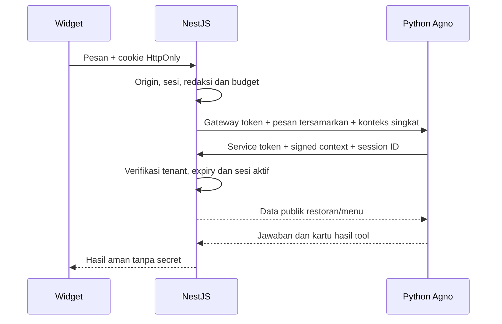

# Konfigurasi Komunikasi Internal

## Tujuan

Tiga secret mengamankan komunikasi antarlayanan lokal; bukan password login customer/staff dan bukan API key OpenRouter. Tidak memerlukan akun provider atau biaya.

| Variabel | Pemakaian | Lokasi |
| --- | --- | --- |
| ASSISTANT_GATEWAY_TOKEN | Python memverifikasi request turn dari API | API dan assistant, nilai sama |
| INTERNAL_TOOL_SERVICE_TOKEN | API memverifikasi pemanggil tools read-only | API dan assistant, nilai sama |
| INTERNAL_CONTEXT_SECRET | API menandatangani tenant/sesi/expiry | API saja |

Ketiga nilai berbeda satu sama lain. Service token saja tidak memberikan akses semua tenant: signature dan sesi aktif tetap diperiksa.



## Cara membuat

Prasyarat: apps/api/.env dan apps/assistant/.env sudah dibuat privat dan diabaikan Git. Jangan mengisi secret di source, terminal argument atau chat.

Dari root proyek:

```sh
rtk proxy node scripts/provision_internal_secrets.cjs
rtk proxy node scripts/provision_internal_secrets.cjs --check
```

Script memakai randomBytes(32) Node.js dan encoding base64url. Secret tidak dicetak. Script:

1. Memastikan kedua file diabaikan Git dan sudah ada.
2. Memeriksa variabel kosong/duplikat, format dan kecocokan shared secret.
3. Memakai kembali nilai yang sudah valid; tidak merotasi otomatis.
4. Menghasilkan nilai acak bila belum ada, lalu menambahkan hanya variabel yang hilang.
5. Mempertahankan konfigurasi lain, termasuk DATABASE_URL dan konfigurasi model.

Jika salah satu file sudah memiliki shared secret, file satunya mendapat nilai sama. Jika nilainya berbeda, script berhenti sebelum menulis. Kedua file divalidasi sebelum write; write lintas file bukan transaksi filesystem. Jika proses terputus setelah satu write, menjalankan ulang akan melengkapi dari nilai yang sudah tersimpan, bukan menggantinya.

File ditulis dengan mode 0600; pada Windows mode tersebut tidak menjamin ACL. Simpan pada akun OS privat, periksa izin file, jangan bagikan workspace kepada akun tidak tepercaya. Script hanya untuk lokal, bukan mekanisme rotasi/secret manager produksi.

## Restart layanan

Hentikan proses BE dan assistant milik sendiri dengan Ctrl+C. Jangan membunuh proses yang tidak dikenal. Kompilasi API sebelum mulai:

```sh
rtk proxy node node_modules/typescript/bin/tsc --project apps/api/tsconfig.json
rtk proxy node apps/api/dist/main.js
```

Terminal Python terpisah:

```sh
rtk proxy uv run --project apps/assistant --locked python apps/assistant/conversation_server.py
```

API membaca apps/api/.env melalui loader DB yang sudah ada; assistant memuat apps/assistant/.env pada startup. Environment proses memiliki prioritas. Jika terminal mewarisi nilai lama, pemeriksaan file saja tidak menjamin proses memakai nilai sama; mulai terminal bersih atau tinjau environment secara privat tanpa mencetak secret.

## Verifikasi aman

```sh
rtk proxy node scripts/provision_internal_secrets.cjs --check
rtk proxy curl --fail http://127.0.0.1:8001/health
```

Check memvalidasi file, bukan proses yang sedang berjalan. Health HTTP 200 hanya liveness; model_ready=false saat ini nilai tetap, bukan pemeriksaan API key/model. Provisioning dan health tidak memakai kuota inference. Smoke test model gratis tetap memerlukan persetujuan tersendiri dan data sintetis.

## Jika gagal

- File privat belum ada/tidak diabaikan Git: perbaiki penempatan dan ignore dahulu; jangan commit file.
- Variabel kosong atau duplikat: tinjau melalui editor privat; jangan paste isinya.
- Shared secret berbeda: tentukan nilai yang sah secara privat; rotasi memerlukan keputusan terpisah, jangan overwrite otomatis.
- Login/chat mendapat unavailable: pastikan DB, API, assistant berjalan dan sudah restart; secret yang terprovision tidak membuktikan provider tersedia.

Jangan mencetak isi .env, memakai perintah echo secret, mengambil screenshot nilai, atau memasukkan credential ke URL/prompt model.
