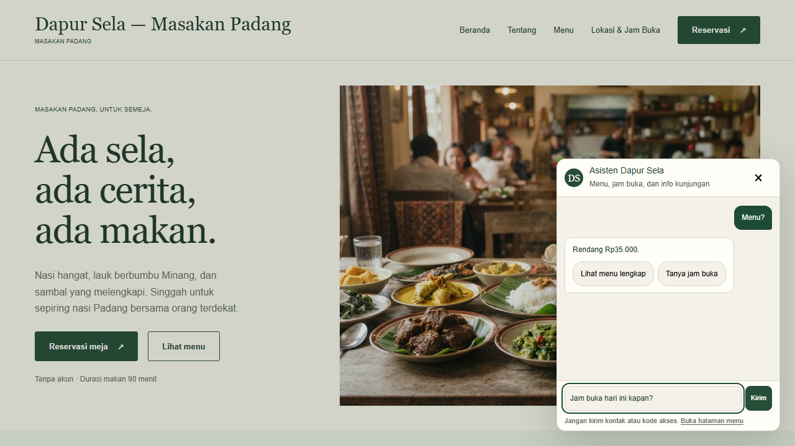
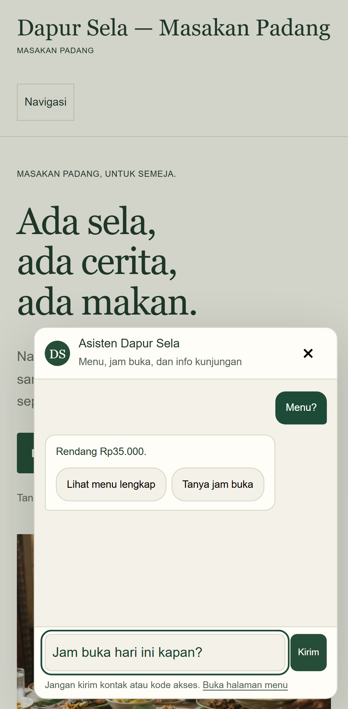
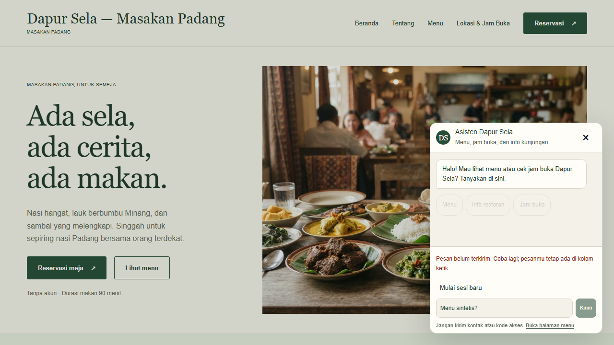
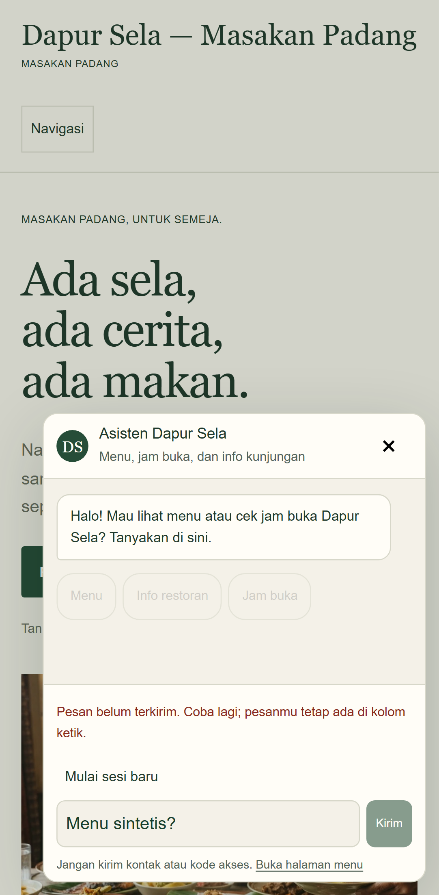
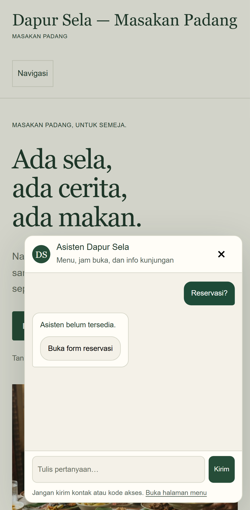

# Pengujian chatbot lokal

## Batas hasil

Pemeriksaan ini membedakan browser dengan respons API stub, integrasi service dengan PostgreSQL nyata, dan inference provider live. Kelulusan stub tidak membuktikan model OpenRouter tersedia, kualitas Bahasa Indonesia, ketahanan semua prompt injection, atau kesiapan produksi.

Gateway FastAPI di `agno-v2` memakai core percakapan bounded dari `apps/assistant`. Keduanya harus tersedia dalam checkout/artifact. Production agent membaca informasi restoran, menu, FAQ, dan availability tanpa menahan meja; konfirmasi reservasi tetap memakai form privat.

## Prasyarat

- Node.js 22, dependency JavaScript sesuai lockfile, Python 3.12 dan uv.
- Chromium Playwright sudah terpasang.
- PostgreSQL Docker lokal sehat pada `127.0.0.1:55432`, database `restaurant`.
- Konfigurasi privat API dan komunikasi internal sudah tersedia; jangan mencetak file environment, cookie atau token.
- Untuk integration browser: panduan website tenant `demo-padang` sudah published. Test tidak menerbitkan dokumen otomatis.
- Port 3100 untuk Playwright; port 3110, 3111 dan 8111 untuk integration browser harus kosong. Jangan menghentikan proses lain untuk membebaskan port.

## Build dan pemeriksaan statis

Dari root workspace:

```sh
rtk proxy pnpm --filter @restaurant/api build
rtk proxy pnpm --filter @restaurant/web build
rtk proxy pnpm typecheck
rtk proxy git diff --check
```

Build web dan development server dapat menghasilkan ulang `apps/web/next-env.d.ts` serta mengubah konfigurasi TypeScript. Catat baseline sebelum menjalankan; pertahankan perubahan lokal yang sudah ada, jangan memakai reset/restore massal.

## Suite browser desktop dan mobile

```sh
rtk proxy node node_modules/@playwright/test/cli.js test apps/web/e2e/chatbot.spec.ts apps/web/e2e/knowledge.spec.ts apps/web/e2e/reservation.spec.ts
```

Konfigurasi menjalankan production web server pada port 3100, satu worker, tanpa retry, trace atau video. Screenshot nonaktif secara default; pengambilan bukti opt-in melalui `BROWSER_SCREENSHOT_DIR`. Desktop Chrome dan emulasi Pixel 7 dipakai. Respons chat/reservasi pada suite ini dicegat pada boundary browser; tidak ada transaksi reservasi DB atau model live.

Cakupan:

- Membuka widget dengan keyboard, menutup memakai Escape, mengembalikan fokus.
- Action navigasi lokal dan prompt aman; action eksternal/tulis tidak dirender.
- Input dan tombol kirim nonaktif selama request berjalan.
- Sesi kedaluwarsa mempertahankan draft; sesi baru memulihkan kemampuan kirim.
- Lebar dialog dan halaman tidak melampaui viewport yang diuji.
- FAQ beserta revision terlihat; teks script tidak dieksekusi.
- Gangguan AI tetap menyediakan navigasi ke form dan alur konfirmasi privat.
- Buat, refresh, batal, logout, koreksi, konflik meja, serta recovery respons commit hilang menggunakan boundary stub.

Emulasi mobile bukan pengujian perangkat fisik atau audit aksesibilitas lengkap.

## Browser sampai PostgreSQL

```sh
rtk proxy node --test apps/api/test/knowledge-browser.integration.cjs
```

Alur aktual: Chromium → Next.js proxy → NestJS → FastAPI `agno-v2` → internal API NestJS → PostgreSQL lokal. Hanya boundary HTTP model diganti respons deterministik oleh `agno-v2/browser_fixture.py`.

Test memeriksa FAQ published/revision, sumber kosong tanpa inference, menu dari internal API, jam buka hari ini, serta arahan ke form reservasi. Metadata dokumen dibandingkan sebelum/sesudah untuk memastikan tidak ada perubahan publikasi. Secret komunikasi dibuat sementara di environment proses; nilainya tidak dicetak. Service yang dibuat test dihentikan setelah selesai. Snapshot konfigurasi web dipulihkan setelah shutdown.

Fixture adalah alat uji, bukan entrypoint deployment. Jangan menjalankan fixture untuk customer atau mengeksposnya ke jaringan publik.

## Hasil aktual lokal

| Pemeriksaan | Hasil |
| --- | --- |
| Prisma generate dan kompilasi API | Lulus |
| Production build web | Lulus |
| Typecheck web setelah browser integration | Lulus |
| Browser desktop dan mobile | 36 tes lulus |
| Browser melalui FastAPI, internal API dan PostgreSQL | 1 tes lulus, termasuk FAQ/menu/jam/arahan reservasi |
| Pemeriksaan whitespace diff | Lulus; Git memberi peringatan normalisasi LF/CRLF pada file Python |

Satu percobaan awal suite browser berhenti karena salah kurung pada file test baru; diperbaiki, lalu seluruh 36 tes lulus. Tidak ada hasil gagal yang dihapus dari perhitungan kelulusan provider: provider live memang tidak dipanggil.

## Bukti pengujian browser

Screenshot berikut diambil dari browser Chromium saat suite dijalankan ulang. Seluruh respons chat dan reservasi pada gambar memakai **boundary stub dan data sintetis**, bukan inference OpenRouter live atau bukti transaksi DB. Screenshot hanya menunjukkan state UI; assertion otomatis dan output runner membuktikan pemeriksaan perilakunya.

[Output terminal lengkap pengujian ulang](evidence/chatbot-browser-output.txt) mencatat `36 passed (1.1m)` tanpa retry. Output ini hanya untuk suite browser, bukan build atau integration PostgreSQL.

### Action aman

Prompt jam buka mengisi composer; tombol navigasi tetap lokal. Action eksternal dan write tidak dirender. Pengujian juga memeriksa fokus serta lebar viewport.





### Sesi kedaluwarsa

Respons stub `403` memunculkan tindakan mulai sesi baru dan mempertahankan draft sebelum pemulihan.





### Gangguan AI dan jalur form

Respons gangguan disimulasikan tanpa provider. Tombol membuka form reservasi; suite melanjutkan konfirmasi menggunakan API reservasi stub. Tidak ada booking PostgreSQL dibuat pada skenario ini.




### Mengambil ulang screenshot

Set `BROWSER_SCREENSHOT_DIR` melalui environment proses ke direktori bukti yang dipilih, lalu jalankan command suite browser di atas. Test mengambil screenshot viewport setelah assertion state UI berhasil. Pilih direktori baru bila bukti lama perlu dipertahankan. Screenshot tidak merekam DevTools, cookie, token, atau konfigurasi privat; gunakan data sintetis saja.

## Menjalankan layanan normal

Pada terminal terpisah dari root:

```sh
rtk proxy pnpm dev:api
rtk proxy pnpm dev:web
rtk proxy uv run --project agno-v2 --locked uvicorn app.main:app --app-dir agno-v2 --host 127.0.0.1 --port 8010 --no-access-log
```

Pastikan `ASSISTANT_ORIGIN` API memilih `http://127.0.0.1:8010`. Service auth gateway dan internal tools harus cocok melalui konfigurasi privat; context ditandatangani NestJS. Jangan menyalin credential ke terminal, URL, browser, dokumentasi atau bahan review. Health hanya liveness, bukan bukti model siap.

Jika rollback diperlukan, arahkan origin ke server lama pada port 8001 melalui konfigurasi privat dan restart API. Jangan menjalankan migrasi data atau menghapus core. Rollback perlu diuji tersendiri; hasil suite ini bukan rehearsal rollback.

## Pemeriksaan yang masih terpisah

- Pengujian OpenRouter live dilakukan terpisah dengan tools sintetis: [hasil dan bukti smoke live](Smoke%20Chatbot%20Live.md). Lima skenario uji ulang lulus dengan lima inference request HTTP 200; ini bukan browser dengan model live dan DB nyata sekaligus. Eksekusi berikutnya tetap memerlukan persetujuan dan batas kuota; tidak ada paid fallback.
- Shadow comparison runtime dan rehearsal rollback belum dijalankan.
- Browser dengan reservasi DB nyata, konkurensi dan constraint transaksi bukan bagian suite boundary stub ini.
- Perangkat mobile fisik, screen reader, serta audit aksesibilitas menyeluruh belum diuji.
- Grounding masih pemeriksaan bounded/heuristik, bukan pembuktian semantik semua klaim.

## Referensi

- [Playwright Browser API](https://playwright.dev/docs/api/class-browser)
- [Playwright test configuration](https://playwright.dev/docs/test-configuration)
