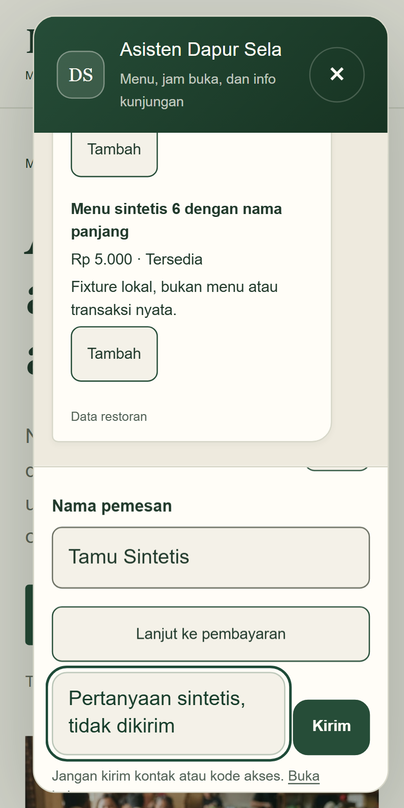

# Perbaikan Chatbot Setelah Revisi Mentor

## Tujuan dan tampilan yang dipertahankan

Revisi mentor meminta chat mobile lebih ringkas. Screenshot lama dari pengguna menunjukkan draft pesanan terlalu besar; tampilan lama bukan target untuk dikembalikan.

Perbaikan mempertahankan panel compact, header, kartu menu, percakapan yang dapat digulir, footer dengan batas tinggi 42% dan gulir internal, composer yang menyesuaikan tinggi, serta tombol **Lanjut ke pembayaran**. Draft panjang tidak dipindahkan kembali menjadi panel besar. Hanya batas minimum tinggi tombol Tambah, Hapus/Kurangi dan Tutup chat yang diselaraskan menjadi 44px agar tetap mudah disentuh.

## Perubahan

### Instalasi reproducible

`pnpm-lock.yaml` kembali memuat metadata package manager `pnpm@12.15.0` dan satu dokumen dependensi aplikasi. Separator dokumen kosong yang berlebih dihapus. Perbaikan format awal tidak mengubah versi dependensi; patch keamanan berikutnya mengubah pin `next` dari **16.4.3 menjadi 16.4.5** pada manifest web dan lockfile.

Selisih lockfile terhadap baseline sebelum upgrade terbatas pada `next`, `@next/env` dan delapan paket platform `@next/swc` versi 16.4.5, termasuk metadata libc paket SWC Linux. Preamble pnpm 12.15.0 tetap sama. React dan React DOM tetap 19.3.1; TypeScript, NestJS, Prisma, sharp dan dependensi Python tidak diubah. Metadata npm resmi menyatakan Node >=20.9.0 serta peer React/React DOM ^19.0.0 kompatibel; pemeriksaan lokal memakai Node 22.22.0.

Advisory resmi Next.js yang dibaca pada 18 November 2026 mencantumkan patch 16.4.5 untuk tujuh advisory terbaru yang memengaruhi 16.4.3. Upgrade sempit ini bukan audit seluruh dependency tree atau jaminan bebas kerentanan. Pemeriksaan keamanan Next.js tetap aktif; tidak ada bypass, perubahan heap atau worker.

Tes `apps/api/test/workspace-lock.test.cjs` memeriksa pin versi pnpm, metadata dan jumlah dokumen. Jangan menghapus preamble metadata untuk memperbaiki instalasi; frozen install aktual memakai pnpm 12.15.0 berhasil setelah upgrade.

### Pesanan dan mobile

Selector positif maupun negatif pada tes pesanan memakai label aktual **Lanjut ke pembayaran**. Label lama tidak dikembalikan ke UI. Tes layout memakai capability pembayaran sintetis secara eksplisit.

Tes cart panjang pada viewport 320 × 640 memeriksa footer tetap compact, area percakapan tetap memiliki ruang, kontrol Hapus, nama pemesan, composer, Kirim, checkout dan retry dapat dijangkau melalui gulir. Retry harus memakai payload yang sama. Seluruh request pesanan pada tes tersebut dibatalkan oleh fixture browser; tidak ada transaksi nyata.

Konfigurasi fixture `apps/web/e2e/playwright.menu.config.ts` mencakup tes chat dan customer layout, selain tes dashboard dan pesanan yang sudah ada. Server API fixture memakai port 3311; tidak memakai API nyata di port 3001.

### Reservasi saat asisten gagal

Fallback transport mengenali kata reservasi, booking dan pesan meja termasuk tanggal, jumlah tamu dan bahasa seperti “reservasi dong”. Sebelum memilih form reservasi, fallback membaca katalog tenant dan mencocokkan nama item aktual, bukan daftar nama makanan hardcoded. Pertanyaan campuran seperti “Booking besok, es teh sintetis tersedia?” menampilkan status tersedia/habis dari item katalog tanpa membuat draft otomatis. Permintaan makanan seperti “pesan nasi” dan intent menu eksplisit tetap memakai jalur menu. Reservasi murni tetap mendapat tautan form saat pembacaan katalog gagal.

Fallback hanya menampilkan tautan form reservasi dan pengingat mengisi kontak pada form privat. Tidak mengarang availability, menahan meja atau membuat reservasi. Aturan availability dan zona waktu tidak berubah. Parser Agno tetap read-only untuk prefill detail nonprivat; availability eksplisit tidak tersedia tetap mencegah prefill.

### Privasi tanggal dan kontak

Masking memeriksa rangkaian nomor telepon utuh terlebih dahulu. Pengecualian hanya diberikan jika seluruh kandidat adalah tanggal mandiri valid secara kalender dengan format ISO `2026-11-20` atau Indonesia `20-11-2026`. Tanggal di dalam nomor lebih panjang, termasuk pemisah spasi dan kurung, tidak dikecualikan. Email, nomor telepon dan token panjang tetap disamarkan sebelum transport maupun history. Tanggal slash dan nama bulan tetap didukung tanpa mengubah parser.

Tes mencakup tahun kabisat, 31 Februari, tanggal tidak valid, angka sepuluh digit, nomor panjang berisi bentuk tanggal, serta token berisi tanggal. Perlindungan ini bukan jaminan masking sempurna untuk semua data pribadi; kontak tetap harus diisi melalui form privat.

## Pemeriksaan lokal yang benar-benar dijalankan

Build dan tes perilaku memakai URL database sintetis pada port 1, tanpa koneksi database nyata, model atau provider pembayaran. Instalasi dependensi mengunduh paket yang diperlukan; pembacaan metadata keamanan memakai endpoint publik resmi. Browser memakai API fixture loopback port 3311 dan web port 3100, bukan API nyata port 3001.

```sh
rtk proxy pnpm --version
rtk proxy pnpm --filter @restaurant/web add next@16.4.5 --save-exact
rtk proxy pnpm install --frozen-lockfile
rtk proxy env DATABASE_URL=postgresql://127.0.0.1:1/offline_test API_ORIGIN=http://127.0.0.1:1 pnpm --filter @restaurant/api build
rtk proxy env DATABASE_URL=postgresql://127.0.0.1:1/offline_test API_ORIGIN=http://127.0.0.1:1 pnpm --filter @restaurant/web build
rtk proxy env DATABASE_URL=postgresql://127.0.0.1:1/offline_test API_ORIGIN=http://127.0.0.1:1 node --test apps/api/test/chat-message-offline.test.cjs apps/api/test/workspace-lock.test.cjs
rtk proxy env DATABASE_URL=postgresql://127.0.0.1:1/offline_test API_ORIGIN=http://127.0.0.1:1 agno-v2/.venv/Scripts/python.exe -B -m unittest discover -s agno-v2 -p test_reservation_intent.py
rtk proxy env DATABASE_URL=postgresql://127.0.0.1:1/offline_test API_ORIGIN=http://127.0.0.1:1 pnpm --filter @restaurant/web typecheck
rtk proxy env DATABASE_URL=postgresql://127.0.0.1:1/offline_test API_ORIGIN=http://127.0.0.1:3311 pnpm exec playwright test --config apps/web/e2e/playwright.menu.config.ts --list
rtk proxy env DATABASE_URL=postgresql://127.0.0.1:1/offline_test API_ORIGIN=http://127.0.0.1:3311 CAPTURE_COMPACT_MOBILE=1 pnpm exec playwright test --config apps/web/e2e/playwright.menu.config.ts
rtk proxy env DATABASE_URL=postgresql://127.0.0.1:1/offline_test API_ORIGIN=http://127.0.0.1:3311 pnpm exec playwright test --config .local/playwright.navigation.config.ts
```

Hasil:

- pnpm: **12.15.0**.
- Frozen install setelah upgrade: **lulus**, lockfile up to date, resolution dilewati, pnpm 12.15.0. Frozen offline install sebelum upgrade juga lulus.
- Build API ulang: **lulus**, Prisma Client 7.10.1 dan TypeScript terkompilasi; tidak menjalankan migrasi atau query DB.
- Build web Next.js 16.4.5: **lulus**, exit code 0, artefak build baru `BUILD_ID` tersedia sebelum browser dijalankan. Tidak memakai build lama.
- Tes Node terbaru: **9 lulus** setelah build API ulang. Tes mencakup input/payload, kedua role history, history turn berikutnya untuk nomor berisi tanggal, serta status katalog tersedia/habis pada pertanyaan campuran. Reproduksi sebelum koreksi terakhir: **4 gagal dan 4 lulus**; dua kegagalan langsung membuktikan nomor gabungan bocor dan intent campuran tertangkap reservasi, dua lainnya menegaskan perubahan jumlah panggilan katalog. Pada perbaikan awal, hasil regresi adalah **4 gagal dan 2 lulus**.
- Tes Python reservasi: **5 lulus**, tanpa inference/model.
- Typecheck web: **lulus**, termasuk source tes browser.
- Discovery Playwright: **90 kasus terdaftar** untuk desktop dan mobile; eksekusi suite fixture kemudian **90 lulus, 0 gagal**, satu worker, tanpa retry. Termasuk chatbot, customer layout, cart panjang, pesanan dan dashboard.
- Navigasi customer tambahan: **2 lulus, 0 gagal**, desktop dan mobile. Config lokal ignored `.local/playwright.navigation.config.ts` mewarisi config menu, mengganti `testDir` menjadi `apps/web/e2e`, `testMatch` menjadi hanya `navigation.spec.ts` dan output menjadi `.local/navigation-browser-results`. Kedua server dan environment fixture tetap sama; root config yang tidak menyediakan fixture tidak dipakai.
- Tidak ada assertion dilemahkan atau perubahan source/tes tambahan setelah upgrade; seluruh suite lulus pada eksekusi pertama.

## Riwayat kegagalan build dan screenshot terbaru

Build web sebelum upgrade gagal dengan exit code 1. Output awal yang tersimpan hanya `Finished TypeScript in 2.7s ...`. Diagnosis terpisah menemukan `SecurityFatalError`: pemeriksaan keamanan Next.js 16.4.3 menghentikan build sesudah static generation selesai. Setelah persetujuan patch keamanan 16.4.5, build ulang berhasil dan seluruh tes browser di atas dijalankan terhadap artefak baru. Pemeriksaan tidak dinonaktifkan atau dilewati.

Isi aktual `next-env.d.ts` dan `tsconfig.json` disnapshot sebelum upgrade/build dan dibandingkan sesudahnya: keduanya tetap identik byte demi byte. Baseline `next-env.d.ts` sudah memakai `.next/types/routes.d.ts` dan `.next/types/root-params.d.ts`; tidak dikembalikan ke jalur dev dari sesi lama. Perubahan dirty sebelumnya tetap dipertahankan.



Screenshot `docs/images/chatbot-mentor/after-mobile.png` berasal dari **fixture lokal sintetis**, bukan menu/pesanan atau pembayaran nyata, pada viewport CSS **320 × 640** setelah build Next.js 16.4.5 berhasil. Cart berisi enam menu bernama panjang; gambar menangkap footer yang digulir ke nama pemesan, checkout dan composer. Baris cart berada pada posisi gulir lain, bukan dihapus atau dipindah menjadi panel besar. Tes memeriksa footer maksimal 43% tinggi panel, area percakapan lebih dari 180px, semua kontrol Hapus setidaknya 44px dan dapat dijangkau, composer/Kirim/checkout/retry dapat dijangkau, serta payload retry identik. Gambar dibaca ulang untuk pemeriksaan visual; kelulusan kontrol tersembunyi didasarkan pada assertion browser, bukan gambar saja.

Belum diuji: DB nyata, concurrency reservasi, provider AI, Midtrans sandbox/live, VPS dan deployment. Tidak ada klaim siap produksi atau keamanan supply chain menyeluruh dari pemeriksaan ini.

## Sumber resmi

- [Advisory keamanan Next.js melalui GitHub API](https://api.github.com/repos/vercel/next.js/security-advisories?per_page=10)
- [Metadata npm Next.js 16.4.5](https://registry.npmjs.org/next/16.4.5)
- [Panduan Next.js untuk pengujian Playwright](https://nextjs.org/docs/app/guides/testing/playwright)
