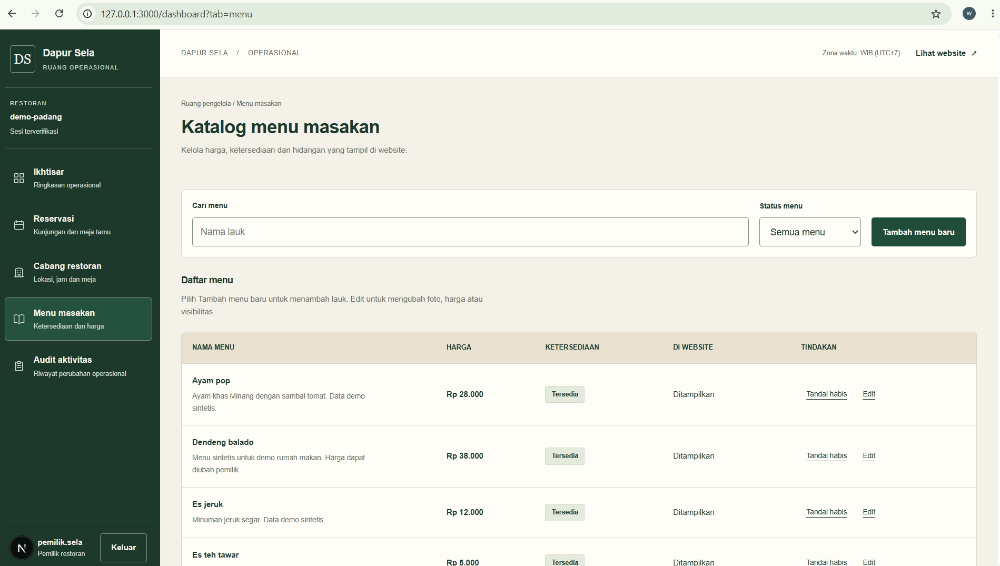
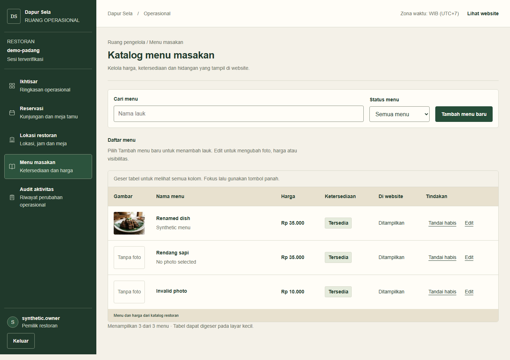
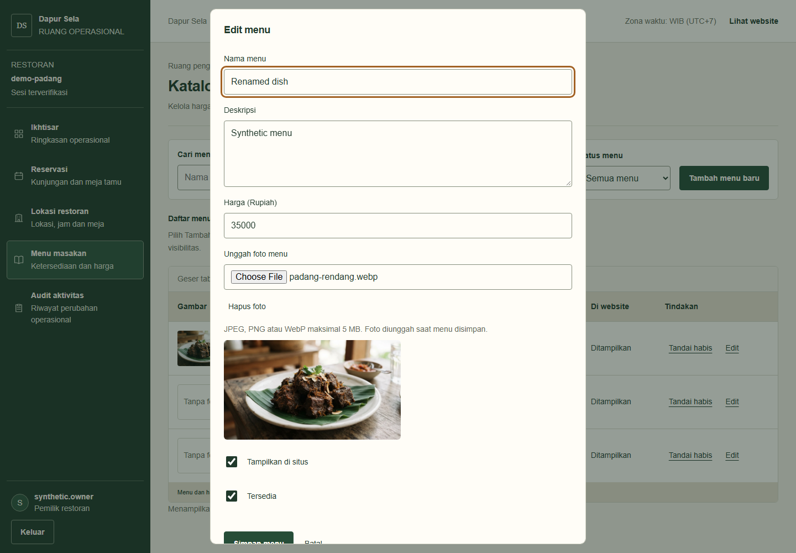
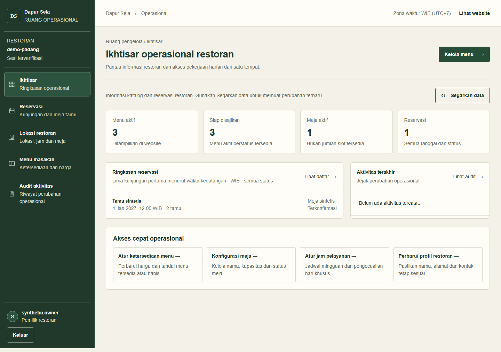
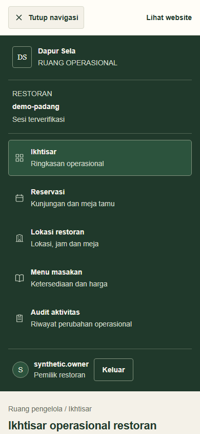
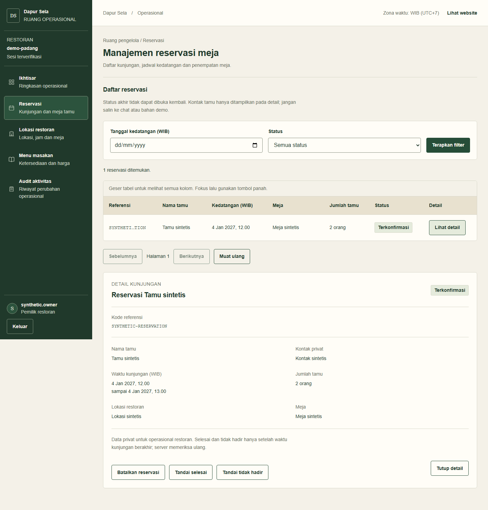
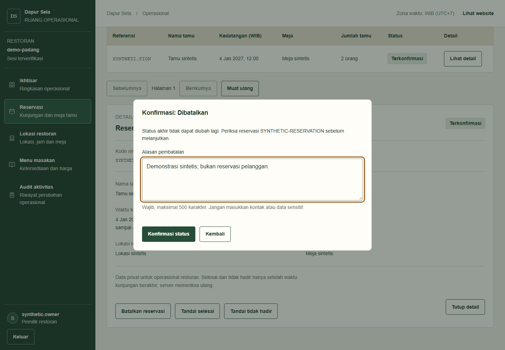
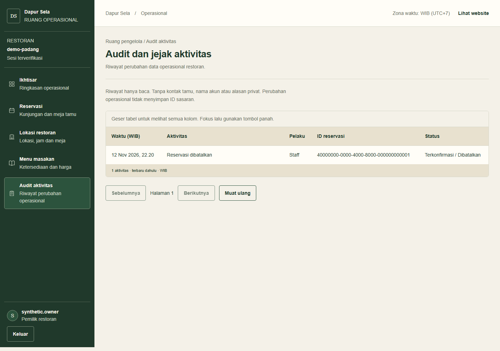

# Perubahan tampilan dan operasional dashboard

## Cakupan dan sumber bukti

Perubahan mencakup navigasi responsif, keterbacaan tabel/form, pengelolaan foto menu, status reservasi oleh staff, serta pembacaan audit. Warna hijau-krem dan identitas Dapur Sela dipertahankan.

- **Sebelum:** screenshot menu yang diberikan pengguna, disalin tanpa perubahan. Dimensi gambar 1899×1075 termasuk chrome browser; ukuran viewport asli tidak diketahui. Ini bukan hasil render ulang commit tertentu.
- **Sesudah:** screenshot browser dari production build lokal pada branch `feat/customer-navigation-menu-polish` yang masih memiliki perubahan belum di-commit. API diganti fixture sintetis; tidak memakai akun, kontak tamu, atau transaksi produksi.
- Desktop memakai viewport 1440×1000 dengan device scale 1; mobile 390×844. Beberapa gambar full-page lebih tinggi daripada viewport.
- Pengambilan gambar tidak membuktikan seluruh transaksi database. Pembatalan pada screenshot hanya mengubah fixture dalam memori. Preview foto tidak disimpan atau diunggah saat pengambilan bukti.
- Render ulang baseline Git sempat gagal pada tahap compile tanpa diagnostik yang dapat ditindaklanjuti. Karena itu pembanding lama hanya berasal dari screenshot pengguna; tidak ada gambar baseline yang direkonstruksi atau direkayasa.

## Menu: sebelum dan sesudah

### Sebelum

Tabel belum memiliki kolom gambar. Nama, deskripsi, harga dan status tersedia, tetapi pemilik belum dapat melihat foto setiap menu langsung dari daftar.

### Sesudah

Tabel menampilkan thumbnail atau penanda tanpa foto. Kolom tetap memiliki header yang jelas; tabel dapat digeser horizontal pada layar sempit. Ketersediaan dan visibilitas tetap dibedakan.

Perbandingan ini menunjukkan perubahan antarmuka, bukan kesetaraan jumlah menu atau nilai data. Sumber data dan dimensi layar kedua gambar berbeda.

### Form edit dalam popup

Tambah/edit menu menggunakan modal agar pemilik tidak perlu mencari form di bawah daftar. Modal memuat input menu, unggah foto, preview, serta tindakan simpan/batal. Foto lama dipertahankan kecuali diganti atau dilepas. Dropdown galeri bawaan dihilangkan; alur utama adalah pilih file dari perangkat, preview, lalu simpan.

Ketentuan upload: JPEG/PNG/WebP maksimal 5 MiB; server memeriksa isi, membatasi piksel dan mengubah ulang menjadi WebP. File disimpan lokal, sedangkan DB menyimpan referensi beserta kepemilikan tenant. Batas tersebut berlaku di backend, bukan hanya atribut input browser.

## Hasil terbaru: ikhtisar dan navigasi

Tidak ada screenshot lama yang sepadan untuk bagian berikut. Gambar diberi label hasil terbaru, bukan pembanding baseline.

### Ikhtisar

Ringkasan menampilkan jumlah menu, meja dan reservasi dari layanan bisnis. Loading atau kegagalan tidak ditampilkan sebagai angka nol. Aktivitas terbaru memakai feed audit; bila sesi dinyatakan tidak sah, snapshot privat dibersihkan dan pengguna diminta masuk kembali.

### Navigasi mobile

Hamburger membuka satu sidebar navigasi yang sama. Escape menutup navigasi dan mengembalikan fokus. Setelah memilih halaman, navigasi menutup dan fokus masuk ke konten. Topbar sticky; label lokasi menggambarkan satu restoran, bukan pengelolaan banyak cabang.

## Hasil terbaru: reservasi

Detail reservasi tetap privat. Staff atau owner dapat meminta pembatalan dengan alasan, menandai selesai, atau menandai tidak hadir dengan pengakuan pemeriksaan. Selesai dan tidak hadir hanya diterima server setelah waktu akhir lewat. Tidak ada reschedule atau penghapusan booking permanen.

Perubahan memerlukan konfirmasi terstruktur. Tombol dibatasi selama request berlangsung. Hasil tidak pasti mempertahankan payload dan key percobaan agar retry tidak mencatat perubahan kedua. Status dan event audit ditulis dalam transaksi yang sama. Snapshot retry di browser hanya bertahan selama komponen aktif; reload dapat menghilangkan state client.

## Hasil terbaru: Audit Aktivitas

Riwayat menggabungkan event operasional dan reservasi, terbaru dahulu, dengan pagination. Feed hanya baca dan dibatasi tenant sesi. Kontak tamu, nama akun, token, serta alasan pembatalan bebas tidak ditampilkan. Event operasional yang tidak menyimpan ID sasaran tidak diberi rincian sasaran rekaan.

## Ringkasan verifikasi

| Pemeriksaan | Bukti aktual | Batas |
| --- | --- | --- |
| Build API dan web serta typecheck | Dilaporkan lulus pada implementasi; build web diulang setelah koreksi privasi dan lulus | Bukan deployment |
| Tes Node reservasi/audit terfokus | 14 tes lulus pada run implementasi | Sebagian memakai stub transaksi |
| Browser dashboard | 46 tes desktop/mobile lulus pada pengujian ulang | API fixture; bukan seluruh CRUD DB nyata |
| Integrasi CRUD dashboard | 1 tes HTTP web–API–PostgreSQL lulus | Fixture sintetis terpisah, mencakup operasi tertentu, bukan seluruh klik form/upload |
| Integrasi reservasi PostgreSQL | 1 tes lulus: scope tenant, pagination, pembatalan, replay, rollback audit, proyeksi audit | Fixture transaksi di-rollback; savepoint bukan konkurensi koneksi terpisah |
| Integrasi upload HTTP dan konkurensi PostgreSQL lokal | 6/6 tes Node lulus (5 subtes perilaku dan 1 tes induk): raster diunggah lewat Nest, ownership DB, attach–baca ulang–ganti–lepas, penolakan tenant/role/Origin/input dan trigger DB; replay paralel key sama, konflik payload berbeda, kompetisi selesai/tidak hadir/batal, serta batal staff/customer menghasilkan tepat satu event terminal | API HTTP dan DB nyata; bukan klik UI atau proxy Next. Kompetisi memakai 2–3 koneksi PostgreSQL berbeda, dibuktikan PID dan antrean advisory lock. Pembatalan customer memakai repository asli, bukan HTTP customer. Pelanggaran CHECK event yang diinjeksi membuktikan rollback status. Fixture tenant sintetis dibersihkan; semua jumlah model terkait kembali ke baseline dan direktori file sementara terhapus |
| Pengambilan screenshot | 7 screenshot terbaru, 0 page error, 0 request browser nonlokal dilaporkan pada capture | Preview tidak disimpan; status berasal dari fixture |
| Review independen | Temuan privasi autentikasi ditangani dan ditambah regression test | Bukan sertifikasi keamanan |

Percobaan browser awal pada implementasi reservasi/audit menghasilkan 34/44 lulus; setelah koreksi source dan assertion menjadi 44/44. Regression test sesi audit menambah dua kasus desktop/mobile, sehingga hasil terakhir 46/46. Hasil awal tidak disajikan sebagai keberhasilan.

## Pemeriksaan yang masih diperlukan

- Upload–simpan–buka ulang foto melalui UI/proxy Next dan DB lokal nyata. Jalur HTTP Nest–DB serta trigger kepemilikan gambar sudah lulus, tetapi belum membuktikan klik form browser.
- Kompetisi batal staff/customer sudah lulus pada koneksi PostgreSQL terpisah; jalur customer HTTP/browser paralel serta uji beban lintas proses belum dicakup.
- Screen reader, zoom browser 200%, keyboard layar ponsel dan perangkat fisik.
- Penilaian kapasitas feed audit dan koordinasi quota upload untuk banyak proses.
- Backup file `.local/menu-images` bersama backup DB; file tanpa referensi dapat tetap tersimpan dalam batas quota, tanpa penghapusan otomatis.

## Sources

- [Playwright screenshots](https://playwright.dev/docs/screenshots)
- [Next.js client components](https://nextjs.org/docs/app/api-reference/directives/use-client)
- [React effect lifecycle](https://react.dev/reference/react/useEffect)
