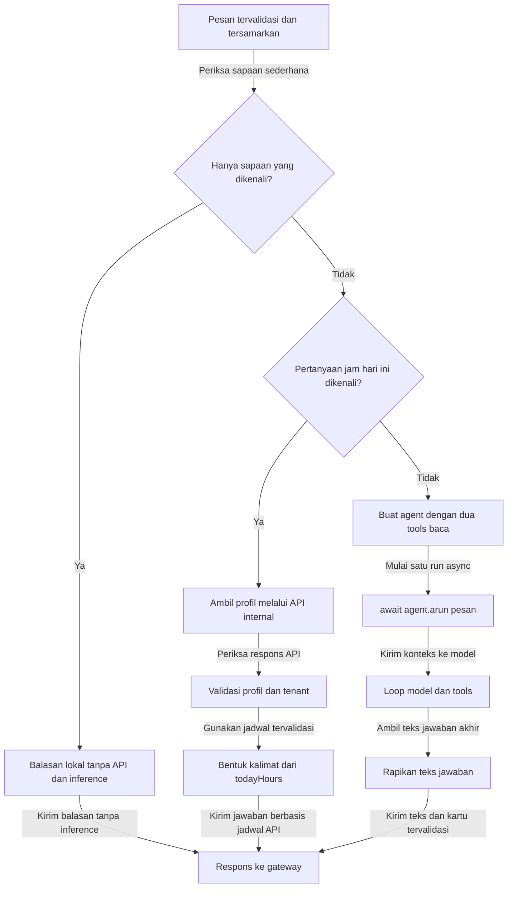
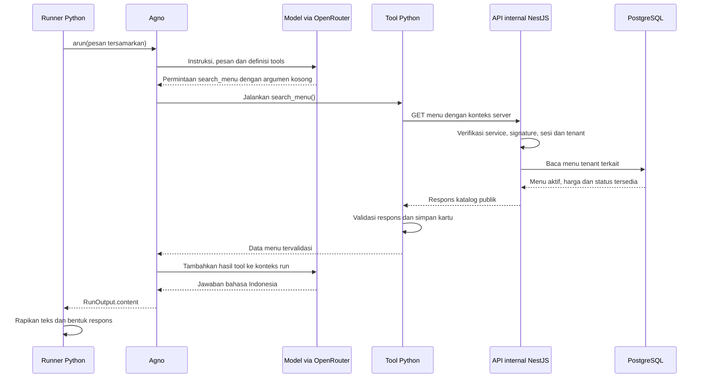
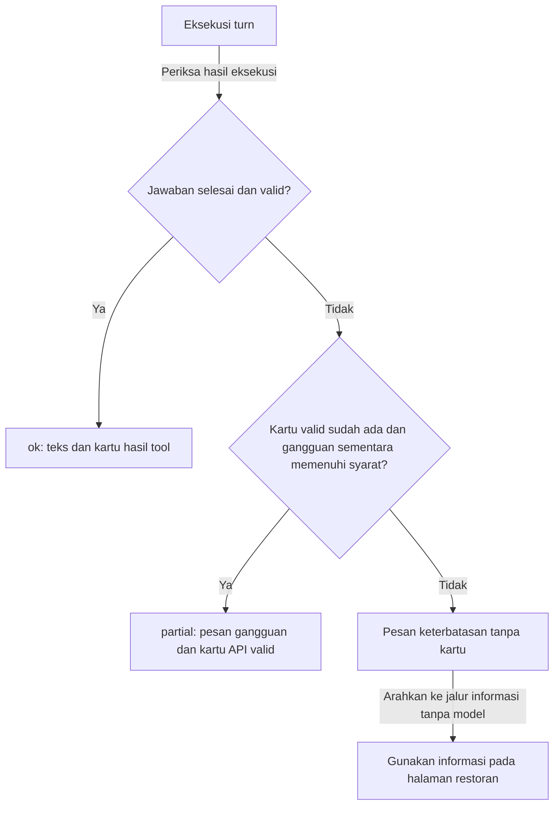

# Proses AI dengan Agno

## Gambaran singkat

Agno adalah framework pengatur agent, bukan model AI dan bukan database. Dalam proyek ini, Agno menghubungkan model bahasa melalui OpenRouter dengan fungsi Python yang membaca API restoran.

Pembagian tugasnya:

- **Model bahasa:** memahami pertanyaan, memilih tool yang tersedia, lalu menyusun jawaban.
- **Agno:** menyiapkan konteks dan definisi tools, menjalankan permintaan tool, serta mengembalikan hasilnya ke model.
- **Service assistant Python:** membatasi eksekusi, memvalidasi hasil tools, membentuk respons dan menangani kegagalan.
- **API NestJS:** memverifikasi sesi dan tenant, menyediakan data operasional, serta mengakses PostgreSQL.
- **Web Next.js:** menerima input dan menampilkan teks serta kartu data restoran.

Dokumen ini menjelaskan kode development yang tersedia, bukan jaminan layanan live atau kesiapan produksi. Dependensi Agno dipin pada versi `3.1.10`. Model aktual dipilih melalui konfigurasi server; suffix `:free` bukan bukti model masih tersedia atau mendukung tools.

## Arsitektur yang tersedia

```mermaid
flowchart LR
    USER[Customer] -->|Kirim pertanyaan| WEB[Widget dan route Next.js]
    WEB -->|Teruskan request chat| API[Gateway chat NestJS]
    API -->|Periksa request masuk| SESSION[Validasi sesi dan tenant]
    SESSION -->|Lanjutkan pesan dengan sesi valid| INPUT[Redaksi input dan pembatasan request]
    INPUT -->|Kirim pesan aman dan konteks server| PY[Service assistant Python]
    PY -->|Tentukan cara menjawab| ROUTE{Jalur pesan}
    ROUTE -->|Sapaan sederhana| LOCAL[Jawaban lokal]
    ROUTE -->|Jam hari ini dikenali| HOURS[Jawaban deterministik dari API]
    ROUTE -->|Pertanyaan lain| AGNO[Satu agent Agno]
    AGNO -->|Kirim konteks dan definisi tools| MODEL[Model melalui OpenRouter]
    MODEL -->|Kembalikan jawaban atau permintaan tool| AGNO
    AGNO -->|Jalankan tool yang diminta model| TOOLS[Tools Python read-only]
    HOURS -->|Minta profil dan jadwal hari ini| INTERNAL[API internal NestJS]
    TOOLS -->|Minta profil atau menu| INTERNAL
    INTERNAL -->|Periksa izin request tool| AUTH[Verifikasi service, konteks, sesi dan tenant]
    AUTH -->|Teruskan pembacaan yang diizinkan| DATA[Service bisnis restoran]
    DATA -->|Query data tenant terkait| DB[(PostgreSQL)]
    DB -->|Kembalikan data restoran| DATA
    DATA -->|Kembalikan respons publik| INTERNAL
    INTERNAL -->|Kembalikan profil untuk jawaban jam| HOURS
    INTERNAL -->|Kembalikan hasil baca untuk divalidasi| TOOLS
    TOOLS -->|Serahkan data tervalidasi ke konteks run| AGNO
    LOCAL -->|Serahkan balasan sapaan| RESPONSE[Teks dan kartu tervalidasi]
    HOURS -->|Serahkan jawaban jam dari API| RESPONSE
    AGNO -->|Serahkan teks dan kartu hasil tool| RESPONSE
    RESPONSE -->|Kirim hasil Python untuk diperiksa ulang| API
    API -->|Kembalikan response chat ke web| WEB
    WEB -->|Tampilkan teks dan kartu jawaban| USER
```

Panah Python ke API merupakan HTTP internal, bukan MCP atau komunikasi antar-agent. Python tidak membaca database bisnis secara langsung. Model tidak menerima credential service internal.

## Urutan satu pesan

### Dari browser ke Python

1. Customer mengirim pesan melalui widget. Route web meneruskannya ke gateway chat.
2. Gateway NestJS memeriksa Origin, cookie sesi dan bentuk input. Body chat hanya menerima `message`, bukan tenant atau role pilihan model.
3. Gateway mengambil tenant dari sesi server. Jalur pesan saat ini dibatasi pada tenant demo `demo-padang`; ini belum pemilihan tenant dinamis untuk seluruh restoran.
4. Email, pola nomor dan string panjang tertentu disamarkan sebelum diteruskan ke Python. Masking berbasis pola belum menjamin seluruh data pribadi terdeteksi.
5. Gateway membatasi lima turn per menit per sesi dan satu turn aktif per sesi.
6. Gateway membuat konteks bertanda tangan yang mengikat tenant, ID sesi dan expiry. Konteks berlaku paling lama 30 detik serta tidak melewati expiry sesi.
7. Gateway memanggil `POST /turn` pada service Python loopback port `8001`. Service memeriksa autentikasi antarlayanan dan payload; satu proses hanya menerima satu turn aktif.

Sesi akses aplikasi berbeda dari memory model. Menggunakan cookie sesi tidak berarti model mengingat percakapan sebelumnya.

### Pemilihan jalur di Python

**Tidak semua pesan memakai AI generatif.** Sapaan sederhana seperti “Halo!” dijawab lokal. Pertanyaan jam hari ini dengan kosakata yang dikenali membaca API, lalu aplikasi menyusun kalimat tanpa inference model.

Pengenal jam memakai aturan terbatas, bukan klasifikasi AI. Pesan tentang besok, tanggal tertentu, “sekarang”, atau kosakata di luar cakupan masuk jalur agent. Sistem tidak boleh menyamakan jadwal hari ini dengan jadwal tanggal lain.

`todayHours` diselesaikan API berdasarkan tanggal Asia/Jakarta: jadwal khusus mengalahkan jadwal mingguan. Data belum tersedia berbeda dari restoran tercatat tutup. Jam buka juga bukan bukti meja tersedia.

## Bagaimana loop Agno bekerja?

Pada jalur generatif, `run_conversation` membuat satu `Agent` dengan adapter `OpenRouter`, instruksi domain restoran dan dua fungsi async. Selanjutnya aplikasi menjalankan `await agent.arun(prompt)`.

Agno membentuk definisi tool dari nama fungsi, docstring dan type hints. Model menerima definisi tersebut, bukan kebebasan mengeksekusi Python sembarang.

Contoh tersebut biasanya memakai **dua inference request**: memilih tool, lalu menyusun jawaban setelah hasil tool diterima. Satu pesan customer tidak selalu sama dengan satu request model. Model juga bisa menjawab tanpa tool; instruksi agar memakai tool bukan jaminan setiap klaim faktual benar.

### Tools yang benar-benar tersedia

| Tool runtime | Data yang dibaca | Batas |
| --- | --- | --- |
| `get_restaurant_info()` | Nama restoran, lokasi aktif, alamat, kontak, jadwal mingguan, jadwal hari ini dan informasi kebijakan reservasi | Bukan slot meja live atau detail booking privat; pengecualian tanggal mendatang belum diselesaikan oleh profil hari ini |
| `search_menu()` | Menu aktif, deskripsi, harga Rupiah dan label tersedia/habis | Saat ini membaca daftar menu, bukan pencarian semantik atau pemesanan makanan |

Kedua tools tidak memiliki parameter tenant dari model. Slug serta header internal terikat pada konteks aplikasi di closure Python. API tetap memverifikasi binding itu; menyembunyikan parameter saja bukan kontrol akses yang cukup.

Model tidak mempunyai tools SQL, shell, admin, tulis data, buat reservasi atau batal reservasi. Harga dan status menu berasal dari API, bukan hafalan model.

## Contoh: pertanyaan harga menu

Customer bertanya: **“Berapa harga rendang?”**

- Gateway menyamarkan input bila perlu dan meneruskan konteks sesi server.
- Agno mengirim pertanyaan dan definisi tools ke model.
- Model dapat meminta `search_menu()`.
- Tool membaca menu tenant melalui API internal. Nama, harga dan status tersedia diambil dari respons aktual.
- Python memvalidasi hasil dan menyiapkan kartu menu dari data API yang sama.
- Model menerima hasil tool dan menyusun jawaban singkat.
- Gateway memvalidasi ulang kartu; widget menampilkan teks serta kartu.

Angka harga tidak ditetapkan dalam contoh ini karena nilainya harus mengikuti data API saat request. Jika menu tidak ditemukan atau API gagal, chatbot tidak boleh mengarang harga.

Kartu bukan JSON buatan model. Kartu dibentuk dari hasil tool tervalidasi. Meski begitu, validasi schema kartu tidak membuktikan teks model selalu sesuai fakta; evaluasi jawaban tetap diperlukan.

## Batas eksekusi dan penanganan gagal

| Kontrol runtime | Nilai/perilaku saat ini |
| --- | --- |
| Panjang pesan | Maksimal 2.000 karakter |
| Deadline runner | Maksimal 30 detik per turn; gateway juga memiliki timeout 30 detik |
| Inference | Maksimal tiga percobaan request melalui transport penghitung budget |
| Tools Agno | `tool_call_limit=3` per run |
| Output model | Maksimal 512 token per request |
| Timeout model/API tool | 10 detik / 5 detik |
| Respons tool | Maksimal 64 KiB; profil dan menu divalidasi |
| Retry otomatis SDK/agent | Dinonaktifkan |
| Model | Harus masuk allowlist server dan memakai ID berakhiran `:free` |
| Routing tambahan | Override routing, daftar model, provider dan plugin ditolak transport |
| History otomatis | `add_history_to_context=False`; tidak ada history lintas turn yang dikirim oleh runner |
| Telemetry/debug Agno | Dinonaktifkan |

Batas tool call berbeda dari batas inference. Aplikasi menghitung request di transport HTTP agar loop tidak dianggap aman hanya karena memiliki `tool_call_limit`.

`partial` dapat terjadi ketika tool berhasil, tetapi inference lanjutan gagal karena gangguan sementara seperti 429 atau error upstream. Kegagalan auth, tool atau validasi tidak diperlakukan sebagai partial yang aman. Partial bukan keberhasilan jawaban model.

Modul `model_failover.py` tersedia terpisah, tetapi tidak dipanggil oleh `run_conversation`. Jangan menganggap runtime chat otomatis mengganti model saat gagal. Tidak ada fallback berbayar dalam jalur ini.

Halaman informasi dan kartu katalog manual dapat menjadi jalur alternatif. Ini bukan bukti transaksi reservasi melalui form sudah tersedia.

## Apa yang belum dilakukan Agno di sini?

| Kemampuan | Posisi dalam runtime yang diperiksa |
| --- | --- |
| Membaca profil dan menu lewat tools | Tersedia dalam kode runtime |
| Jawaban lokal untuk sapaan dan sebagian pertanyaan jam hari ini | Tersedia; tidak memerlukan inference |
| Mengingat pesan sebelumnya lintas turn | Belum diteruskan ke model |
| RAG FAQ/kebijakan published | Belum terhubung ke runner |
| Memeriksa slot meja live | Belum ada tool pada runner |
| Membuat, melihat atau membatalkan reservasi privat | Bukan kemampuan agent saat ini |
| MCP, A2A, multi-agent atau fine-tuning | Tidak digunakan pada alur ini |

Untuk pengembangan berikutnya, retrieval FAQ harus mengambil dokumen published dengan revision aktif dan filter tenant sebelum ranking. Data retrieval tetap dianggap data tak tepercaya, bukan instruksi system. Harga, jam, slot dan status booking tetap memakai API bisnis, bukan RAG.

Jika reservasi diintegrasikan kemudian, model hanya membantu usulan detail. Konfirmasi customer harus melalui komponen terstruktur; backend memvalidasi izin, waktu, kapasitas, idempotency dan transaksi. Pesan “ya” atau keputusan model bukan izin menulis database. Alur tersebut belum dijalankan oleh runner yang dijelaskan di atas.

## Peta kode untuk membaca alur

| File | Peran |
| --- | --- |
| `apps/api/src/restaurant/chat-message.controller.ts` | Gateway pesan, redaksi, rate limit, pemanggilan Python dan validasi hasil |
| `apps/api/src/restaurant/chat-sessions.service.ts` | Sesi server dan pembuatan konteks internal |
| `apps/api/src/restaurant/internal-context.ts` | Signature tenant, sesi dan expiry |
| `apps/api/src/restaurant/internal-tools.controller.ts` | Otorisasi endpoint baca internal |
| `apps/assistant/conversation_server.py` | Endpoint HTTP `/turn`, autentikasi service dan pembatasan turn aktif |
| `apps/assistant/conversation_runner.py` | Orkestrasi runtime utama, dua tools dan pembentukan hasil |
| `apps/assistant/conversation_style.py` | Sapaan lokal dan pembersihan format teks |
| `apps/assistant/opening_hours_reply.py` | Pengenalan pertanyaan jam dan kalimat deterministik |
| `apps/assistant/execution_gateway.py` | Deadline, budget dan fallback eksekusi |
| `apps/assistant/model_transport.py` | Penghitungan request dan pembatasan endpoint/model |
| `apps/assistant/agent_factory.py` | Validasi konfigurasi model dan factory profil sederhana; bukan runner chat utama |

Factory profil sederhana hanya mendaftarkan satu tool. Untuk memahami chat web saat ini, mulai dari `conversation_runner.py`, bukan menyimpulkan seluruh kemampuan dari factory tersebut.

## Batas pembuktian

Penjelasan ini bersandar pada source runtime dan tes deterministik. Tes stub dapat membuktikan loop tool, budget, pemisahan credential dan fallback tanpa memakai kuota model. Itu tidak membuktikan model gratis tertentu sedang tersedia atau seluruh variasi pertanyaan Bahasa Indonesia berhasil.

Sesi aplikasi masih in-memory dan hilang saat API restart. Model tidak diberi history lintas turn. Masking bukan perlindungan privasi sempurna; gunakan data sintetis sebelum peninjauan privasi untuk customer nyata. Health endpoint bukan bukti model siap. Prompt dan pembersihan teks bukan jaminan bebas halusinasi atau prompt injection.

## Sources

- [Agno: Tools](https://docs.agno.com/agents/tools) — definisi fungsi, pemilihan tool oleh model dan loop hasil tool.
- [Agno: Running Agents](https://docs.agno.com/agents/running-agents.md) — `run`, `arun`, konteks run dan hasil eksekusi. Fitur umum dalam dokumentasi tidak otomatis aktif pada konfigurasi proyek ini.
