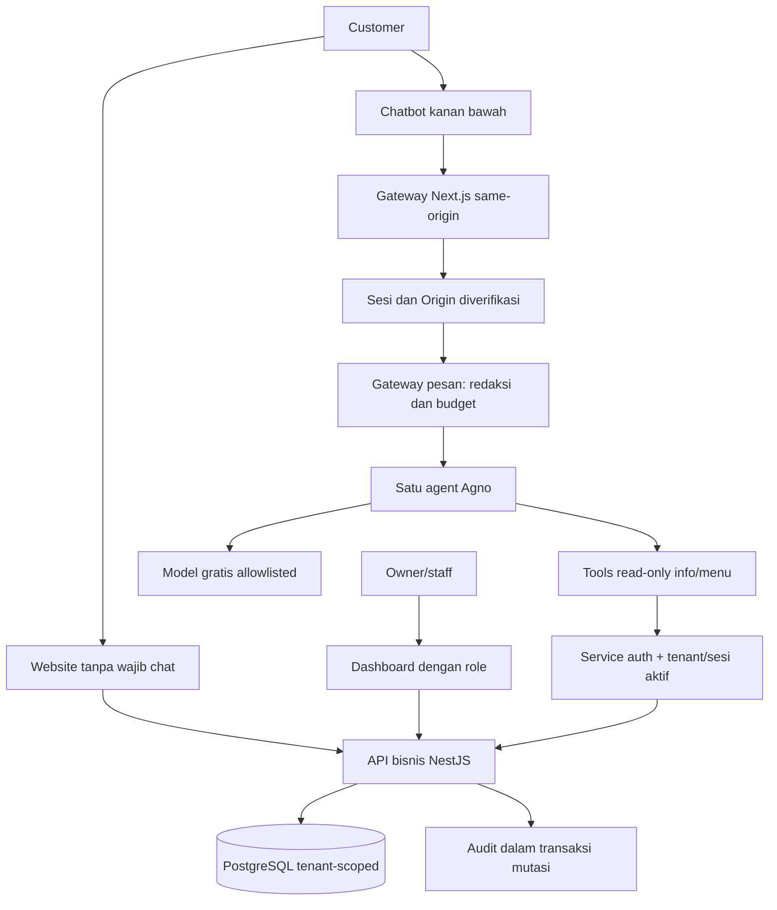
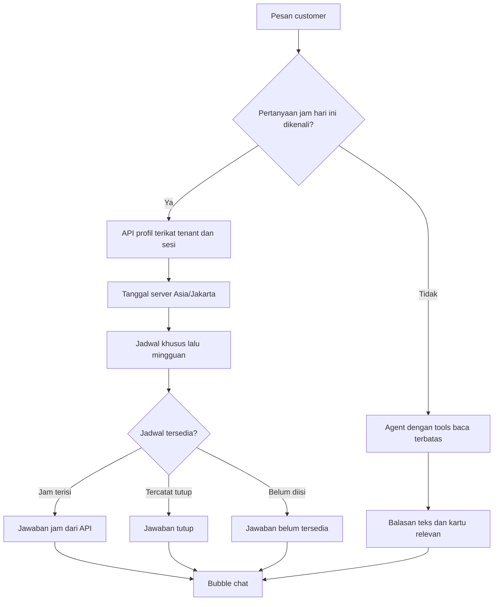
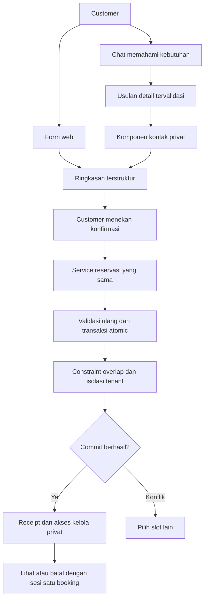

# Ringkasan Pengerjaan dan Evaluasi

## Kesimpulan

Website, dashboard dan API data restoran tersedia untuk demo lokal. Chatbot membaca info/menu melalui satu agent Agno; pertanyaan jam buka hari ini yang dikenali memakai jawaban deterministik dari profil API tanpa inference model. Pengguna telah mencoba beberapa jawaban terbaru dan menyatakan hasilnya sesuai. Scope website dan data restoran ditutup setelah seluruh tiket terkait berstatus selesai, dengan batas verifikasi di bawah tetap terbuka. Ini bukan penerimaan fitur reservasi atau evaluasi keamanan keseluruhan.

Status Done pada tracker bukan bukti seluruh pengalaman produk selesai. Ringkasan ini membedakan implementasi, pengujian deterministik, hasil live dan keterbatasan; tidak menyatakan siap produksi.

## Hasil yang tersedia

| Area | Implementasi | Bukti dan batas |
| --- | --- | --- |
| Website | Beranda, profil, menu, lokasi, jadwal, akses reservasi | Profil/menu/jadwal membaca API; reservasi belum aktif |
| Dashboard | Pengelolaan menu, meja, jadwal mingguan, profil, hari khusus | Owner/staff berbeda izin; submit browser dan penolakan API diuji |
| Auth | Password hash, cookie, expiry, logout/revocation, Origin | Tes positif/negatif dan login browser owner/staff |
| Tenant | Scope sesi/query dan FK komposit | Pengujian dua tenant, akses silang ditolak |
| Jadwal | Mingguan, override tanggal dan profil `todayHours` | Tanggal server WIB; override didahulukan; tutup dibedakan dari data kosong; pertanyaan yang dikenali dijawab aplikasi |
| Audit | Aktor server, update dan audit atomic | Kegagalan audit mengembalikan transaksi, tanpa payload privat pada audit |
| Internal tools | Info/menu read-only, service auth, konteks bertanda tangan dan sesi aktif | Tenant/sesi/expiry/revocation dan metode tidak diizinkan diuji |
| Chatbot | Pemicu kanan bawah, input bebas, kartu API, fallback | Browser katalog dan tes lintas proses lulus; inference live tidak stabil pada model awal |
| Dokumentasi API | Scalar/OpenAPI, status sukses/error | Kontrak diuji; bukan bukti semua error pernah terjadi live |

## Alur data



Model tidak memiliki credential DB bisnis, tool SQL, shell, admin atau write booking. Harga/status menu berasal API, bukan ingatan model.

## Masalah dan penanganan

| Masalah | Penyebab/bukti | Penanganan dan status |
| --- | --- | --- |
| Build rusak setelah merge | Model Prisma/komponen ganda, decorator salah tempat, JSON kontrak rusak | Implementasi canonical direkonsiliasi; kompilasi/schema/tes kembali lulus |
| Migration membuat tabel duplikat | Dua migration pending membuat tabel yang sudah ada | Pada DB lokal yang riwayatnya diperiksa, migration direkonsiliasi menjadi guard schema; deploy sukses tanpa reset. DB mesin lain perlu review riwayat/checksum |
| Login/chat melalui localhost ditolak | Allowlist development semula hanya satu hostname | Alias loopback localhost/127.0.0.1 diterima pada development; production tetap strict |
| Chat unavailable meski FE/API hidup | Service Python port 8001 pernah belum berjalan | Jalankan empat komponen: Docker DB, API, Python dan FE. Health bukan bukti inference siap |
| Model awal sering 429 | Respons provider rate_limited; beberapa turn gagal pada request pertama | Tidak retry tanpa batas. Katalog manual tetap tersedia; model gratis alternatif diuji terpisah |
| 200 lalu 429 | Satu turn tools membutuhkan beberapa inference request | Keberhasilan request bukan keberhasilan turn; diagnostics mencatat request/status aman |
| Data tool ikut hilang saat inference lanjutan gagal | Runtime sebelumnya membuang semua kartu pada status gagal | Status partial kini mempertahankan kartu tervalidasi pada kegagalan sementara, bukan error izin/tool. Tes stub lulus, live perubahan terakhir belum diverifikasi |
| Format dan bahasa terasa kaku | UI teks biasa menerima markup dan kalimat bebas model | Pembersihan format, prompt ringkas, serta jawaban jam deterministik diterapkan. Beberapa hasil terbaru diterima pengguna; pertanyaan umum tetap perlu evaluasi lebih luas |
| Jam buka hari ini tidak terjawab | Deskripsi tool, payload API dan prompt tidak selaras; jadwal lokal juga kosong | Profil kini membawa jadwal efektif WIB. Jalur deterministik memberi jam dari API, tutup, atau belum tersedia. Data kosong tidak diisi dengan jam contoh |
| Pertanyaan beragam belum dievaluasi cukup | Tes variasi memakai model stub | Butuh set pertanyaan live terbatas: rekomendasi, gabungan, ambigu, di luar scope dan tanpa sumber |

## Hasil uji yang pernah dijalankan

- Sebelum perbaikan partial terakhir: 30 tes Node dan 47 tes Python lulus pada pemeriksaan sebelum commit.
- Model alternatif nvidia/nemotron-3.5-lightning:free lulus smoke dengan satu tool fixture sintetis dan dua request 200. Itu bukan bukti DB nyata atau stabilitas semua pertanyaan.
- Pengguna kemudian mengonfirmasi model alternatif bisa menjawab melalui UI; screenshot memperlihatkan jawaban menu, tetapi format dan jam buka belum sesuai kebutuhan.
- Pada branch perbaikan partial: tiga tes runtime Python dan dua tes Node lulus; kompilasi API/diff check lulus. Pertanyaan variasi dalam tes bukan evaluasi pemahaman model live.
- Pemeriksaan browser sebelumnya mencakup posisi pemicu, lebar 320px, kartu katalog API, label dan pemulihan fokus.

Jumlah tes di atas berasal pemeriksaan berbeda, bukan satu suite acceptance final pada snapshot terakhir. Tidak ada klaim kebal injection atau siap produksi.

## Batas evaluasi lanjutan

1. Jalur jam hari ini sudah memakai tanggal server WIB dan hasil API. Perluas pengenalan bahasa serta tanggal mendatang hanya dengan resolver dan tes yang sesuai.
2. Pertanyaan menu/rekomendasi menghasilkan teks yang terbaca dan kartu sesuai API tanpa klaim favorit/sertifikasi yang tidak tersedia.
3. Uji ulang partial: tool sukses lalu provider gagal, serta request pertama gagal tanpa kartu palsu.
4. Jalankan regresi lengkap pada snapshot final, lalu smoke end-to-end dengan data sintetis dan kuota eksplisit.
5. Selaraskan status tracker dengan bukti; jangan menyamakan seluruh proyek dengan status beberapa tiket.

Reservasi buat/lihat/batal, idempotency, proposal/konfirmasi, constraint overlap dan akses privat booking belum menjadi fitur aktif. Itu tidak boleh ditunjukkan sebagai transaksi sukses dari browser atau model.

## Penutupan website dan data restoran

Seluruh sepuluh tiket pada proyek tracker terkait sudah berstatus selesai saat pemeriksaan. Status proyek kemudian diubah dari berjalan menjadi selesai atas persetujuan pengguna. Tidak ada tiket reservasi, retrieval atau evaluasi keamanan yang ikut ditutup.

Bukti terbaru pada working tree:

- Kompilasi TypeScript API lulus.
- Typecheck web lulus.
- Seluruh 23 tes Node berakhiran `.test.cjs` lulus.
- Seluruh 63 tes Python lulus; pesan error sintetis dari tes negatif bukan kegagalan suite.
- Pengguna mencoba beberapa keluaran chat terbaru dan menyatakan sesuai. Itu bukti penerimaan manual terbatas, bukan evaluasi seluruh skenario.
- Tidak menjalankan ulang suite PostgreSQL nyata, build produksi web atau audit browser menyeluruh pada penutupan ini.
- Perubahan masih lokal dan belum commit/push. Penutupan tracker bukan bukti deployment.

### Pelajaran dari perbaikan chat

| Masalah | Akar penyebab | Perbaikan dan pelajaran |
| --- | --- | --- |
| Pesan pengguna terlambat muncul | Bubble menunggu seluruh inference selesai | Preview tersamarkan langsung tampil; respons server mengganti preview; input dipulihkan jika request gagal |
| Chat terlalu penuh | Kartu profil dan tombol cepat selalu muncul | Kartu profil otomatis dihilangkan dari balasan biasa; tombol cepat hanya di awal; input satu baris dapat membesar |
| Penambahan prompt tidak menyelesaikan fakta | Model tetap bebas menyusun klaim dan memilih tool | Fakta jam hari ini dibentuk deterministik untuk pertanyaan yang dikenali; model tetap untuk pertanyaan lain |
| Perubahan source belum terlihat saat dicoba | Proses API/Python lama masih berjalan | Bedakan source, hasil kompilasi dan proses aktif; restart setelah perubahan backend/runtime |
| Jam buka tetap kosong | API jadwal mengembalikan nol hari terkonfigurasi | Data operasional harus diisi pengelola; jangan menutupi kekosongan dengan jam buatan |
| Klaim reservasi terlalu luas | Field kebijakan disalahartikan sebagai kemampuan booking aktif | Bedakan informasi aturan dari transaksi reservasi; chat belum dapat membuat booking |
| Tes HTTP Windows sempat gagal | Koneksi lokal terputus; penyebab belum terbukti | Tes terpisah dan suite ulang lulus tanpa mengubah auth; jangan menyebut akar penyebab sudah diperbaiki |



## Fokus berikutnya: reservasi web dan chat

Fokus berpindah dari membaca data ke transaksi reservasi yang aman. Mulai dengan satu vertical slice: availability dan create melalui form web, kemudian integrasikan usulan chat dan konfirmasi. Tidak menambah RAG, multi-agent, atau kanal pesan eksternal untuk menggantikan fondasi transaksi.

| Jalur | Fokus | Bukti selesai |
| --- | --- | --- |
| Backend | Aturan waktu, kapasitas, jam mingguan/hari khusus dan availability | Tes batas waktu; slot tersedia bukan hold |
| Backend | Create confirmed dalam transaksi dan exclusion constraint | PostgreSQL nyata menolak overlap; tidak ada write parsial |
| Backend | Idempotency dan pemulihan receipt | Key sama/payload sama mengembalikan hasil lama; payload berbeda ditolak; respons commit putus dapat dipulihkan |
| Backend | Token kelola dan pembatalan | Hash token dan expiry; sesi dibatasi satu booking; cutoff dan audit konsisten |
| Frontend | Form, ringkasan absolut dan receipt | Form mandiri tetap berjalan saat model gagal; hasil sukses hanya setelah commit |
| Frontend dan assistant | Usulan berskema, koreksi, klarifikasi tanggal dan kontak privat | Kontak tidak masuk model/transcript; koreksi membatalkan usulan lama |
| Integrasi | Konfirmasi eksplisit dan konsumsi proposal atomic | Sesi/payload/nonce/expiry diverifikasi; double click dan replay tidak membuat booking ganda |
| Pengujian | Konkurensi, lintas tenant dan perjalanan buat/lihat/batal | 50 request satu meja fixed menghasilkan satu confirmed; akses silang ditolak; jalur chat/web diuji |



Diagram reservasi menggambarkan target pengerjaan berikutnya, bukan kemampuan yang sudah aktif. Model tidak memiliki write tool; persetujuan berasal dari kontrol UI customer, bukan pesan “ya” atau flag keluaran model.

## Operasional lokal

Jalankan dari root proyek di terminal terpisah:

```sh
rtk proxy docker compose up -d --wait database
```

```sh
rtk proxy node node_modules/typescript/bin/tsc --project apps/api/tsconfig.json
rtk proxy node apps/api/dist/main.js
```

```sh
rtk proxy uv run --project apps/assistant --locked python apps/assistant/conversation_server.py
```

```sh
rtk proxy node apps/web/node_modules/next/dist/bin/next dev apps/web --hostname 127.0.0.1
```

Konfigurasi privat tetap pada file gitignored; jangan menyalin password, token, key atau cookie ke dokumen, chat, screenshot maupun commit. Restart Python setelah perubahan instruksi/runtime dan API setelah kompilasi. Jangan jalankan dua proses pada port sama.
