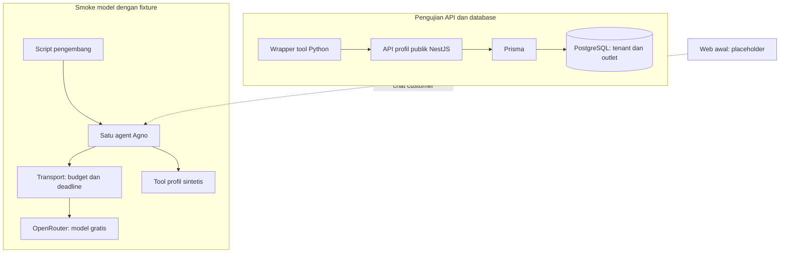
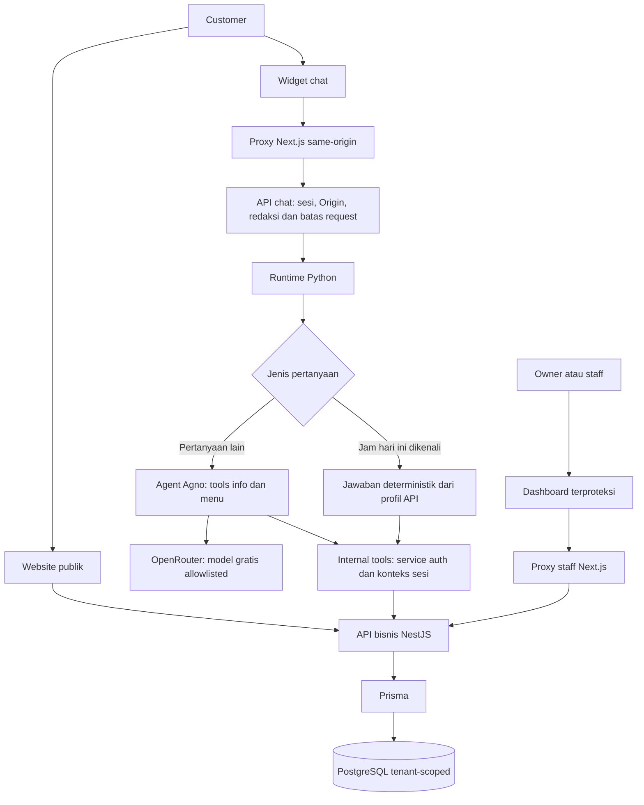
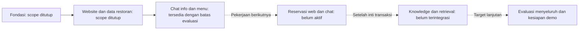

# Ringkasan Progres Pengerjaan

Dokumen pelaporan progres untuk tim: fondasi sistem serta website dan data restoran. Pembagian fase menjelaskan hasil pengerjaan, bukan penanda bahwa seluruh produk sudah selesai.

Snapshot kode yang diperiksa: commit `cab7008`, bertanggal 30 Oktober 2026. Tanggal commit bukan tanggal penerimaan seluruh fitur. Angka pengujian di bawah merupakan catatan pemeriksaan sebelumnya, bukan hasil menjalankan ulang suite pada penyusunan ringkasan ini.

## Ringkasan utama

| Fase | Fokus | Hasil | Status dan batas |
| --- | --- | --- | --- |
| Phase 1 | Fondasi dan pembuktian integrasi dasar | Workspace web/API/assistant, database lokal, tenant/outlet, kontrak layanan, smoke model gratis dan tool | Scope fondasi telah ditutup pada evaluasi sebelumnya. Smoke model memakai fixture sintetis; pengujian tool ke API/DB dilakukan terpisah. |
| Phase 2 | Website, dashboard, data operasional dan chat read-only | Halaman publik, auth staff, pengelolaan restoran, tools internal serta widget percakapan | Scope website/data restoran telah ditutup pada evaluasi sebelumnya. Implementasi tersedia untuk demo lokal; evaluasi live dan regresi menyeluruh masih terbatas. |

**Posisi proyek:** beralih dari membaca informasi restoran menuju pembangunan transaksi reservasi. Website dan chat belum dapat membuat, melihat, atau membatalkan booking. Tidak ada dasar untuk menyatakan seluruh MVP selesai atau siap produksi.

## Phase 1 — Fondasi sistem

### Tujuan

Menyiapkan komponen lokal dan membuktikan bahwa model dapat meminta tool, aplikasi menjalankannya, lalu jawaban memakai hasil tool. API bisnis dan runtime AI dipisah sejak awal.

### Hasil pengerjaan

| Area | Hasil yang tersedia | Batas pembuktian |
| --- | --- | --- |
| Workspace | Struktur `apps/web`, `apps/api`, dan `apps/assistant`; konfigurasi build dan dependency terkunci | Skeleton awal, bukan perjalanan customer lengkap |
| Web dan API | Next.js untuk halaman awal; NestJS untuk health dan profil publik | Health hanya membuktikan proses hidup |
| Database | PostgreSQL lokal dalam Docker; Prisma dan migrasi tenant/outlet | Tidak menyatakan deployment atau kesiapan produksi |
| Multi-tenant | Dua tenant sintetis, seed dapat diulang, query terikat tenant dan relasi komposit | Belum membuktikan seluruh endpoint privat aman |
| Assistant | Python/Agno dengan satu agent; tool baca profil restoran | Tidak memegang credential database bisnis |
| Model gratis | Smoke `nvidia/nemotron-3.5-lightning:free` berhasil memakai satu tool dan dua request HTTP 200 | Fixture sintetis; bukan integrasi model–DB–browser secara penuh |
| Ketahanan | Validasi schema, request budget, deadline dan fallback diuji offline | Cadangan model belum terbukti berhasil live pada penutupan fondasi |

### Bukti pengujian historis

- Build web/API dilaporkan lulus.
- Tiga unit test API dan tiga integration test PostgreSQL/API dilaporkan lulus.
- Pemeriksaan offline assistant terakhir pada penutupan fondasi mencatat 43 tes lulus.
- Smoke health API/Python dan HTTP halaman awal dilaporkan lulus.
- Preview model menghasilkan jawaban Bahasa Indonesia sesuai nama restoran dalam fixture.
- Biaya nol dan provider NVIDIA tercatat pada smoke sukses sebelumnya; metadata provider tidak direkam ulang pada setiap preview.

Jumlah di atas berasal snapshot fondasi. Jangan dijumlahkan dengan hasil fase berikutnya sebagai satu suite final.

### Diagram fondasi

Dua jalur pengujian sengaja dipisah. Sukses model dengan fixture tidak sama dengan sukses membaca database melalui browser.

## Phase 2 — Website dan data restoran

### Tujuan

Menyediakan website yang dapat dijelajahi tanpa chat, dashboard operasional dengan izin berbeda, serta chatbot yang membaca data restoran melalui API.

### Hasil pengerjaan

| Area | Hasil yang tersedia | Batas dan catatan |
| --- | --- | --- |
| Website publik | Beranda, profil, menu, lokasi, jadwal serta bagian reservasi | Bagian reservasi menyatakan layanan belum dibuka |
| Auth dan dashboard | Login/logout, cookie sesi, expiry, revocation dan pemeriksaan Origin | Penerapan lokal; bukan audit keamanan lengkap |
| Menu | Owner mengelola item; staff mengubah tersedia/habis; katalog publik membaca API | Harga dan status menu berasal database, bukan model |
| Meja | Pengelolaan nama, kapasitas dan status aktif meja | Daftar meja bukan availability slot reservasi |
| Jadwal | Jam mingguan dan pengecualian tanggal; profil menyediakan `todayHours` | Hari khusus didahulukan; jadwal kosong berbeda dari tutup |
| Profil | Data restoran dapat dikelola melalui dashboard dan dibaca publik | Data operasional tetap harus diisi pengelola |
| Isolasi dan audit | Query/sesi terikat tenant, relasi komposit, update dan audit dalam transaksi | Bukti negatif tersedia pada tes; tidak menjamin seluruh serangan tertutup |
| Tools internal | Info restoran dan menu read-only; service auth, konteks bertanda tangan dan sesi aktif | Tidak ada tool SQL, shell, admin atau write booking |
| Chatbot | Widget, input bebas, kartu katalog API, jawaban teks serta fallback | Inference bergantung ketersediaan provider gratis |
| Jawaban jam buka | Pertanyaan hari ini yang dikenali memakai jawaban deterministik dari API | Tidak mencakup seluruh variasi bahasa atau resolver tanggal mendatang |
| Kontrak API | OpenAPI dan halaman dokumentasi development | Kontrak teruji tidak berarti seluruh kondisi pernah dicoba live |

### Diagram alur implementasi

Diagram menunjukkan hubungan komponen pada kode, bukan bukti bahwa semua jalur sudah diuji live pada snapshot terakhir. Model tidak mengakses DB langsung. Jalur jam deterministik tidak memerlukan inference untuk pertanyaan yang dikenali.

### Masalah yang ditangani

| Masalah | Penanganan | Batas tersisa |
| --- | --- | --- |
| Konflik source, kontrak dan migrasi setelah integrasi | Implementasi direkonsiliasi; migrasi lokal diperiksa tanpa reset | Riwayat/checksum database mesin lain tetap perlu review |
| Login atau chat ditolak saat memakai alias loopback | Development menerima localhost dan 127.0.0.1 | Production tetap membutuhkan Origin yang sesuai konfigurasi |
| Model terkena 429 atau gagal setelah tool sukses | Batas request dan fallback; kartu tervalidasi dapat dipertahankan pada kegagalan sementara | Perilaku partial terakhir belum terbukti ulang live secara menyeluruh |
| Format chat terlalu penuh dan bahasa kaku | Teks biasa, kartu relevan, tombol cepat awal serta preview pesan tersamarkan | Evaluasi ragam pertanyaan masih terbatas |
| Jam hari ini tidak terjawab atau data jadwal kosong | API menyelesaikan jadwal efektif WIB; aplikasi membedakan jam terisi, tutup dan belum tersedia | Tidak menambahkan jam contoh untuk menutupi data kosong |
| Informasi aturan disalahartikan sebagai booking aktif | UI dan instruksi assistant menegaskan reservasi belum tersedia | Transaksi reservasi tetap pekerjaan berikutnya |

### Bukti pengujian historis

Catatan penutupan website/data restoran menyebut:

- Kompilasi TypeScript API dan typecheck web lulus.
- Seluruh 23 tes Node berakhiran `.test.cjs` lulus.
- Seluruh 63 tes Python lulus.
- Pengujian sebelumnya mencakup login owner/staff, submit dashboard, penolakan akses API, dua tenant, sesi internal dan audit transaksi.
- Pemeriksaan browser sebelumnya mencakup pemicu widget, lebar 320px, kartu katalog, label dan pemulihan fokus.
- Beberapa jawaban terbaru diterima pengguna secara manual; bukan evaluasi lengkap seluruh skenario.

Suite PostgreSQL nyata, build produksi web, audit browser menyeluruh dan evaluasi model live tidak dijalankan ulang pada penutupan tersebut. Semua pemeriksaan aplikasi juga tidak dijalankan ulang saat membuat ringkasan ini.

## Diagram posisi progres

Garis putus-putus menunjukkan pekerjaan lanjutan, bukan fitur yang sudah dapat dipakai. Tidak ada persentase total proyek karena belum ada pengukuran penerimaan seluruh scope pada snapshot ini.

## Pekerjaan tersisa

| Area | Hasil yang masih diperlukan |
| --- | --- |
| Availability | Hitung slot dari waktu, kapasitas, meja aktif, jam mingguan dan hari khusus; slot terlihat bukan hold |
| Transaksi reservasi | Buat booking dalam transaksi dengan validasi ulang, constraint overlap dan isolasi tenant |
| Idempotency | Retry konsisten, payload berbeda ditolak, pemulihan hasil setelah respons commit terputus |
| Akses privat | Token ter-hash dan expiry; sesi pengelolaan dibatasi satu booking; lihat/batal dengan aturan cutoff |
| Integrasi chat | Usulan terstruktur, koreksi detail, form kontak privat dan konfirmasi eksplisit customer; model tetap tanpa write tool |
| Pengujian reservasi | Konkurensi satu meja, replay, double click, lintas tenant, transaksi gagal dan alur web saat model mati |
| Knowledge | FAQ published, revision aktif, retrieval terikat tenant, sumber jawaban dan abstention |
| Evaluasi akhir | Regresi pada snapshot final, smoke live terbatas kuota, privasi, aksesibilitas, backup/restore dan rehearsal demo |

## Batas laporan dan pemeriksaan dokumen

- Ringkasan disusun dari inspeksi source, skema, manifest, riwayat Git dan catatan hasil uji lokal sebelumnya.
- Graph yang tersedia menunjuk direktori proyek lain; tidak dipakai sebagai bukti untuk repository ini.
- Status penutupan scope bersifat historis, bukan hasil memeriksa ulang tracker eksternal.
- Tidak ada perubahan kode, migrasi database, deployment atau pemanggilan model live dalam penyusunan laporan.
- Diagram memakai Mermaid dan dapat dibuka pada Markdown viewer yang mendukungnya. Paket Mermaid/CLI tidak tersedia pada pemeriksaan dependency lokal; diagram belum dirender atau diperiksa secara visual.
- Tidak ada klaim siap produksi, bebas prompt injection, atau jaminan ketersediaan model gratis.
