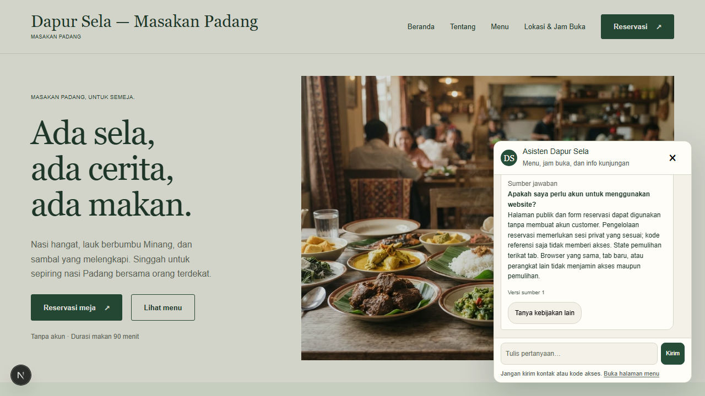
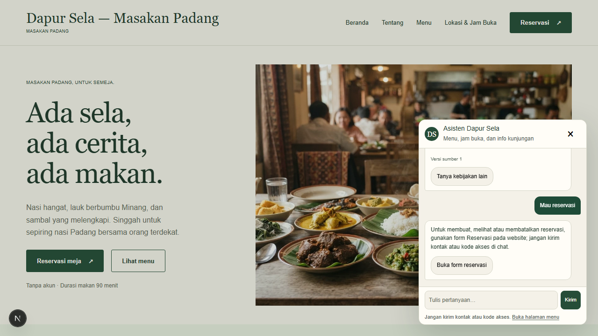
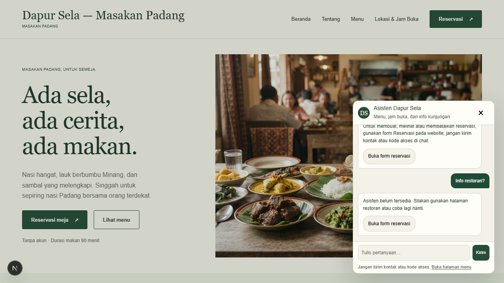
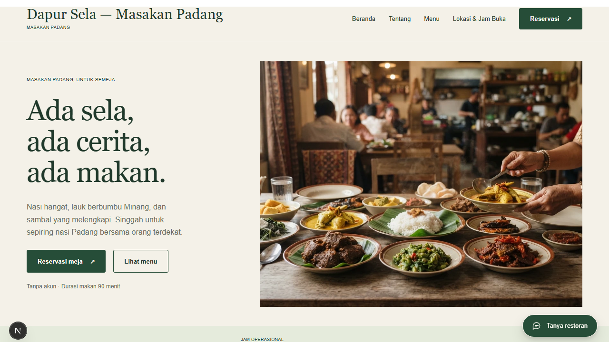

# Smoke browser chatbot live

## Kesimpulan

Pengujian lokal 10 November 2026 pukul 08:33 UTC lulus pada alur Chromium → Next.js → NestJS → FastAPI Agno → OpenRouter, dengan internal API dan PostgreSQL nyata. Data restoran dan FAQ berasal dari demo sintetis lokal, bukan fixture HTTP.

Batas enam inference request disetujui; tiga request dipakai, seluruh diagnostik model HTTP 200. Tidak ada retry otomatis atau paid fallback. Runtime AI kemudian dihentikan untuk memeriksa fallback dan akses form; tidak ada reservasi dibuat.

## Hasil aktual dan bukti

[Laporan JSON aktual](evidence/chatbot-live-browser-2026-11-10T08-33-01-293Z.json) memuat jawaban, kartu, diagnostik, jumlah request, nilai menu pembanding dan hasil pemeriksaan DB.

| Skenario | Hasil | Request model |
| --- | --- | --- |
| Harga rendang | Jawaban Rp35.000; kartu Rendang sapi cocok dengan harga DB Rp35.000 | 2 |
| Perlu akun untuk website | Jawaban sesuai FAQ, kartu sumber published revision 1 terlihat | 1 |
| Minta reservasi | Diarahkan ke form privat, tanpa akses booking | 0 |
| Runtime AI dihentikan | Gateway memberi `unavailable`; tombol form tetap bekerja | 0 |
| Akses form | Input tanggal bisa diakses setelah chat ditutup | 0 |
| Pemeriksaan jumlah booking | Sama sebelum/sesudah | Tidak berlaku |

### Harga dari database


Harga jawaban sesuai DB. Frasa aktual model “saat ini terjual harga” kurang natural; ini catatan kualitas Bahasa Indonesia, bukan bukti transaksi penjualan. Chatbot tidak memiliki tool pemesanan makanan.

### FAQ published



### Arahan reservasi



### Runtime AI tidak tersedia



### Form tetap dapat diakses



Gambar diambil langsung dari browser pengujian, bukan render laporan atau mock percakapan. Screenshot hanya membuktikan state UI; laporan dan assertion melengkapi pemeriksaan harga serta booking count. Tidak ada cookie, token, DevTools atau konfigurasi privat ditampilkan.

## Metode

- `apps/api/test/chatbot-live-browser.integration.cjs` menjalankan service terisolasi pada port 3110/3111/8111 dan Chromium desktop.
- `agno-v2/browser_live.py` memakai core production dan transport live dengan cap global enam request.
- Secret komunikasi dibuat sementara di environment proses, tidak ditulis ke file atau dicetak. Model key berasal dari konfigurasi server privat yang sudah ada.
- Harga expected dibaca langsung dari tenant demo di DB; FAQ diambil melalui internal API terautentikasi.
- Setelah skenario normal, hanya proses AI milik test dihentikan. Web dan API tetap berjalan untuk uji fallback.
- Proses yang dibuat test dihentikan saat cleanup. Snapshot konfigurasi web dipulihkan; tidak ada reset/migrasi/seed atau mutasi booking.

## Reproduksi

Pengujian ini memakai kuota provider. Eksekusi baru perlu otorisasi dan batas request baru. Bukan bagian default unit test atau CI.

```sh
rtk proxy node -e "process.env.ALLOW_BROWSER_LIVE='1';require('./apps/api/test/chatbot-live-browser.integration.cjs')"
```

Port harus kosong, DB demo dan published FAQ sudah tersedia, kompilasi API serta environment Python sudah siap. Test tidak membuat akun, menerbitkan FAQ atau mengisi data otomatis. Berhenti saat kegagalan; tidak ada retry otomatis.

## Penguatan pemeriksaan offline

Assertion smoke diperketat setelah pengujian live: teks jawaban menu harus menyebut harga expected tanpa harga lain, FAQ harus memakai document/revision/title current yang diharapkan dan memenuhi pemeriksaan jawaban guest-access, serta reservasi wajib mengarahkan ke form tanpa klaim sukses. Pemeriksaan FAQ bersifat bounded untuk pertanyaan ini, bukan pembuktian semantik universal.

Penyimpanan laporan kini dilindungi `try/finally`: kegagalan menulis bukti tidak melewati cleanup browser, service, DB dan pemulihan environment. Tes fault injection mengeksekusi blok cleanup integration yang sebenarnya. Test browser FAQ juga menampilkan revision expected dari DB, bukan konstanta versi 1.

Verifikasi tanpa inference tambahan:

- Lima tes assertion/cleanup lulus, termasuk harga salah dengan kartu benar, sumber/revision salah, arahan reservasi invalid dan kegagalan tulis laporan.
- Satu integration browser dengan model stub dan PostgreSQL nyata lulus.
- Bukti JSON live tersimpan lulus pemeriksaan jawaban yang diperketat secara offline; bukan eksekusi live ulang atau validasi ulang revision DB historis.
- Syntax integration dan `git diff --check` lulus.

```sh
rtk proxy node --test apps/api/test/chatbot-smoke-assertions.test.cjs apps/api/test/chatbot-smoke-cleanup.test.cjs
rtk proxy node --test apps/api/test/knowledge-browser.integration.cjs
rtk proxy node --check apps/api/test/chatbot-live-browser.integration.cjs
```

## Batas hasil

- Satu smoke desktop, bukan evaluasi AI lengkap atau SLA provider.
- Akses form diuji, bukan commit reservasi DB saat AI mati. Alur transaksi dan konkurensi membutuhkan suite terpisah.
- Model live/mobile, screen reader, adversarial lengkap, shadow comparison dan rehearsal rollback belum dibuktikan oleh pengujian ini.
- HTTP 200 model tidak sendirian membuktikan keberhasilan: test juga memeriksa status gateway, kartu menu, sumber FAQ, dan akses UI.
- Model yang dikonfigurasi tetap harus memenuhi allowlist gratis. Grounding bersifat bounded/heuristik, bukan pembuktian semantik universal.
