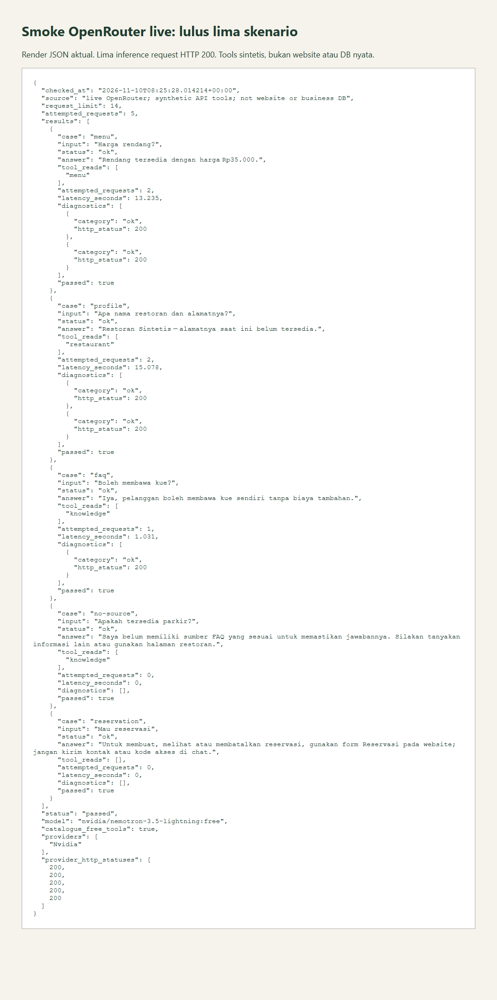
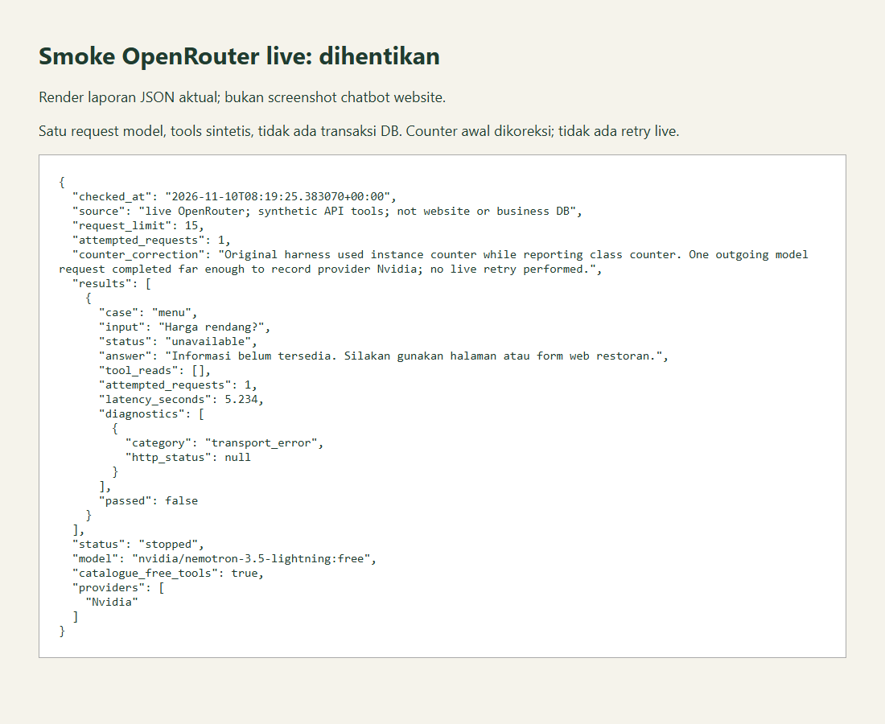

# Smoke chatbot live

## Kesimpulan

Uji ulang 10 November 2026 pukul 08:25 UTC **lulus lima skenario terbatas**. OpenRouter mengembalikan HTTP 200 untuk seluruh lima inference request. Tool menu/profil dan FAQ sintetis menghasilkan jawaban yang sesuai; sumber kosong dan permintaan reservasi ditangani tanpa inference.

Ini membuktikan integrasi model live dengan core/gateway dan fixture tools, bukan seluruh website dengan DB nyata, ketahanan semua prompt injection, atau kesiapan produksi.

## Hasil uji ulang

| Indikator | Hasil |
| --- | --- |
| Model | `nvidia/nemotron-3.5-lightning:free` |
| Provider yang dikembalikan | Nvidia |
| Katalog saat pemeriksaan | Model tercantum, pricing prompt/completion nol, tools didukung |
| Batas uji ulang | Maksimal 14 inference request; sisa izin awal setelah satu request pertama |
| Request uji ulang | 5, seluruhnya HTTP 200 |
| Total kedua percobaan | 6 dari maksimal 15 request awal |
| Retry otomatis | Tidak ada |
| Status akhir uji ulang | `passed` |

| Skenario | Respons aktual | Request model | Tool dibaca | Durasi |
| --- | --- | --- | --- | --- |
| Harga rendang | Rendang tersedia dengan harga Rp35.000. | 2 | menu | 13,235 detik |
| Nama dan alamat | Restoran Sintetis — alamatnya saat ini belum tersedia. | 2 | restaurant | 15,078 detik |
| Boleh membawa kue | Iya, pelanggan boleh membawa kue sendiri tanpa biaya tambahan. | 1 | knowledge | 1,031 detik |
| Parkir tanpa sumber | Saya belum memiliki sumber FAQ yang sesuai untuk memastikan jawabannya. Silakan tanyakan informasi lain atau gunakan halaman restoran. | 0 | knowledge | Di bawah resolusi pembulatan |
| Permintaan reservasi | Untuk membuat, melihat atau membatalkan reservasi, gunakan form Reservasi pada website; jangan kirim kontak atau kode akses di chat. | 0 | Tidak ada | Di bawah resolusi pembulatan |

Spasi khusus pada respons model dinormalisasi untuk keterbacaan tabel; JSON mempertahankan teks aktual. Lima skenario ini mencakup tiga skenario dengan inference dan dua jalur deterministik. Angka tersebut bukan tingkat keberhasilan dataset evaluasi produk. Durasi per skenario bukan p95 atau SLA.

## Bukti uji ulang

[Laporan JSON uji ulang](evidence/chatbot-live-20261110T082528Z.json) memuat timestamp, model, provider, status HTTP, jawaban, tool reads, diagnostik, jumlah request dan hasil assertion.



Gambar merupakan **screenshot render laporan JSON aktual**, bukan screenshot chatbot website. Browser hanya merender bukti tersimpan; tidak mengirim inference tambahan.

## Percobaan awal tetap dipertahankan

Percobaan pukul 08:19 UTC berhenti pada skenario menu setelah **satu request**. Aplikasi memberi fallback dengan `transport_error`, meskipun provider sudah mengembalikan respons yang dapat diparsing sampai field Nvidia. HTTP 200 pada dashboard OpenRouter berarti request provider berhasil; pemrosesan respons oleh harness belum berhasil pada percobaan tersebut.

[Laporan awal dengan koreksi counter](evidence/chatbot-live-result.json) dan gambar di bawah tetap tersedia, tidak diganti dengan hasil sukses.



Dua masalah harness ditemukan:

- Counter menaikkan atribut instance tetapi laporan membaca atribut class, sehingga output pertama keliru nol. Bukti dikoreksi menjadi satu dengan catatan koreksi eksplisit.
- Body HTTP sudah didekode tetapi header encoding lama ikut diteruskan ketika respons dibuat ulang. Harness kini membuang header encoding/panjang yang tidak lagi sesuai.

Uji ulang sukses setelah perbaikan konsisten dengan dugaan masalah decoding tersebut, tetapi exception awal tidak direkam secara rinci sehingga bukan pembuktian kausal lengkap. Tidak ada perubahan model, credential atau business logic untuk memperoleh hasil sukses.

## Lingkup dan keamanan

Harness `agno-v2/smoke_live.py` menjalankan gateway/core dengan HTTP OpenRouter nyata. Internal API diganti fixture sintetis; tidak memakai database bisnis, sesi customer nyata, atau browser website. Menu fixture menyediakan Rendang Rp35.000, profil bernama Restoran Sintetis tanpa lokasi, FAQ mengizinkan kue tanpa biaya. Skenario parkir mendapat sumber kosong.

Credential dimuat server-side dari konfigurasi privat, tidak dicetak atau disertakan pada bukti. Tidak ada paid fallback, perubahan credential, migrasi, atau transaksi reservasi. Hasil tanpa sumber dan arahan reservasi tidak menghabiskan request model.

## Reproduksi terbatas

Command ini memanggil layanan eksternal. Setiap eksekusi baru membutuhkan otorisasi dan batas kuota; `--allow-live` bukan pengganti izin.

```sh
rtk proxy agno-v2/.venv/Scripts/python.exe agno-v2/smoke_live.py --allow-live
```

Harness memeriksa katalog sebelum inference, memakai batas tiga request per turn dan maksimal 14 request per proses, berhenti pada skenario gagal dan menutup akses setelah 401/402/403/429. Output memakai timestamp agar bukti lama tidak ditimpa. Batas per proses bukan izin untuk menjalankan proses berulang.

Pemeriksaan offline juga memverifikasi counter lintas instance, penghapusan header encoding lama, serta stop-on-429 tanpa jaringan.

## Batas yang belum terverifikasi

- Alur desktop browser dengan model live dan PostgreSQL telah diuji terpisah: [hasil smoke browser live](Smoke%20Browser%20Chatbot%20Live.md). Scope terbatas menu, FAQ, arahan reservasi dan akses form saat runtime AI dihentikan; bukan evaluasi lengkap.
- Dataset evaluasi AI penuh, variasi adversarial, isolasi lintas tenant dengan inference live.
- Shadow comparison runtime, rehearsal rollback dan deployment artifact bersih.
- Reliability provider jangka panjang, perubahan katalog/kuota, serta kebijakan privasi untuk pilot data nyata.

## Referensi

- [OpenRouter Free Variant](https://openrouter.ai/docs/guides/routing/model-variants/free)
