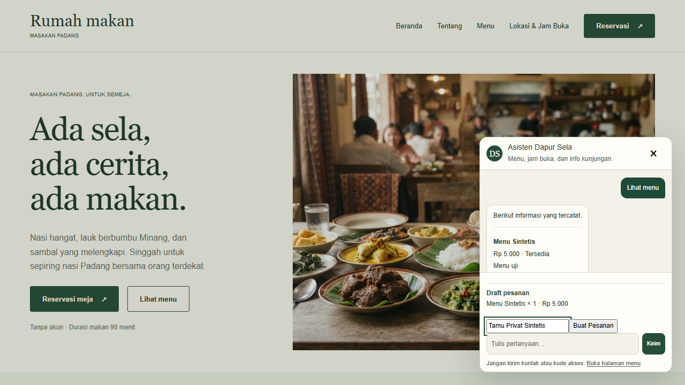
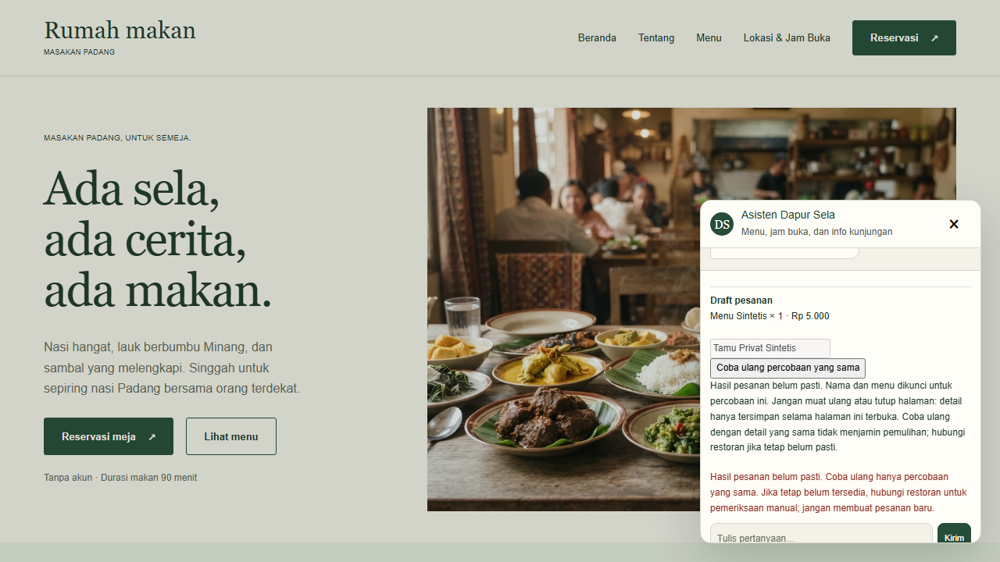
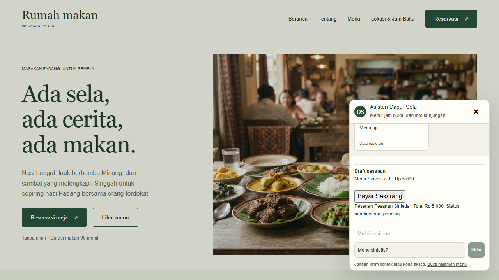
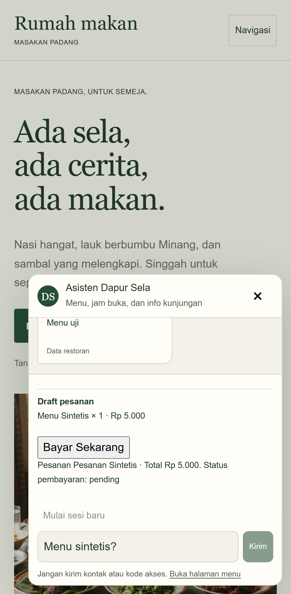

# Tes lokal pesanan chat

## Batas hasil

Screenshot dan hasil berikut memakai browser Chromium dengan respons API stub serta identitas sintetis. Tidak ada API bisnis, database, model AI, transaksi Midtrans atau uang nyata yang digunakan. Status pending pada gambar adalah simulasi, bukan bukti token Snap terbit atau pembayaran berhasil.

Patch pembayaran masih berada pada branch lokal `fix/chatbot-order-payment-hardening`; belum dipublikasikan. Jangan menjalankan tes API luas atau migrasi terhadap database terkonfigurasi untuk mencoba tampilan ini.

## Hasil pemeriksaan

Pengujian ulang desktop Chrome dan emulasi Pixel 7: **16 tes lulus dalam 24,7 detik**, tanpa retry. Pemeriksaan mencakup:

- Respons pembuatan pesanan hilang: nama dan menu dikunci; retry menggunakan payload dan idempotency key yang sama.
- Respons 503 atau 409 setelah hasil tidak pasti tidak menghasilkan key baru.
- Penolakan validasi pertama memungkinkan koreksi input.
- Nama pemesan, receipt dan URL pembayaran tidak muncul dalam log percakapan; data privat tidak disimpan ke localStorage atau sessionStorage.
- Hilangnya akses status tidak membuka kembali pembuatan pesanan.
- Navigasi widget, keyboard, prefill form reservasi tanpa kontak, dan fallback model.

Keterbatasan: snapshot percobaan hanya bertahan selama komponen halaman hidup. Peringatan sebelum meninggalkan halaman bersifat best-effort; paksa reload atau menutup tab dapat menghilangkan snapshot. Status inisialisasi pembayaran yang tidak pasti memerlukan pemeriksaan manual. Tes ini tidak membuktikan transaksi PostgreSQL atau notifikasi Midtrans nyata.

## Screenshot simulasi

### Draft pesanan

Customer memilih menu sintetis dan mengisi nama pada input privat. Harga yang tampak di sini berasal dari fixture browser; pengujian ini tidak membuktikan perhitungan harga database.



### Respons terputus dan retry aman

UI menampilkan hasil belum pasti, mengunci input dan menyediakan tombol mencoba ulang percobaan yang sama. Jangan membuat percobaan baru untuk mengatasi hasil pembayaran yang belum diketahui.



### Receipt pending

Setelah retry menerima receipt stub, tombol pembayaran tampil. Tombol tidak diklik dalam tes ini; tidak ada jendela Midtrans yang dibuka.





## Menjalankan tes sendiri

Prasyarat: dependensi sesuai lockfile, Chromium Playwright sudah tersedia, production build web terbaru, dan port 3100 kosong. Jangan menghentikan proses lain untuk mengambil port.

1. Build frontend dari root workspace. Perintah ini tidak menjalankan API bisnis atau migrasi:

```sh
rtk proxy pnpm --filter @restaurant/web build
```

2. Jalankan dua file browser berikut saja:

```sh
rtk proxy node node_modules/@playwright/test/cli.js test apps/web/e2e/orders.spec.ts apps/web/e2e/chatbot.spec.ts
```

Konfigurasi Playwright menjalankan server Next.js sementara di `http://127.0.0.1:3100`, lalu menutupnya setelah tes. Endpoint chat, pesanan dan reservasi dicegat oleh fixture browser. Tidak perlu menyalakan NestJS, Agno, PostgreSQL atau menyediakan credential pembayaran.

3. Untuk melihat browser selama tes, tambahkan `--project=desktop --headed`. Server tes bersifat sementara, bukan demo interaktif permanen:

```sh
rtk proxy node node_modules/@playwright/test/cli.js test apps/web/e2e/orders.spec.ts --project=desktop --headed
```

4. Untuk mengambil screenshot ulang, jalankan wrapper Node berikut. Environment hanya menetapkan direktori gambar dan alamat database nonaktif sebagai pengaman; tidak ada secret:

```sh
rtk proxy node -e "const {spawnSync}=require('child_process');const r=spawnSync(process.execPath,['node_modules/@playwright/test/cli.js','test','apps/web/e2e/orders.spec.ts','apps/web/e2e/chatbot.spec.ts'],{env:{...process.env,BROWSER_SCREENSHOT_DIR:'docs/images/order-local',DATABASE_URL:'postgresql://127.0.0.1:1/offline_test'},stdio:'inherit'});process.exit(r.status??1);"
```

Gambar di direktori tersebut akan diganti oleh run berikutnya. Screenshot diambil setelah assertion state UI lolos. Direktori ini juga berisi contoh action, sesi kedaluwarsa dan fallback chatbot.

## Sebelum pengujian integrasi nyata

- Tinjau terlebih dahulu insiden tes sebelumnya yang mengakses database terkonfigurasi; dampak data belum dipastikan.
- Gunakan database pengujian khusus yang boleh dimutasi, bukan database kerja atau produksi.
- Periksa dan setujui migrasi tambahan sebelum menjalankannya.
- Gunakan Midtrans sandbox dan endpoint HTTPS khusus jika perlu menguji notifikasi. Aktivasi credential, konfigurasi merchant dan transaksi sandbox tidak dijalankan oleh panduan browser stub ini.
- Callback browser tidak boleh dianggap bukti lunas. Verifikasi signature, nominal, status server dan audit perlu diuji terpisah.

## Sources

- [Playwright screenshots](https://playwright.dev/docs/screenshots)
- [Midtrans notification verification](https://docs.midtrans.com/docs/https-notification-webhooks)
