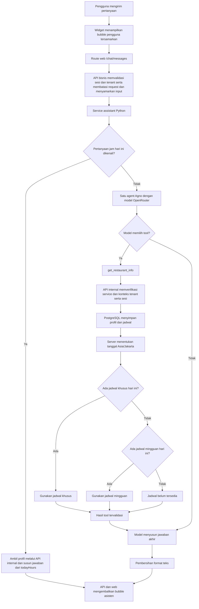
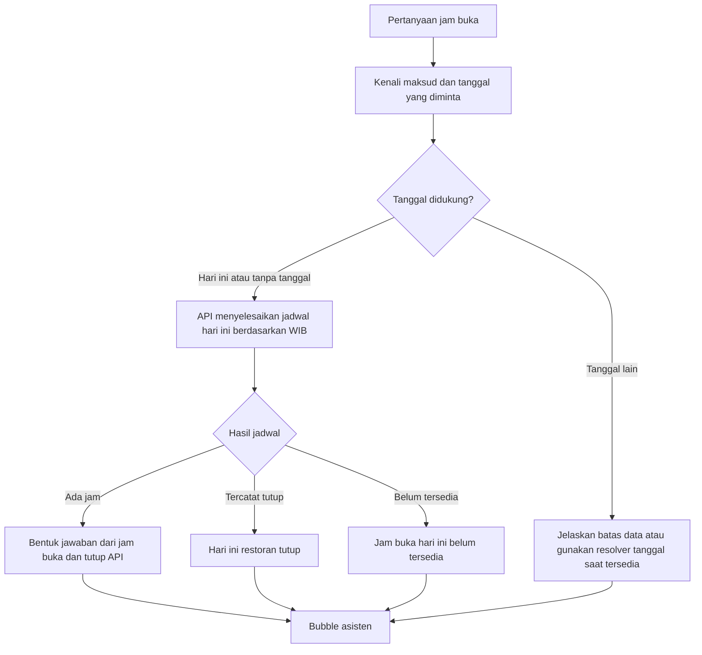

# Alur Chatbot Restoran

## Ringkasan

Chatbot menjadi antarmuka percakapan untuk membaca data restoran melalui API bisnis. Model tidak menjadi sumber fakta harga, jam buka, lokasi, atau ketersediaan meja.

Jam buka yang tidak tersimpan tidak boleh diganti dengan angka contoh. Jawaban yang menyatakan data belum tersedia berbeda dari jawaban yang menyatakan restoran tutup.

## Alur yang sudah diterapkan



### Pemilihan jadwal

1. Server mengambil tanggal saat ini berdasarkan Asia/Jakarta, bukan tanggal dari browser atau ingatan model.
2. Jadwal khusus tanggal tersebut diprioritaskan, termasuk jika jadwal khusus menetapkan tutup.
3. Jika tidak ada jadwal khusus, server memakai jadwal mingguan untuk hari tersebut.
4. Jika keduanya tidak ada, server menandai jadwal belum tersedia.

Field `todayHours` pada profil memuat tanggal, zona waktu, sumber jadwal, penanda konfigurasi, serta menit buka dan tutup.

| Kondisi data | Makna |
| --- | --- |
| `configured=true`, jam buka dan tutup terisi | Ada jadwal operasional hari ini |
| `configured=true`, kedua jam bernilai `null` | Hari ini tercatat tutup |
| `configured=false`, sumber `unconfigured` | Jadwal hari ini belum tersedia |

Jadwal operasional bukan bukti meja tersedia dan tidak otomatis menyatakan restoran sedang buka pada saat pesan dikirim. Pengecualian tanggal mendatang belum disertakan pada profil hari ini.

## Hasil pemeriksaan lokal

Pada pemeriksaan tanggal 30 Oktober 2026 WIB, API lokal mengembalikan:

```json
{
  "weeklyRows": 0,
  "todayHours": {
    "date": "2026-10-30",
    "timezone": "Asia/Jakarta",
    "configured": false,
    "source": "unconfigured",
    "openMinute": null,
    "closeMinute": null
  }
}
```

Hasil tersebut adalah snapshot pemeriksaan, bukan jadwal operasional restoran yang berlaku selamanya. Data dapat berubah setelah pengelola mengisi jadwal.

Karena jadwal kosong, chatbot tidak memiliki dasar untuk memberikan jam tertentu. Frasa seperti “belum dikonfigurasi” merupakan istilah internal yang tidak perlu ditampilkan kepada customer.

## Batas jawaban reservasi

Runtime percakapan memiliki tools baca, bukan tool membuat reservasi. Field kapasitas, durasi dan batas waktu reservasi adalah informasi kebijakan, bukan bukti bahwa pemesanan melalui chat sudah aktif atau meja tersedia.

Chatbot tidak boleh mengaku menerima atau berhasil membuat reservasi berdasarkan field kebijakan tersebut.

## Keterbatasan alur saat ini

- Pertanyaan jam hari ini yang dikenali memakai jawaban aplikasi tanpa inference model. Pertanyaan lain masih bergantung pada pemilihan tool dan penyusunan kalimat model.
- Pengenalan memakai kosakata terbatas. Pesan dengan maksud tambahan yang tidak dikenali atau tanggal lain tetap masuk jalur agent agar maksud tersebut tidak dihilangkan.
- Instruksi prompt tidak menjamin model selalu memakai tool atau mempertahankan fakta dengan benar.
- Pembersihan format menghapus sebagian markup dan frasa, bukan memvalidasi seluruh makna jawaban.
- Data jadwal kosong tidak dapat diperbaiki dengan perubahan prompt.
- RAG tidak menggantikan API untuk jam buka dan informasi operasional yang berubah.

## Alur jawaban jam buka deterministik

Alur ini diterapkan untuk pertanyaan hari ini atau tanpa tanggal yang dikenali. Pertanyaan campuran jam buka dan keinginan reservasi dasar mendapat jawaban jam serta batas kemampuan chat. Pertanyaan dengan kosakata di luar cakupan tetap masuk jalur agent.

Untuk pertanyaan jam buka, aplikasi membentuk jawaban inti dari hasil API. Model dapat membantu mengenali maksud, tetapi tidak boleh menentukan tanggal atau angka jam berdasarkan ingatan.



Contoh format ketika data tersedia:

```text
Hari ini restoran buka pukul {jam_buka}–{jam_tutup} WIB.
```

Placeholder harus diganti hanya dengan nilai dari API, bukan jam contoh.

Untuk data kosong dan pertanyaan tentang reservasi melalui chat, jawaban ringkas yang sesuai:

```text
Jam buka hari ini belum tersedia. Reservasi lewat chat juga belum bisa dilakukan.
```

Pertanyaan campuran tetap memerlukan pemisahan maksud agar jawaban jam buka tidak menghilangkan pertanyaan lain.

## Peran komponen

| Komponen | Tanggung jawab |
| --- | --- |
| Widget chat | Bubble pesan, status menunggu, input, dan tampilan hasil |
| API bisnis | Sesi, tenant, izin, sumber data, dan penyelesaian jadwal |
| PostgreSQL | Profil, jadwal mingguan, dan pengecualian tanggal |
| Agno | Menjalankan satu agent dan tools yang diizinkan |
| Model OpenRouter | Memahami pertanyaan dan menyusun bahasa dalam batas sumber |
| RAG | FAQ atau kebijakan published dengan filter tenant, saat tersedia |
| Guardrails | Validasi input/output, izin tools, privasi, batas request, dan penanganan kegagalan |

## Verifikasi yang dibutuhkan

- Pergantian tanggal di tengah malam WIB meskipun tanggal UTC belum berganti.
- Jadwal khusus mengalahkan mingguan, termasuk penutupan khusus.
- Jadwal kosong tidak dianggap tutup dan tidak menghasilkan angka jam buatan.
- Pertanyaan tanpa tanggal menggunakan hari ini.
- Pertanyaan besok atau tanggal tertentu tidak dianggap sebagai hari ini.
- Pertanyaan campuran jam buka dan reservasi tetap menjawab kedua maksud.
- Kegagalan tool menghasilkan keterbatasan yang jelas, bukan klaim sukses.
- Evaluasi model live dipisahkan dari tes stub; kelulusan stub bukan bukti semua variasi bahasa akan ditangani benar.
