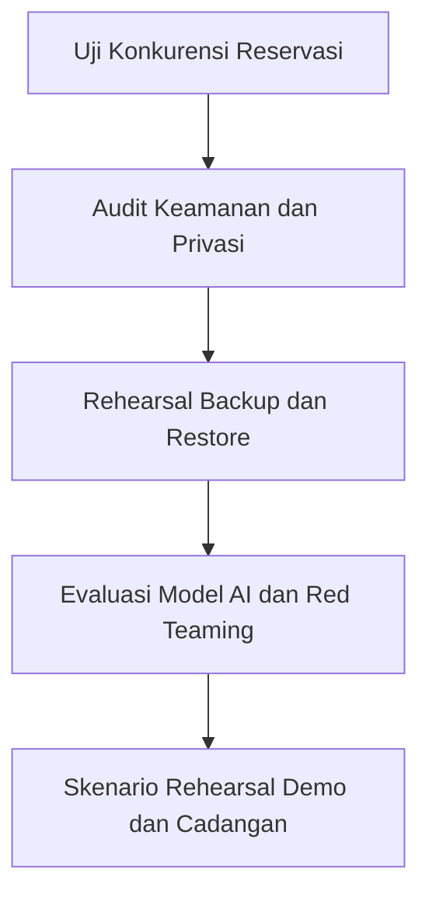

# Rencana Pengerjaan Lanjutan

Dokumen perencanaan teknis untuk menyelesaikan sisa persyaratan sebelum demonstrasi sistem. Rencana ini berfokus pada verifikasi integritas data, keamanan sistem, ketahanan model AI, dan kesiapan operasional demo.

## Urutan dan Keterkaitan Pekerjaan

## Daftar Pekerjaan

| Topik | Fokus Utama | Target Bukti | Status |
| --- | --- | --- | --- |
| [Uji Konkurensi Reservasi](uji-konkurensi-reservasi.md) | Validasi exclusion constraint PostgreSQL terhadap pemesanan meja simultan | Tepat satu booking `confirmed` dari 50 request konkuren pada slot meja yang sama | Selesai |
| [Audit Keamanan dan Privasi](audit-keamanan-privasi.md) | Pembersihan dan penyensoran data sensitif pada log, sesi, dan prompt | Nol data kontak mentah, nomor telepon, atau credential pembayaran di log/history | Selesai |
| [Rehearsal Backup dan Restore](rehearsal-backup-restore.md) | Pengujian prosedur pencadangan dan pemulihan database serta foto menu | Restore database terpisah sukses tanpa mengganggu staging aktif | Skrip & Runbook Siap (Menunggu DB Docker Aktif) |
| [Evaluasi Model AI](evaluasi-model-ai.md) | Uji 30 skenario jawaban berbasis dokumen, pembatasan tool, dan injeksi | Minimal 90% akurasi FAQ bersumber, abstain saat tidak ada rujukan, nol aksi tulis | Selesai (Offline 30/30, Live 25/30) |
| [Skenario Rehearsal Demo](skenario-rehearsal-demo.md) | Panduan langkah demonstrasi live dan rekaman cadangan | Alur demo tervalidasi lengkap beserta video cadangan berlabel | Panduan Siap (Menunggu Rehearsal Live & Rekaman) |

## Prinsip Pelaksanaan

1. **Satu Jalur Verifikasi**: Setiap tiket dikerjakan dengan bukti nyata (hasil eksekusi skrip, log uji, atau rekaman), bukan asumsi.
2. **Isolasi Lingkungan**: Seluruh pengujian destruktif atau pengujian beban hanya dijalankan pada database lokal atau instance sementara, dilarang menjalankan uji beban pada staging aktif.
3. **Penyensoran Informasi Rahasia**: Tidak mencatat kredensial, kunci akses pembayaran, atau data pribadi nyata pada berkas dokumentasi dan kode pengujian.
